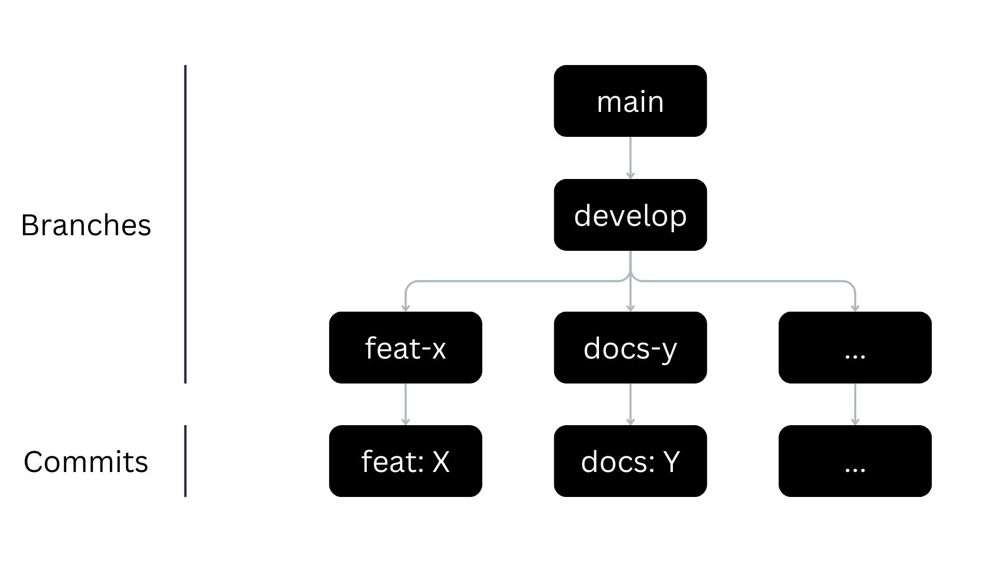

<Table>
  <tr>
    <td><a href= "https://www.cps.sp.gov.br/"></td>
    <td>
      
    </td>
  </tr>
</table>

# Nome do Projeto: LinkUp

## Nome do Grupo: LinkUp

## Integrantes:

- <a href="https://www.linkedin.com/in/arthur-bretas/">Arthur Bretas Oliveira</a>
- <a href="https://www.linkedin.com/in/felipe-zillo-72b367247/">Felipe Gutierres Zillo</a>
- <a href="https://www.linkedin.com/in/kauarodrigues/">Kauã Rodrigues dos Santos</a>
- <a href="https://www.linkedin.com/in/lucca-henrique-pereira/">Lucca Henrique Pereira</a>
- <a href="https://www.linkedin.com/in/milena-castro-vieira/">Milena Aparecida Vieira Castro</a>
- <a href="https://www.linkedin.com/in/rodrigo-lee/">Rodrigo Hu Tchie Lee</a>
- <a href="https://www.linkedin.com/in/vitor-balbo/">Vitor Margarido Balbo</a>

# Sumário

- [1. Introdução](#1-introdução)
  - [1.1 Objetivo do Documento](#11-objetivo-do-documento)
- [2. Política de Branches](#2-política-de-branches)
  - [2.1 Visão Geral do Gitflow](#21-visão-geral-do-gitflow)
  - [2.2 Estrutura de Branches](#22-estrutura-de-branches)
  - [2.3 Diretrizes de Uso das Branches](#23-diretrizes-de-uso-das-branches)
- [3. Políticas de Commit](#3-políticas-de-commit)
- [4. Política de Push e Pull Requests](#4-política-de-push-e-pull-requests)
- [Referências](#referências)

# 1. Introdução
Este documento descreve as regras para usar o Git no projeto projeto, incluindo branches, commits e pull requests. O objetivo é manter o desenvolvimento simples, ajudar na organização e garantir que o projeto seja realizado de forma mais simples.

## 1.1 Objetivo do Documento
Este documento estabelece diretrizes claras para a utilização de boas práticas no desenvolvimento de software, visando a organização e a qualidade do código. Todos os membros da equipe devem seguir as instruções definidas.

# 2. Política de Branches

## 2.1 Visão Geral do Gitflow

O **GitFlow** é um modelo de branching amplamente utilizado para estruturar o fluxo de desenvolvimento em projetos baseados em Git. Ele define uma organização clara das branches, separando o código em desenvolvimento (`develop`) do código de produção (`main`), além de permitir a criação de branches específicas para novas funcionalidades (`feature`), correções (`hotfix`), releases (`release`) e docs (`docs`). Essa abordagem melhora a colaboração da equipe, facilita a integração contínua e garante um ciclo de desenvolvimento mais organizado e previsível.

## 2.2 Estrutura de Branches
Padrão de Nomenclatura das Branches:

**main**: Contém o código pronto para produção.  
**dev**: Integração contínua das novas funcionalidades em desenvolvimento.  
**feature/[nome-da-feature]**: Para desenvolvimento de novas funcionalidades. Exemplo: feature/integracao-api  
**fix/[nome-do-bug]**: Para correção de bugs. Exemplo: bugfix/corrige-login  
**hotfix/[nome-do-hotfix]**: Correção urgente diretamente na produção. Exemplo: hotfix/corrige-bug-em-producao  
**docs/[mudanca]**: Adição ou modificação de um arquivo da documentação. Exemplo: docs/implementa-matriz-risco  
**config/[alteracao]**: Adição ou modificação de um arquivo de configuração. Exemplo: config/altera-gitignore  

## 2.3 Diretrizes de Uso das Branches
### Processo de Trabalho e Controle de Versionamento

Para garantir um fluxo de desenvolvimento organizado e previsível, adotamos o modelo de versionamento GitFlow, que define a estrutura principal do repositório com as branches `main` e `develop`, além de `branches específicas` para cada tarefa, como `docs-task-1` ou `feat-task-2`. Esse modelo permite um ciclo de desenvolvimento bem estruturado e facilita a contribuição e o gerenciamento de entregas. Também seguimos o padrão de *Conventional Commits* para padronizar as mensagens de commit, o que garante maior organizaçõa e rastreabilidade das alterações no código. O fluxo de trabalho deve ser seguido rigorosamente para manter a consistência e a qualidade do desenvolvimento ao longo do projeto.

Figura X - Diagrama de fluxo  
 
Fonte: Material produzido pelos autores (2025)

# 3. Políticas de Commit
Integrar "Conventional Commits" nas políticas de commit ajuda a manter um histórico de commits claro e estruturado, facilitando a automação de processos como geração de changelogs e versionamento semântico.

As mensagens de commit devem seguir o padrão de Conventional Commits para garantir clareza e consistência.

Formato: **[Tipo][Escopo opcional]: Mensagem clara e descritiva.**

Os tipos devem ser:

**feat**: Uma nova funcionalidade para o usuário.  
**fix**: Correção de bug.  
**docs**: Mudanças na documentação.  
**style**: Mudanças que não afetam o significado do código (espaços em branco, formatação, etc.).  
**refactor**: Uma mudança de código que não corrige um bug nem adiciona uma funcionalidade.  
**test**: Adição ou correção de testes.  
**chore**: Atualizações de tarefas de build ou ferramentas auxiliares e bibliotecas, como a geração de documentação.  

Exemplo de commit: **feat: adiciona sistema de login**

Proibido:
**- O uso de emojis nas mensagens de commit, e commits com mensagens vagas como "melhorias" ou "atualizações".**

IMPORTANTE!
- Realizar commits frequentes (diários) para facilitar o rastreamento de mudanças e a colaboração.

# 4. Política de Push e Pull Requests

**Políticas de Push**:
- Não é permitido fazer push diretamente para a main ou dev.
- Todas as contribuições devem ser feitas em suas respectivas branches, indicando que tipos de mudanças foram feitas nas mesmas ('feature', 'docs', etc.), e submetidas por meio de pull requests.

**Regras de Push**:
- Todo código deve passar por revisão de código por pares antes de ser mergeado.
- A revisão (de código) só deve ser aprovada se os testes automatizados forem bem-sucedidos e os critérios de qualidade (cobertura de testes, análise de código) forem atendidos.

**Revisão por Pares - Critério de Aprovação**:
- O pull request deve ser revisado por, no mínimo, uma pessoa.
- A revisão de código deve considerar: 
  - Está funcional e resolve o problema proposto.
  - Passou em todos os testes automatizados.
  - Cobertura mínima de testes (60% ou mais). 
  - Verificação de boas práticas de código(como clean code).
  - Não introduz duplicidade de código.
- Após a aprovação, a branch deve ser mergeada na dev e o pull request pode ser fechado. 
- O Scrum Master da Sprint é responsável por subir os artefatos para a MAIN ao final da Sprint.

# Referências
- Conventional Commits: https://www.conventionalcommits.org/en/v1.0.0/
- GitFlow: https://nvie.com/posts/a-successful-git-branching-model/
- Gitihub/iuricode: https://github.com/iuricode/padroes-de-commits
