<Table>
  <tr>
    <td><a href= "https://www.cps.sp.gov.br/"></td>
    <td>
      
    </td>
  </tr>
</table>

# Nome do Projeto: LinkUp
# Nome do Projeto: LinkUp

## Integrantes:

- <a href="https://www.linkedin.com/in/arthur-bretas/">Arthur Bretas Oliveira</a>
- <a href="https://www.linkedin.com/in/felipe-zillo-72b367247/">Felipe Gutierres Zillo</a>
- <a href="https://www.linkedin.com/in/kauarodrigues/">Kauã Rodrigues dos Santos</a>
- <a href="https://www.linkedin.com/in/lucca-henrique-pereira/">Lucca Henrique Pereira</a>
- <a href="https://www.linkedin.com/in/milena-castro-vieira/">Milena Aparecida Vieira Castro</a>
- <a href="https://www.linkedin.com/in/rodrigo-lee/">Rodrigo Hu Tchie Lee</a>
- <a href="https://www.linkedin.com/in/vitor-balbo/">Vitor Margarido Balbo</a>

# Sumário

- [1. Introdução](#1-introdução)
  - [1.1 Termos e Abreviações](#11-termos-e-abreviações)
  - [1.2 Objetivo do Documento](#12-objetivo-do-documento)
- [2. Entendimento do Projeto e do Negócio](#2-entendimento-do-projeto-e-do-negócio)
  - [2.1 Contexto da Indústria do Parceiro](#21-contexto-da-indústria-do-parceiro)
  - [2.2 Problema](#22-problema)
  - [2.3 Visão do Projeto e do Produto](#23-visão-do-projeto-e-do-produto)
  - [2.4 Personas e Jornada do Usuário](#24-personas-e-jornada-do-usuário)
  - [2.5 Modelagem do Fluxo de Negócio](#25-modelagem-do-fluxo-de-negócio)
    - [2.5.1 Fluxo de Negócio Atual (AS-IS)](#251-fluxo-de-negócio-atual-as-is)
    - [2.5.2 Fluxo de Negócio Proposto (TO-BE)](#252-fluxo-de-negócio-proposto-to-be)
  - [2.6 Matriz de Risco do Projeto](#26-matriz-de-risco-do-projeto)
  - [2.7 Ideação](#27-ideação)
    - [2.7.1 Brainstorming de features](#271-brainstorming-de-features)
    - [2.7.2 Sequenciamento/Priorização de entregas](#272-sequenciamentopriorização-de-entregas)
  - [2.8 Canvas do Projeto](#28-canvas-do-projeto)
- [3. Requisitos do Projeto](#3-requisitos-do-projeto)
  - [3.1 Requisitos Funcionais (RFs)](#31-requisitos-funcionais-rfs)
  - [3.2 Requisitos Não Funcionais (RNFs)](#32-requisitos-não-funcionais-rnfs)
  - [3.3 Correlação RFs e RNFs](#33-correlação-rfs-e-rnfs)
- [4. Modelagem de Dados](#4-modelagem-de-dados)
  - [4.1 Modelo Conceitual de Dados](#41-modelo-conceitual-de-dados)
  - [4.2 Modelo Lógico de Dados](#42-modelo-lógico-de-dados)
  - [4.3 Modelo Físico de Dados](#43-modelo-físico-de-dados)
- [5. Solução Técnica (Design)](#5-solução-técnica-design)
  - [5.1 Diagrama de Componentes da UML](#51-diagrama-de-componentes-da-uml)
  - [5.2 Diagramas de Sequência da UML](#52-diagramas-de-sequência-da-uml)
  - [5.3 Descrição Textual dos Diagramas](#53-descrição-textual-dos-diagramas)
- [6. Mapeamento Técnico de Infraestrutura e Implantação](#6-mapeamento-técnico-de-infraestrutura-e-implantação)
  - [6.1 Diagrama de Implantação da UML](#61-diagrama-de-implantação-da-uml)
  - [6.2 Justificativa das Escolhas de Implantação](#62-justificativa-das-escolhas-de-implantação)
  - [6.3 Considerações sobre Desempenho e Segurança](#63-considerações-sobre-desempenho-e-segurança)
- [7. Projeto Visual da Solução](#7-projeto-visual-da-solução)
  - [7.1 Desenvolvimento de Wireframes](#71-desenvolvimento-de-wireframes)
  - [7.2 Desenvolvimento de Mockups](#72-desenvolvimento-de-mockups)
  - [7.3 Guia Visual](#73-guia-visual)
- [8. Desenvolvimento do Projeto](#8-desenvolvimento-do-projeto)
  - [8.1 Arquitetura de Codificação e Estrutura de Diretórios](#81-arquitetura-de-codificação-e-estrutura-de-diretórios)
  - [8.2 Desenvolvimento de Features](#82-desenvolvimento-de-features)
    - [8.2.1 Sprint 3](#821-sprint-3)
    - [8.2.2 Sprint 4](#822-sprint-4)
    - [8.2.3 Sprint 5](#823-sprint-5)
  - [8.3 Testes Unitários e de Integração](#83-testes-unitários-e-de-integração)
  - [8.4 Documentações automáticas](#84-documentações-automáticas)
- [9. Planejamento e Execução de Testes](#9-planejamento-e-execução-de-testes)
  - [9.1 Testes Funcionais](#91-testes-funcionais)
    - [9.1.1 Planejamento](#911-planejamento)
    - [9.1.2 Resultados](#912-resultados)
  - [9.2 Testes de RNFs](#92-testes-de-rnfs)
    - [9.2.1 Planejamento](#921-planejamento)
    - [9.2.2 Resultados](#922-resultados)
  - [9.3 Testes de Usabilidade](#93-testes-de-usabilidade)
    - [9.3.1 Planejamento](#931-planejamento)
    - [9.3.2 Resultados](#932-resultados)
- [10. Procedimentos de Implantação](#10-procedimentos-de-implantação)
  - [10.1 Implantação e Configuração do Banco de Dados](#101-implantação-e-configuração-do-banco-de-dados)
  - [10.2 Implantação do Protótipo para uso por equipe de desenvolvimento](#102-implantação-do-protótipo-para-uso-por-equipe-de-desenvolvimento)
- [Referências](#referências)

# 1. Introdução

## 1.1 Termos e Abreviações

- CPS: Centro Paula Souza

## 1.2 Objetivo do Documento

&nbsp;&nbsp;&nbsp;&nbsp;Este documento tem como objetivo apresentar o processo de desenvolvimento do projeto Linkup em parceria com o Centro Paula Souza, para o desenvolvimento de um sistema de gerenciamento dos atendimentos profissionais dos alunos portadores de deficiência das ETECs e FATECs que compõem o centro.

# 2. Entendimento do Projeto e do Negócio

## 2.1 Contexto da Indústria do Parceiro

O Centro Paula Souza está inserido na indústria da educação técnica e superior tecnológica, um setor estratégico para o desenvolvimento econômico e social. Com as Etecs (Escolas Técnicas) e Fatecs (Faculdades de Tecnologia), a instituição atende à crescente demanda por formação qualificada, alinhada às necessidades do mercado de trabalho local, com cursos que na maior parte das vezes estão alinhados com a maior necessidade produtiva do local da Fatec/Etec. A educação profissional vem se tornando cada vez mais importante diante das transformações tecnológicas e produtivas, como é o caso da digitalização de processos. Nesse contexto, as Etecs e Fatecs desempenham um papel fundamental na capacitação de profissionais para setores como tecnologia, indústria, gestão e serviços, contribuindo para a inovação e competitividade das empresas e para o fortalecimento da economia.

## 2.2 Problema

&emsp;O principal problema é a necessidade de um ambiente de gestão para os atendimentos realizados pela Assessoria de Inclusão do Centro Paula Souza. A ausência de um sistema integrado dificulta o controle das informações sobre os alunos atendidos, os profissionais responsáveis e os tipos de suporte prestados. O uso de formulários digitais e planilhas torna o processo suscetível a erros, inconsistências e falta de rastreabilidade, comprometendo a qualidade do acompanhamento. Além disso, a ausência de uma ferramenta de análise de dados impede uma visão estratégica sobre o impacto das ações realizadas, dificultando a tomada de decisão por parte dos gestores.

## 2.3 Visão do Projeto e do Produto

## 2.3.1 Visão do Produto

Criamos aplicação web que permite realizar o registro da conexão entre os alunos do Centro Paula Souza a profissionais especializados. Além disso, gestores acessam um dashboard com estatísticas detalhadas. O sistema facilita o acompanhamento e suporte a alunos com deficiência, promovendo inclusão.

Figura x - Visão do Produto 
 
Fonte: Material produzido pelos autores (2025) 

## 2.3.2 É - Não é - Faz - Não faz

Nosso projeto é uma aplicação web que permite realizar o registro da conexão entre os alunos do Centro Paula Souza a profissionais especializados. O sistema permite gerenciar profissionais e visualizar dados via dashboard. **Faz** gestão de associações e estatísticas. **Não faz** controle acadêmico. O Lean Inception ajudou a delimitar funcionalidades essenciais para tornar o produto eficiente.

Figura x - É - Não é - Faz - Não faz 
 
Fonte: Material produzido pelos autores (2025) 

## 2.3.3 Objetivos do Produto

A imagem representa os objetivos da solução: facilitar o acompanhamento de alunos com deficiência, garantir suporte especializado e fornecer estatísticas para gestão. Nossa plataforma possibilita associar alunos a profissionais, gerenciar dados e visualizar métricas estratégicas. O Business Intelligence embutido garante decisões informadas para gestores administrativos e unidades educacionais.

Figura x - Objetivos do Produto 
 
Fonte: Material produzido pelos autores (2025) 

## 2.4 Personas, Jornada do Usuário e User Stories

## 2.4.1 Persona 1 - Mariana Santos

&nbsp;&nbsp;&nbsp;&nbsp;A seguir, apresenta-se a persona Mariana Santos, criada com base no workshop realizado com o parceiro.

Figura x - Persona 1 - Mariana Santos 
 
Fonte: Material produzido pelos autores (2025) 

  
&nbsp;&nbsp;&nbsp;&nbsp;Além disso, segue abaixo a sua jornada do usuário durante o processo de alocação de profissionais.
  

Figura x - Jornada do Usuário - Mariana Santos 
 
Fonte: Material produzido pelos autores (2025) 

&nbsp;&nbsp;&nbsp;&nbsp; Segue abaixo a User Stories da Mariana com a função de registrar um profissional ao banco de dados.

Tabela X - Tabela User Stories Assessora 1

| Identificação        | US01                                                                                                |
| -------------------- | --------------------------------------------------------------------------------------------------- |
| Persona              | Mariana Santos - Assessora de Inclusão                                                               |
| User Story           | Como assessora, quero registrar um profissional no banco de dados para manter o cadastro atualizado. |
| Critério de aceite 1 | Fazer login na plataforma.                                                                          |
| Critério de aceite 2 | Acessar a Home Page.                                                                                |
| Critério de aceite 3 | Navegar até a página de cadastro de profissionais.                                                  |
| Critério de aceite 4 | Preencher os dados obrigatórios do profissional.                                                    |
| Critério de aceite 5 | Confirmar o cadastro e garantir que os dados sejam salvos no banco de dados.                        |

Fonte: Material produzido pelos autores (2025)

## 2.4.2 Persona 2 - Cleber Oliveira
&nbsp;&nbsp;&nbsp;&nbsp;A seguir, apresenta-se a persona Cleber Oliveira, criada com base no workshop realizado com o parceiro, buscando evidenciar a necessidade apresentada de um sistema compatível com um leitor de tela.

Figura x - Persona 2 - Cleber Oliveira 
 
Fonte: Material produzido pelos autores (2025) 

&nbsp;&nbsp;&nbsp;&nbsp;Além disso, segue abaixo a sua jornada do usuário durante o processo de alocação de profissionais.

Figura x - Jornada do Usuário - Cleber Oliveira 
 
Fonte: Material produzido pelos autores (2025) 

Tabela X - Tabela User Story Cleber Oliveira

Tabela X - Tabela User Stories Assessor de Inclusão

| Identificação        | US02                                                                                                   |
| -------------------- | ------------------------------------------------------------------------------------------------------ |
| Persona              | Cleber Oliveira - Assessor de Inclusão                                                                |
| User Story           | Como Assessor de Inclusão, quero associar um profissional a um aluno no sistema, utilizando comandos de leitor de tela, para garantir que o aluno receba o suporte necessário. |
| Critério de aceite 1 | Ativar um leitor de tela compatível, como NVDA ou JAWS.                                               |
| Critério de aceite 2 | Navegar pela interface do sistema utilizando apenas comandos do leitor de tela e teclado.             |
| Critério de aceite 3 | Acessar a funcionalidade de associação de profissionais a alunos por meio de navegação sequencial.    |
| Critério de aceite 4 | Buscar e selecionar um aluno e um profissional utilizando comandos do teclado.                        |
| Critério de aceite 5 | Confirmar a associação e receber uma mensagem de sucesso audível pelo leitor de tela.                 |

Fonte: Material produzido pelos autores (2025)

## 2.4.3 Persona 3 - Valdemar Souza

&nbsp;&nbsp;&nbsp;&nbsp;A seguir, apresenta-se a persona Valdemar Souza, criada com base no workshop realizado com o parceiro, buscando evidenciar a necessidade apresentada de um sistema eficiente de gerenciamento de atendimentos, com relatórios estruturados.

Figura x - Persona 3 - Valdemar Souza 
 
Fonte: Material produzido pelos autores (2025) 

&nbsp;&nbsp;&nbsp;&nbsp; Segue abaixo a User Story da Mariana com a função de registrar um profissional ao banco de dados.

Tabela X - Tabela User Stories Gestor de Unidade

| Identificação        | US03                                                                                                     |
| -------------------- | ------------------------------------------------------------------------------------------------------ |
| Persona              | Valdemar Souza                                                                                        |
| User Story           | Como gestor de unidade, quero filtrar um(a) aluno(a)  da minha unidade para encontrá-lo(la) rapidamente     |
| Critério de aceite 1 | Fazer login na plataforma                                                                              |
| Critério de aceite 2 | Acessar a Home Page                                                                                    |
| Critério de aceite 3 | Abrir o sistema de busca                                                                               |
| Critério de aceite 4 | Inserir o nome ou outro filtro do aluno para realizar a busca                                             |
| Critério de aceite 5 | Visualizar os resultados da pesquisa com os dados do aluno                                             |

Fonte: Material produzido pelos autores (2025)

&nbsp;&nbsp;&nbsp;&nbsp;Além disso, segue abaixo a sua jornada do usuário durante o processo de gerenciamento dos atendimentos na unidade.

Figura x - Jornada do Usuário - Valdemar Souza 
 

## 2.4.4 Persona 4 - Maria Rita

&nbsp;&nbsp;&nbsp;&nbsp;A seguir, apresenta-se a persona Maria Rita, criada com base no workshop realizado com o parceiro, buscando evidenciar a necessidade apresentada de um dashboard com fácil visualização de dados com o objetivo de melhorar as decisões organizacionais.

Figura x - Persona 2 - Cleber Oliveira 
 
Fonte: Material produzido pelos autores (2025) 

&nbsp;&nbsp;&nbsp;&nbsp;Além disso, segue abaixo a sua jornada do usuário durante o processo visualização de dados por meio do dashboard.

Figura x - Jornada do Usuário - Cleber Oliveira 
 
Fonte: Material produzido pelos autores (2025) 

&nbsp;&nbsp;&nbsp;&nbsp;Produziu-se ainda uma user story para a persona.

Tabela x - Tabela User Story Maria Rita 

| Identificação        | US04                                                                                                   |
| -------------------- | ------------------------------------------------------------------------------------------------------ |
| Persona              | Maria Rita                                                                                              |
| User Story           | Como gestora administrativa, quero visualizar dados estatísticos dos alunos com deficiência do CPS, para que eu possa analisar os atendimentos e tomar decisões estratégicas.      |
| Critério de aceite 1 | Fazer login na plataforma.                                                                               |
| Critério de aceite 2 | Acessar a seção de dashboard.                                                                                   |
| Critério de aceite 3 | Filtrar os dados por unidade, tipo de deficiência, turno, entre outros.                                                                          |
| Critério de aceite 4 | Visualizar gráficos e tabelas com informações detalhadas.                                                         |

Fonte: Material produzido pelos autores (2025)

## 2.5 Modelagem do Fluxo de Negócio

&nbsp;&nbsp;&nbsp;&nbsp;A partir do workshop realizado com o parceiro, foi modelado o seguinte fluxo de negócio, baseado no entendimento do processo atual de alocação de profissionais para o atendimento dos alunos das FATECs e ETECs. A construção e aplicação do nosso sistema não altera o fluxo de negócio do parceiro. No entanto, com o uso da nossa aplicação, será possível substituir ferramentas como o Excel por uma solução personalizada, alinhada às necessidades específicas do parceiro.

Figura x - Fluxo de Negócio  
 
Fonte: Material produzido pelos autores (2025) 

## Objetivo do Processo

O fluxo representa as etapas para:

- Registrar os alunos no sistema via API.
- Avaliar suas necessidades de atendimento.
- Vincular recursos assistivos e profissionais.
- Registrar os atendimentos prestados.
- Gerar relatórios e estatísticas para acompanhamento.

---

## Descrição do Fluxo

### 1. Início do Processo

Evento Inicial: Solicitação de Atendimento

- O aluno é cadastrado via API integrada aos sistemas acadêmicos.

### 2. Avaliação da Assessoria de Inclusão

Tarefa: Analisar informações do aluno  
Decisão: O aluno necessita de suporte?

- Se Não: O fluxo finaliza a análise sem necessidade de acompanhamento.
- Se Sim: O aluno avança para vinculação de recursos.

### 3. Vinculação de Recursos

Tarefa: Definir Tecnologia Assistiva e/ou Profissional

- Se necessário, selecionar tipo de tecnologia assistiva.
- Se necessário, associar profissional de atendimento.

### 4. Registro de Atendimentos

Tarefa: Registrar atendimento

- O profissional insere os detalhes do atendimento, incluindo data, tipo de suporte e observações.

### 5. Geração de Relatórios e Estatísticas

Tarefa: Gerar estatísticas dos atendimentos

- O sistema coleta dados sobre os atendimentos prestados e disponibiliza para análise.

### 6. Fim do Processo

Evento Final: Encerramento do Atendimento

- O atendimento é registrado no sistema e pode ser consultado futuramente.

## 2.6 Matriz de Risco do Projeto

Figura X - Matriz de risco do projeto

Fonte: Material produzido pelo grupo LinkUp (2025)

Tabela X - Matriz de Risco do projeto

| #   | Ameaças                            | Análise do Risco                                                                                                                                     | Nível de Risco | Probabilidade de acontecer | Plano de Ação                                                                                                                                          |
| --- | ---------------------------------- | ---------------------------------------------------------------------------------------------------------------------------------------------------- | -------------- | -------------------------- | ------------------------------------------------------------------------------------------------------------------------------------------------------ |
| 01  | Mudanças nos Requisitos            | Podem causar retrabalho e atrasos                                                                                                                    | Moderado       | 10%                        | Definir muito bem os requisitos do projeto, alinhando sempre com os stakeholders.                                                                      |
| 02  | Dependência Externa                | Caso haja problema na API externa, também haverá mal funcinoamento na aplicação.                                                                     | Muito Alto     | 50%                        | Criar uma página de instrução ao usuário para caso isso aconteça.                                                                                      |
| 03  | Falta de Testes                    | Devido ao curto prazo de entrega, os testes podem ser muito superficiais, podendo ter algum erro em uma parte da aplicação não coberta pelos testes. | Muito Baixo    | 70%                        | Priorizar as partes essenciais do programa para a realização dos testes.                                                                               |
| 04  | Baixa Escalabilidade               | Pode impedir o crescimento contínuo da solução ao ser implementada.                                                                                  | Alto           | 10%                        | Projetar a solução de forma escalável, garantindo que possa suportar grandes volumes de usuários e dados.                                              |
| 05  | Atraso na Implementação            | Atrasos podem ocorrer durante o desenvolvimento do projeto.                                                                                          | Baixo          | 30%                        | Organizar o desenvolvimento e monitorá-lo com frequência, sempre definindo prazos realistas de entrega.                                                |
| 06  | Latência Alta                      | A lentidão pode causar perda de tempo dos colaboradores, o que é o oposto do que a solução busca.                                                    | Moderado       | 50%                        | Implementar cache, processamento assíncrono e retries, tentando garantir uma experiência estável mesmo com a dependência da API externa.               |
| 07  | Vulnerabilidades de Cibersegurança | Podem causar problemas com a justiça brasileira por conter dados pessoais.                                                                           | Muito Alto     | 30%                        | Aplicar boas práticas de segurança, como criptografia de dados e controle de acesso rigoroso. Além de utilizar ferramentas confiáveis de autenticação. |
| 08  | Falta de Acessibilidade            | Caso tenha algum colaborador com deficiência, pode não conseguir utilizar a aplicação.                                                               | Muito Alto     | 10%                        | Desenvolver o sistema tendo como base a NBR ISO 9241-171 para que o sistema seja inclusivo.                                                            |
| 09  | Excesso de Carga                   | Com muitos usuários simultâneos, o servidor pode ser sobrecarregado, causando falhas na aplicação.                                                   | Alto           | 50%                        | Utilizar balanceamento de carga e arquitetura escalável para suportar picos de acesso.                                                                 |

Fonte: Material produzido pelo grupo LinkUp (2025)

Tabela X - Matriz de Oportunidade do projeto

| #   | Oportunidades                      | Análise da Oportunidade                                                                                    | Nível de Oportunidade | Probabilidade de acontecer | Plano de Ação                                                                            |
| --- | ---------------------------------- | ---------------------------------------------------------------------------------------------------------- | --------------------- | -------------------------- | ---------------------------------------------------------------------------------------- |
| 01  | Otimização de Trabalho             | Colaboradores conseguirão realizar o trabalho mais rápido.                                                 | Muito Alto            | 70%                        | Implementar formas de otimizar o desempenho da aplicação.                                |
| 02  | Geração de Relatórios Estatísticos | Permite análises de dados futuras.                                                                         | Moderado              | 70%                        | Implementar dashboards na aplicação.                                                     |
| 03  | Redução de Custo Operacional.      | A substituição de planilhas por um banco de dados relacional diminui o armazenamento da nuvem.             | Alto                  | 70%                        | Criar um banco de dados de maneira a otimizar o espaço.                                  |
| 04  | Melhoria na Acessibilidade         | Permite que usuários com deficiência utilizem o sistema.                                                   | Moderado              | 50%                        | Desenvolver desde o início pensando em acessibilidade, centralizado na NBR ISO 9241-171. |
| 05  | Melhoria na Experiência do Usuário | Permite que o colaborador tenha mais facilidade ao utilizar uma interface mais intuitiva que as planilhas. | Muito Alto            | 90%                        | Aplicar um design limpo, mas com constraste para acessibilidade.                         |
| 06  | Modulaização do Código             | Torna o código de fácil manutenção e escalável.                                                            | Alto                  | 90%                        | Desenvolver com boas práticas, como a separação do código em funções e objetos.          |

Fonte: Material produzido pelo grupo LinkUp (2025)

## 2.7 Ideação

## 2.7.1 Brainstorming de features

&nbsp;&nbsp;&nbsp;&nbsp;Durante a fase de ideação do projeto, realizamos um brainstorming para definir requisitos e funcionalidades do sistema. O objetivo desse momento foi levantar ideias e estruturar os aspectos essenciais para garantir um desenvolvimento coerente com o projeto, alinhando às necessidades dos usuários.

&nbsp;&nbsp;&nbsp;&nbsp;No brainstorming, destacamos funcionalidades como filtros de pesquisa, visualização de dados em dashboards, CRUD dos profissionais, login e níveis de acesso, garantindo a segurança e organização do sistema. Além disso, consideramos a acessibilidade, com suporte para leitores de tela, e a persistência de dados, garantindo a integridade das informações armazenadas.

&nbsp;&nbsp;&nbsp;&nbsp;Outras funcionalidades essenciais levantadas foram a tela de perfil, incluindo a opção de edição de foto, notificações com links para ações rápidas, e o histórico de atendimentos. Também discutimos a necessidade de uma API que funcionará como uma ligação entre o banco de dados do Centro Paula Souza, referente aos alunos, e nossa aplicação.

Figura x - Brainstorming de features 
 
Fonte: Material produzido pelos autores (2025) 

&nbsp;&nbsp;&nbsp;&nbsp;O sistema permite que um aluno seja atendido por múltiplos profissionais, garantindo um acompanhamento mais completo e personalizado. No entanto, o acesso às informações e funcionalidades do sistema é controlado por níveis de usuário, restringindo determinadas ações conforme a permissão de cada perfil. Apenas administradores têm a autorização para criar novas contas, assegurando um controle centralizado sobre os acessos. Além disso, qualquer alteração em informações sensíveis requer a aprovação de um administrador, garantindo a segurança e integridade dos dados.

&nbsp;&nbsp;&nbsp;&nbsp;Para preservar a privacidade dos alunos, os profissionais só podem visualizar os dados dos estudantes aos quais estão vinculados. Os registros de atendimento não podem ser excluídos, apenas desativados ou arquivados, garantindo um histórico confiável e auditável. Esse histórico de atendimentos deve estar sempre acessível aos profissionais autorizados, mas não pode ser modificado retroativamente, assegurando a precisão das informações registradas.

&nbsp;&nbsp;&nbsp;&nbsp;Todas as ações realizadas pelos usuários no sistema devem ser registradas em logs, permitindo um monitoramento contínuo das atividades. Além disso, as notificações dentro do sistema devem seguir critérios baseados nos diferentes níveis de usuário, garantindo que as informações relevantes sejam enviadas às pessoas corretas conforme suas permissões e responsabilidades.

Figura x - Brainstorming de features 
 
Fonte: Material produzido pelos autores (2025) 

&nbsp;&nbsp;&nbsp;&nbsp;Durante a fase de ideação do projeto, realizamos um brainstorming para definir requisitos e funcionalidades do sistema. O objetivo desse momento foi levantar ideias e estruturar os aspectos essenciais para garantir um desenvolvimento coerente com o projeto, alinhando às necessidades dos usuários.

&nbsp;&nbsp;&nbsp;&nbsp;No brainstorming, destacamos funcionalidades como filtros de pesquisa, visualização de dados em dashboards, CRUD dos profissionais, login e níveis de acesso, garantindo a segurança e organização do sistema. Além disso, consideramos a acessibilidade, com suporte para leitores de tela, e a persistência de dados, garantindo a integridade das informações armazenadas.

&nbsp;&nbsp;&nbsp;&nbsp;Outras funcionalidades essenciais levantadas foram a tela de perfil, incluindo a opção de edição de foto, notificações com links para ações rápidas, e o histórico de atendimentos. Também discutimos a necessidade de uma API que funcionará como uma ligação entre o banco de dados do Centro Paula Souza, referente aos alunos, e nossa aplicação.

Figura x - Brainstorming de features 
 
Fonte: Material produzido pelos autores (2025) 

&nbsp;&nbsp;&nbsp;&nbsp;O sistema permite que um aluno seja atendido por múltiplos profissionais, garantindo um acompanhamento mais completo e personalizado. No entanto, o acesso às informações e funcionalidades do sistema é controlado por níveis de usuário, restringindo determinadas ações conforme a permissão de cada perfil. Apenas administradores têm a autorização para criar novas contas, assegurando um controle centralizado sobre os acessos. Além disso, qualquer alteração em informações sensíveis requer a aprovação de um administrador, garantindo a segurança e integridade dos dados.

&nbsp;&nbsp;&nbsp;&nbsp;Para preservar a privacidade dos alunos, os profissionais só podem visualizar os dados dos estudantes aos quais estão vinculados. Os registros de atendimento não podem ser excluídos, apenas desativados ou arquivados, garantindo um histórico confiável e auditável. Esse histórico de atendimentos deve estar sempre acessível aos profissionais autorizados, mas não pode ser modificado retroativamente, assegurando a precisão das informações registradas.

&nbsp;&nbsp;&nbsp;&nbsp;Todas as ações realizadas pelos usuários no sistema devem ser registradas em logs, permitindo um monitoramento contínuo das atividades. Além disso, as notificações dentro do sistema devem seguir critérios baseados nos diferentes níveis de usuário, garantindo que as informações relevantes sejam enviadas às pessoas corretas conforme suas permissões e responsabilidades.

Figura x - Brainstorming de features 
 
Fonte: Material produzido pelos autores (2025) 

## 2.7.2 Sequenciamento/Priorização de entregas

### Sprint 3 - Fundamentos e Base do Sistema

- Configuração da API - Alunos 
- Estruturação da Persistência de Dados 
- Definição dos Níveis de Acesso de Usuário
- Implementação do CRUD - Profissionais 
- Implementação do Login

### Sprint 4 - Funcionalidades Essenciais

- Desenvolvimento da Tela de Perfil 
- Funcionalidade para Edição da Foto de Perfil 
- Dashboard para Visualização de Dados 
- Implementação de Filtro de Dados 
- Desenvolvimento do Criação e Acompanhamento de Atendimentos 

### Sprint 5 - Refinamento e Melhorias

- Criação do Histórico de Atividade
- Sistema de Notificações com Link 
- Implementação de Classificação de Atendimentos 
- Implementação de Acessibilidade (Leitor de Telas) 

## 2.8 Canvas do Projeto

&nbsp;&nbsp;&nbsp;&nbsp;Segue abaixo, o canvas MVP da aplicação web desenvolvido a partir das atividades realizadas durante o Lean Inception proposto no workshop com o parceiro.

Figura x - Canvas MVP do projeto 
 
Fonte: Material produzido pelos autores (2025) 

# 3. Requisitos do Projeto

## 3.1 Requisitos Funcionais (RFs)

Tabela X - Requisitos Funcionais 

| **ID**   | **Título**                                | **Descrição (5W2H)**                                                                                                                                                                                                                                                                                                                                                                                                                                                                                                                                                                      |
|---------|----------------------------------------|-------------------------------------------------------------------------------------------------------------------------------------------------------------------------------------------------------------------------------------------------------------------------------------------------------------------------------------------------------------------------------------------------------------------------------------------------------------------------------------------------------------------------------------------------------------------------------------|
| RF001   | Cadastro de Profissionais             | **What**: O usuário deve ser capaz de criar, ler, atualizar e deletar profissionais na base de dados.   **Why**: Para manter um registro atualizado dos profissionais que auxiliam os alunos.   **Who**: Mariana Santos, Cleber Oliveira (Assessores de Inclusão) e Maria Rita (Gestora Administrativa), somente atualização: Valdemar Souza (Gestor de Unidade).   **Where**: Na aplicação web.   **When**: Sempre que um novo profissional for contratado ou houver mudanças.   **How**: Através de um formulário na interface do usuário.   **How Much**: Sem custo adicional para o usuário. |
| RF002   | Associação de Alunos a Profissionais  | **What**: O usuário deve ser capaz de associar um aluno a um profissional responsável.   **Why**: Para garantir que cada aluno com deficiência tenha um profissional responsável.   **Who**: Mariana Santos e Cleber Oliveira (Assessores de Inclusão).   **Where**: Na aplicação web.   **When**: Após o cadastro do aluno e do profissional.   **How**: Através de uma interface que permita selecionar um aluno e um profissional.   **How Much**: Sem custo adicional para o usuário. |
| RF003   | Dashboard de Business Intelligence    | **What**: O sistema deve exibir estatísticas gerais e específicas sobre alunos, unidades e gestão através de gráficos e tabelas interativas.   **Why**: Para auxiliar gerentes na tomada de decisões.   **Who**: Maria Rita (Gerente Administrativa) e Valdemar Souza (Gestor de Unidade).   **Where**: Na aplicação web.   **When**: Sempre que necessário, com atualizações em tempo real.   **How**: Através de gráficos e tabelas interativas.   **How Much**: Sem custo adicional para o usuário. |
| RF004   | Acompanhamento de Alunos com Deficiência | **What**: O sistema deve permitir que os usuários acompanhem e auxiliem alunos com deficiência através de um histórico detalhado.   **Why**: Para garantir que os alunos recebam o suporte necessário.   **Who**: Todos os usuários.   **Where**: Na aplicação web.   **When**: Durante todo o período de acompanhamento do aluno.   **How**: Através de uma interface que exiba o histórico e o status do aluno.   **How Much**: Sem custo adicional para o usuário. |
| RF005   | Autenticação e Autorização de Usuários | **What**: O sistema deve permitir que usuários se autentiquem e tenham acesso controlado às funcionalidades de acordo com seu nível de permissão.   **Why**: Para garantir a segurança e privacidade dos dados.   **Who**: Todos os usuários.   **Where**: Na aplicação web.   **When**: No login e durante o uso da aplicação.   **How**: Através de um sistema de login com senha e níveis de permissão.   **How Much**: Sem custo adicional para o usuário. |
| RF006   | Gerenciamento de Perfis de Usuários   | **What**: O usuário deve ser capaz de editar informações de seu perfil, como nome, e-mail e senha.   **Why**: Para garantir que os dados dos usuários estejam atualizados.   **Who**: Todos os usuários.   **Where**: Na aplicação web.   **When**: Sempre que um usuário precisar atualizar informações.   **How**: Através de uma interface de edição de perfil.   **How Much**: Sem custo adicional para o usuário. |
| RF007   | Pesquisa e Filtros Avançados          | **What**: O usuário deve ser capaz de pesquisar e filtrar alunos e profissionais cadastrados.   **Why**: Para facilitar a localização de informações específicas.   **Who**: Todos os usuários.   **Where**: Na aplicação web.   **When**: Sempre que o usuário precisar buscar informações.   **How**: Através de campos de pesquisa e filtros dinâmicos.   **How Much**: Sem custo adicional para o usuário. |
| RF008   | Histórico de Alterações               | **What**: O sistema deve manter um registro detalhado das alterações feitas, incluindo cadastros e associações.   **Why**: Para auditoria e rastreabilidade.   **Who**: Administradores do sistema.   **Where**: Na aplicação web.   **When**: Sempre que uma alteração for feita.   **How**: Através de um log de atividades.   **How Much**: Sem custo adicional para o usuário. |

Fonte: Material produzido pelos autores (2025) 

### Tabela de Testes para Requisitos Funcionais

Tabela X - Testes associados aos Requisitos Funcionais 

| Caso de Teste | RF#   | Descrição Teste                                      | Pré-condição                                                                  | Caso de Aceite                                                                  | Caso de Recusa                                                               |
|--------------|------|--------------------------------------------------|-----------------------------------------------------------------------------|-------------------------------------------------------------------------------|----------------------------------------------------------------------------|
| CT001        | RF001 | Testar o cadastro de um novo profissional.      | O sistema está online e o usuário tem permissão para cadastrar profissionais. | O profissional é cadastrado com sucesso e aparece na lista de profissionais.  | O sistema exibe uma mensagem de erro ou nada acontece após tentar cadastrar. |
| CT002        | RF002 | Testar a associação de um aluno a um profissional. | O aluno e o profissional já estão cadastrados no sistema.                     | A associação é criada com sucesso e aparece na lista de associações.         | O sistema exibe uma mensagem de erro ou nada acontece após tentar associar.  |
| CT003        | RF003 | Testar a exibição do dashboard de BI.            | O sistema possui dados de alunos, unidades e gestão.                          | O dashboard é exibido com gráficos e tabelas atualizados.                     | O dashboard não é exibido ou os dados estão incorretos.                      |
| CT004        | RF004 | Testar o acompanhamento de um aluno com deficiência. | O aluno e o profissional já estão cadastrados e associados.                   | O histórico e o status do aluno são exibidos corretamente.                    | O sistema exibe uma mensagem de erro ou dados incorretos.                    |
| CT005        | RF005 | Testar a autenticação de um usuário.             | O usuário possui credenciais válidas.                                         | O usuário é autenticado com sucesso e tem acesso às funcionalidades permitidas. | O sistema exibe uma mensagem de erro ou o acesso é negado.                   |
| CT006        | RF006 | Testar a edição de perfil de um usuário.         | O usuário está autenticado e possui permissão para editar o perfil.           | As informações do perfil são atualizadas com sucesso.                         | O sistema exibe uma mensagem de erro ou as informações não são atualizadas.  |
| CT007        | RF007 | Testar a pesquisa de alunos e profissionais.     | O sistema possui dados de alunos e profissionais cadastrados.                 | Os resultados da pesquisa são exibidos corretamente.                          | O sistema exibe uma mensagem de erro ou resultados incorretos.               |
| CT008        | RF008 | Testar a visualização do histórico de alterações. | O sistema possui registros de alterações.                                     | O histórico de alterações é exibido corretamente.                             | O sistema exibe uma mensagem de erro ou o histórico não é exibido.           |

Fonte: Material produzido pelos autores (2025) 

## 3.2 Requisitos Não Funcionais (RNFs)

Tabela X - Requisitos não funcionais

| **RNF#**  | **Descrição**                                                                                                                   | **Aspecto de Qualidade (ISO 25010)** | **Prioridade** |
|-----------|-------------------------------------------------------------------------------------------------------------------------------|--------------------------------------|--------------|
| RNF01     | O sistema deve garantir que o tempo de resposta máximo para consultas de dados seja de 0,8 segundo.                          | Eficiência de desempenho (Tempo de resposta) | Moderada     |
| RNF02     | O sistema deve garantir que usuários com limitações visuais consigam utilizá-lo completamente.                               | Usabilidade (Acessibilidade)        | Alta         |
| RNF03     | O sistema deve permitir que o assessor encontre alunos e profissionais com, no máximo, 3 cliques.                           | Usabilidade (Operacionalidade)      | Baixa        |
| RNF04     | O sistema deve garantir que cada tipo de usuário tenha acesso somente às suas respectivas funcionalidades.                   | Segurança (Controle de acesso)      | Alta         |
| RNF05 | O sistema deve armazenar e transmitir os dados dos alunos e dos profissionais com segurança, seguindo as diretrizes de LGPD e boas práticas do setor. | Segurança (Proteção de dados)            | Moderada     |
| RNF06 | O sistema deve seguir um padrão de modularidade e documentação que facilite futuras atualizações e manutenções. | Manutenibilidade         | Alta         |
| RNF07 | O sistema deve garantir compatibilidade com as versões mais recentes dos principais navegadores suportados pelo mercado. | Compatibilidade (Portabilidade)         | Moderada     |
| RNF08 | O sistema deve ter uma disponibilidade alinhada com as necessidades operacionais, conforme a infraestrutura disponibilizada. | Confiabilidade (Disponibilidade)       | Moderada     |
| RNF09     | O sistema deve exibir alertas com mensagens claras e em linguagem natural em caso de erros e/ou falhas.                     | Confiabilidade (Tolerância a falhas) | Moderada     |
| RNF10     | O sistema deve validar os dados antes de armazená-los, garantindo atualizações em tempo real sem comprometer a integridade. | Integridade e funcionalidade (Validação) | Moderada     |
| RNF11     | O sistema deve garantir a integração com a API do Centro Paula Souza, permitindo consulta e obtenção de dados dos alunos.    | Compatibilidade (Interoperabilidade) | Moderada     |
| RNF12     | O sistema deve realizar backups automáticos para evitar perda de dados.                                                     | Confiabilidade (Recuperação de falhas) | Alta         |
| RNF13     | O sistema deve seguir as diretrizes WCAG para garantir acessibilidade a usuários com deficiência.                           | Usabilidade (Acessibilidade)        | Alta         |

Material produzido pelos autores (2025)

### Tabela de Testes para Requisitos Não Funcionais

Tabela X - Testes dos requisitos Não Funcionais

| **Caso de Teste** | **RNF#** | **Descrição do Teste**                                                               | **Pré-condição**                                         | **Caso de Aceite**                                                   | **Caso de Recusa**                                                          |
|------------------|---------|-----------------------------------------------------------------------------------|--------------------------------------------------------|------------------------------------------------------------------------|---------------------------------------------------------------------------|
| CT-001          | RNF01   | Testar o tempo de resposta para consultas de dados.                                | O sistema está operando com carga normal e sob estresse. | Consultas são feitas em menos de 0,8 segundo.                         | Consultas excedem 0,8 segundo de tempo de resposta.                         |
| CT-002          | RNF02   | Testar usabilidade com leitor de tela e acessibilidade.                             | O leitor de tela está ativado.                           | Usuário com deficiência consegue usar a aplicação sem dificuldades.   | Usuário com deficiência não consegue utilizar a aplicação.                  |
| CT-003          | RNF03   | Testar se o assessor encontra alunos e profissionais com, no máximo, 3 cliques.     | Usuário assessor logado no sistema.                      | Usuário encontra alunos e profissionais com até 3 cliques.            | Usuário precisa de mais de 3 cliques para encontrar alunos e profissionais. |
| CT-004          | RNF04   | Testar níveis de acesso dos usuários para garantir segurança.                       | Perfis de usuários criados com permissões diferenciadas. | Cada tipo de login acessa apenas suas funcionalidades.                | Um tipo de login acessa informações de outro perfil.                        |
| CT-005          | RNF05   | Testar segurança da transmissão de dados contra interceptação.                      | O sistema está em funcionamento normal.                  | O invasor não consegue obter os dados brutos.                         | O invasor consegue acessar os dados brutos.                                 |
| CT-006          | RNF06   | Testar a modularidade e documentação do código ao adicionar uma nova funcionalidade. | O código está modularizado e documentado.                | A funcionalidade é adicionada sem impactar outras partes do sistema.  | A adição da funcionalidade gera erros nas demais funções.                   |
| CT-007          | RNF07   | Testar funcionamento da aplicação nos navegadores Chrome, Firefox, Edge e Safari.   | A aplicação está acessível nos navegadores testados.     | A aplicação funciona integralmente em todos os navegadores.           | A aplicação apresenta falhas em um ou mais navegadores.                     |
| CT-008          | RNF08   | Monitorar a disponibilidade do sistema ao longo do tempo.                           | O sistema está em produção.                              | A aplicação mantém disponibilidade de 99,5% ou mais.                  | O sistema fica fora do ar por mais tempo que o permitido.                   |
| CT-009          | RNF09   | Testar exibição de mensagens claras em caso de erro.                                | O sistema está operando normalmente.                     | O sistema exibe mensagens de erro claras e compreensíveis.            | O sistema não exibe mensagens ou elas são confusas.                         |
| CT-010          | RNF10   | Testar atualização simultânea do mesmo dado em dois dispositivos.                   | Dois dispositivos acessando a aplicação ao mesmo tempo.  | O sistema valida corretamente os dados e mantém a integridade.        | A aplicação permite atualizações incorretas ou inconsistentes.              |
| CT-011          | RNF11   | Testar a integração com a API do Centro Paula Souza.                                | O sistema está online e a API do Centro Paula Souza está disponível. | Os dados dos alunos são retornados corretamente e sem erros.           | O sistema exibe uma mensagem de erro informando falha na integração.        |
| CT-012          | RNF12   | Testar o backup automático de dados.                                                | O sistema está configurado para realizar backups periódicos. | O backup ocorre na frequência estabelecida e pode ser restaurado corretamente. | O sistema não realiza o backup ou os dados não podem ser restaurados.       |
| CT-013          | RNF13   | Testar os requisitos de acessibilidade (WCAG).                                      | O sistema está implementado conforme as diretrizes WCAG. | Usuários com deficiência conseguem utilizar a aplicação sem barreiras. | O sistema apresenta dificuldades de navegação ou acessibilidade deficiente. |

Material produzido pelos autores (2025)

## 3.3 Correlação RFs e RNFs

Os requisitos não funcionais RNF07, referente a modularidade do código, e RNF09, referente a alta disponibilidade da aplicação, se aplicam a todos os requisitos funcionais porpostos. Os demais podem ser relacionados com seus respectivos requisitos na tabela abaixo:

Tabela X - Relação entre requisitos

| **Requisito Funcional**                          | **Requisitos Não Funcionais Associados** | **Justificativa**                                                                                                                                                                |
|-------------------------------------------------|-----------------------------------------|--------------------------------------------------------------------------------------------------------------------------------------------------------------------------------|
| RF001 - Cadastro de Profissionais               | RNF04, RNF05, RNF06, RNF11             | Usabilidade aprimorada (RNF04), segurança para controle de acesso (RNF05), conformidade com a LGPD (RNF06) e validação dos dados antes do cadastro (RNF11).                    |
| RF002 - Associação de Alunos a Profissionais    | RNF01, RNF04, RNF05, RNF06, RNF11       | Tempo de resposta das pesquisas (RNF01), usabilidade aprimorada para buscas (RNF04), controle de acesso (RNF05), conformidade com a LGPD (RNF06) e validação dos dados (RNF11). |
| RF003 - Dashboard de Business Intelligence      | RNF01, RNF05, RNF10                     | Tempo de resposta das consultas (RNF01), controle de acesso aos dados do BI (RNF05) e alertas claros de erros (RNF10).                                                         |
| RF004 - Acompanhamento de Alunos com Deficiência | RNF03, RNF04, RNF05, RNF06, RNF11       | Acessibilidade para inclusão (RNF03), facilidade na busca de alunos (RNF04), controle de acesso por perfis (RNF05), conformidade com LGPD (RNF06) e validação dos dados (RNF11). |
| RF005 - Autenticação e autorização de usuários  | RNF05, RNF06, RNF10                     | Controle de acesso seguro (RNF05), conformidade com a LGPD (RNF06) e mensagens claras de erro em falhas de autenticação (RNF10).                                               |
| RF006 - Gerenciamento de perfis de usuários     | RNF05, RNF06, RNF10, RNF11              | Controle de acesso (RNF05), conformidade com a LGPD (RNF06), mensagens claras de erros (RNF10) e validação dos dados ao editar perfis (RNF11).                                 |
| RF007 - Pesquisa e filtros avançados           | RNF01, RNF04, RNF06, RNF10, RNF11       | Tempo de resposta das pesquisas (RNF01), usabilidade aprimorada (RNF04), conformidade com a LGPD (RNF06), mensagens de erro claras (RNF10) e atualização de dados em tempo real (RNF11). |
| RF008 - Histórico de alterações                 | RNF05, RNF06, RNF10, RNF11              | Controle de acesso aos registros (RNF05), conformidade com a LGPD (RNF06), mensagens de erro claras (RNF10) e integridade dos dados em tempo real (RNF11).                     |
| RF009 - Backup automático de dados              | RNF09, RNF11, RNF13                     | Disponibilidade do sistema (RNF09), integridade dos dados ao restaurar informações (RNF11) e confiabilidade no backup automático (RNF13).                                      |
| RF010 - Integração com a API do Centro Paula Souza | RNF01, RNF06, RNF10, RNF11, RNF12       | Tempo de resposta das consultas (RNF01), conformidade com a LGPD (RNF06), mensagens de erros (RNF10), validação dos dados (RNF11) e garantia de integração correta (RNF12).    |
| RF011 - Acessibilidade                          | RNF03, RNF04, RNF08, RNF14              | Garantia de acessibilidade (RNF03), usabilidade aprimorada (RNF04), compatibilidade com navegadores (RNF08) e conformidade com diretrizes WCAG (RNF14).                        |

Material produzido pelos autores (2025)

# 4. Modelagem de Dados

## 4.1 Modelo Conceitual de Dados

Figura x - Modelo Conceitual de Dados 
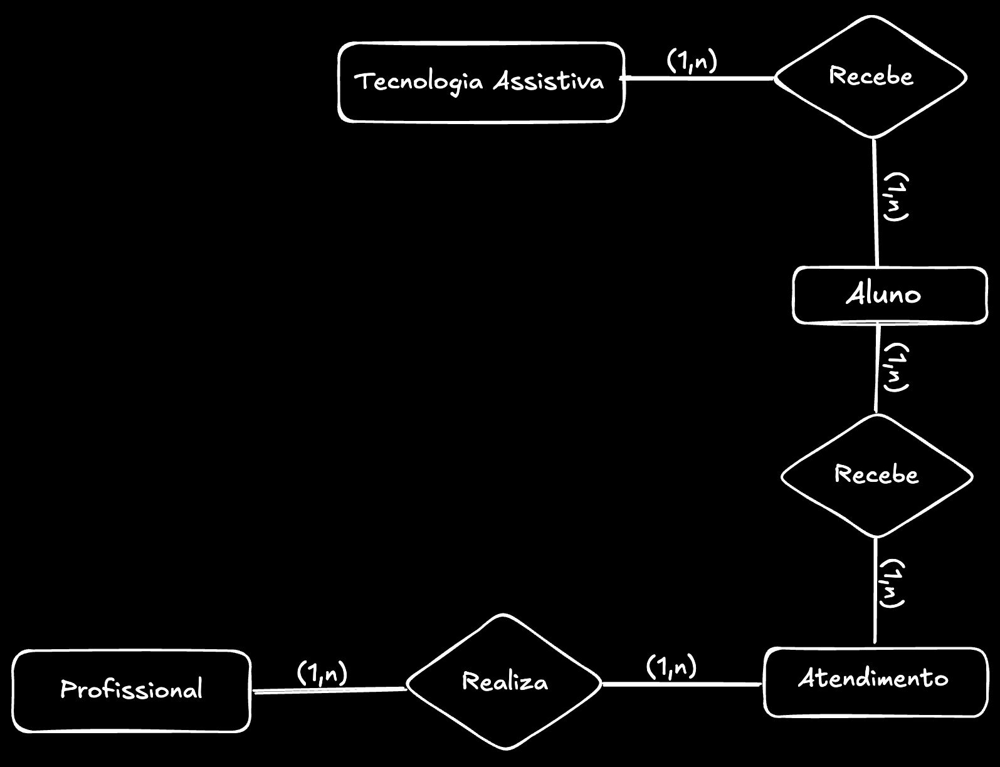 
Fonte: Material produzido pelos autores (2025) 

### 4.1.1. Identificação das Entidades

1. **ALUNO**  
   Refere-se à pessoa que será atendida no sistema, podendo possuir diversas características acadêmicas (unidade, curso) e informações de acessibilidade (deficiência).

2. **PROFISSIONAL**  
   Entidade que descreve o profissional responsável pelos atendimentos (por exemplo, um psicólogo, pedagogo ou outro tipo de especialista).

3. **ATENDIMENTO**  
   Entidade que registra cada ocorrência de atendimento ao Aluno, definindo as datas, tipo de atendimento, quem foi o profissional responsável e, se necessário, alguma tecnologia assistiva empregada.

4. **TECNOLOGIA ASSISTIVA**  
   Entidade que descreve as tecnologias assistivas utilizadas durante os atendimentos, como leitores de tela, lupas digitais ou outros dispositivos.
   
---

### 4.1.2. Estabelecimento das Relações

1. **ALUNO** – **ATENDIMENTO**  
   - Relação **1:N** (um Aluno pode ter vários atendimentos).  
   - Do ponto de vista do banco de dados, `ATENDIMENTO` contém a chave estrangeira `aluno_id` que aponta para `ALUNO.id`.  
   - Exemplo: um Aluno pode ser atendido várias vezes ao longo do semestre, cada registro é um ATENDIMENTO diferente.

2. **PROFISSIONAL** – **ATENDIMENTO**  
   - Relação **1:N** (um Profissional pode realizar diversos atendimentos).  
   - `ATENDIMENTO` contém a chave estrangeira `profissional_id` apontando para `PROFISSIONAL.id`.  
   - Exemplo: o mesmo Profissional faz atendimentos semanais para alunos diferentes.
3. **ALUNO** - **TECNOLOGIA ASSISTIVA**
   - Relação **1:N** (um Aluno pode ter várias tecnologias assistivas).
   - `ALUNO` contém a chave estrangeira `tecnologia_assistiva_id` apontando para `TECNOLOGIA_ASSISTIVA.id`.
   - Exemplo: um Aluno pode usar um leitor de tela e uma lupa digital durante o atendimento.

---

### 4.1.3. Fluxo Geral

- Um **ALUNO** é a pessoa que será registrada no sistema com informações essenciais de identificação e de contexto acadêmico.  
- Um **PROFISSIONAL** é responsável por realizar os atendimentos aos Alunos. Isso pode incluir professores especialistas, psicólogos ou outros membros de uma equipe multiprofissional.  
- Cada **ATENDIMENTO** é um registro histórico que descreve quando ocorreu, qual foi o tipo de atendimento (por exemplo, “Reunião Pedagógica”, “Suporte Psicológico”), qual Profissional realizou e, se necessário, qual tecnologia assistiva foi utilizada.
- **TECNOLOGIA ASSISTIVA** é uma tecnologia que pode ser utilizada durante os atendimentos, como leitores de tela, lupas digitais ou outros dispositivos.

## 4.2 Modelo Lógico de Dados

O banco de dados deste projeto foi estruturado para armazenar informações sobre alunos, profissionais, atendimentos e tecnologias assistivas. A estrutura permite registrar os atendimentos realizados entre um aluno e um profissional, visualizar e acompanhar informações.

## 4.2.1. Modelo Lógico
O modelo lógico do banco de dados é composto pelas seguintes entidades:

- **Usuário**: Representa os usuários do sistema, que podem ter diferentes cargos.
- **Aluno**: Contém apenas o id sobre o aluno que recebe atendimento, uma vez que outras informações sensíveis serão acessadas pela API conjunta da turma.
- **Profissional**: Contém informações sobre os profissionais que realizam atendimentos.
- **Atendimento**: Registra o atendimento entre um aluno e um profissional, incluindo a data e o tipo de atendimento.

## 4.2.2. Relacionamentos

- **Aluno e Atendimento**: Um aluno pode ter vários atendimentos. Cada atendimento está vinculado a um único aluno.
- **Profissional e Atendimento**: Um profissional pode realizar vários atendimentos. Cada atendimento está vinculado a um único profissional.
- **Atendimento e Tecnologia Assistiva**: Caso uma tecnologia assistiva seja utilizada, ela é referenciada dentro do atendimento.

## 4.2.3. Horário do Atendimento
O modelo do banco de dados garante que alunos e profissionais possam realizar atendimentos de forma estruturada, sem necessidade de uma tabela intermediária para agendamentos. O campo **data_atendimento** dentro da tabela **Atendimento** define diretamente o horário do atendimento, assegurando que aluno e profissional estejam juntos nesse período.

Isso significa que:
- Um **Aluno** e um **Profissional** são vinculados na tabela **Atendimento**.
- **data_atendimento** indica o momento exato do atendimento.
- Como o aluno e o profissional compartilham o mesmo registro na tabela **Atendimento**, isso garante que ambos têm um horário comum.

Figura X - Modelo Lógico do Banco de Dados 
 
Fonte: Material produzido pelos autores (2025) 

## 4.2.4. Chaves Primárias

Cada tabela possui um identificador único (chave primária) para garantir a integridade dos registros no banco de dados:

- **Usuário**: `id`
- **Aluno**: `id`
- **Profissional**: `id`
- **Atendimento**: `id`
- **Tecnologia Assistiva**: `id`

## 4.2.5. Chaves estrangeiras

As chaves estrangeiras estabelecem os relacionamentos entre as tabelas, garantindo a integridade de refeência entre as tabela por meio dos dados:

- **Atendimento**:
  - `aluno_id` → Referência para `Aluno(id)`
  - `profissional_id` → Referência para `Profissional(id)`
  - `tecnologia_assistiva_id` → Referência para `Tecnologia Assistiva(id)`

## 4.2.6. Estrutura das Tabelas

### **Usuário**
| Campo  | Tipo  | Descrição  |
|--------|------|--------------|
| id  | INT (PK) | Identificador único do usuário |
| nome  | VARCHAR  | Nome do usuário  |
| email  | VARCHAR  | Email do usuário  |
| senha  | VARCHAR  | Senha criptografada |
| cargo  | VARCHAR  | Cargo do usuário no sistema |

### **Aluno**
| Campo  | Tipo  | Descrição  |
|--------|------|--------------|
| id  | INT (PK) | Identificador único do aluno |

### **Profissional**
| Campo  | Tipo  | Descrição  |
|--------|------|--------------|
| id  | INT (PK) | Identificador único do profissional |
| nome  | VARCHAR  | Nome do profissional |
| email  | VARCHAR  | Email do profissional |
| unidade  | VARCHAR  | Unidade do profissional |
| telefone  | VARCHAR  | Telefone do profissional |
| profissao | VARCHAR  | Profissão do profissional |

### **Atendimento**
| Campo  | Tipo  | Descrição  |
|--------|------|--------------|
| id  | INT (PK) | Identificador único do atendimento |
| aluno_id  | INT (FK) | Referência ao aluno atendido |
| profissional_id  | INT (FK) | Referência ao profissional responsável |
| data_atendimento  | DATETIME | Horário do atendimento |
| tipo_atendimento  | VARCHAR  | Tipo de atendimento realizado |
| tecnologia_assistiva | VARCHAR | Tecnologia assistiva usada |

### **Tecnologia Assistiva**
| Campo  | Tipo  | Descrição  |
|--------|------|--------------|
| id  | INT (PK) | Identificador único da tecnologia assistiva |
| nome  | INT (FK) | Nome da tecnologia assistiva |

## 4.3 Modelo Físico de Dados

_conteúdo_

**Nota:** Insira uma explicação e direcionamento para o readme.md da pasta database.

# 5. Solução Técnica (Design)

## 5.1 Diagrama de Componentes da UML

Figura x - Diagrama de Componentes 
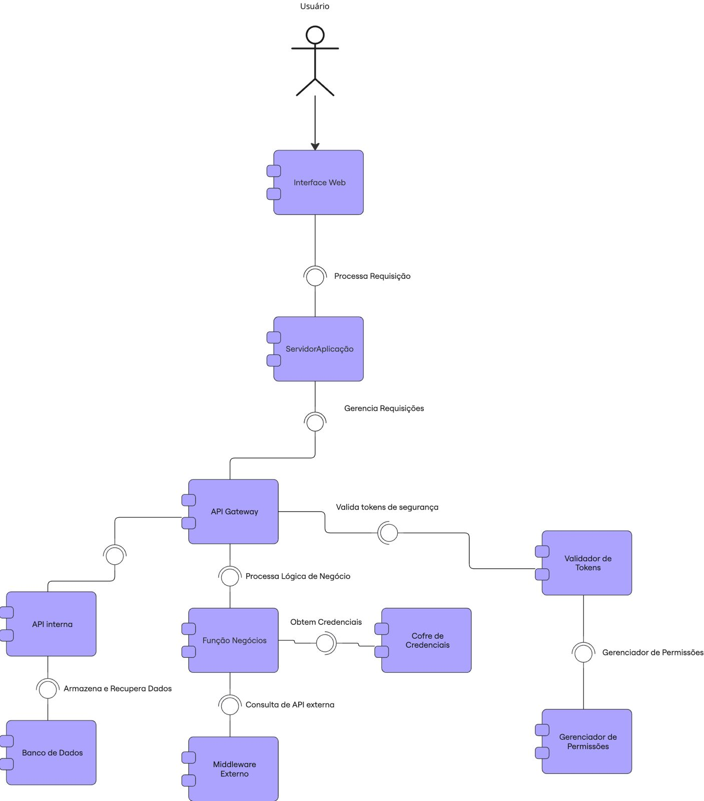 
Fonte: Material produzido pelos autores (2025) 

# Arquitetura de 3 Camadas do Sistema

## 1. Camada de Apresentação (Frontend)
A Camada de Apresentação é responsável pela interface do usuário, permitindo que ele interaja com o sistema.

### Componentes:
- Usuário: Interage com o sistema por meio da interface web.
- Interface Web: Apresenta a interface gráfica ao usuário e envia requisições ao servidor.

### Fluxo:
1. O Usuário acessa a aplicação via a Interface Web.
2. A Interface Web encaminha as requisições para o Servidor de Aplicação.

## 2. Camada de Negócio (Backend)
A Camada de Negócio gerencia a lógica de processamento e a comunicação entre as camadas.

### Componentes:
- Servidor de Aplicação: Processa requisições e envia ao API Gateway
.
- API Gateway
: Orquestra a comunicação entre os serviços do backend.
- Função de Negócios: Executa as regras de negócio.
- Middleware Externo: Realiza chamadas para APIs externas.
- Validador de Tokens: Verifica autenticação e permissões.
- Gerenciador de Permissões: Define e controla permissões de acesso.
- Cofre de Credenciais: Armazena credenciais seguras para acesso a serviços protegidos.

### Fluxo:
1. O Servidor de Aplicação recebe a requisição da Interface Web e a repassa para o API Gateway
.
2. O API Gateway
 decide qual componente do backend será acionado:  
   - Função de Negócios para processar regras de negócio.  
   - API Interna para acessar o banco de dados.  
   - Middleware Externo para interagir com serviços externos.  
3. O Validador de Tokens verifica permissões via o Gerenciador de Permissões antes de liberar determinadas operações.
4. Se necessário, a Função de Negócios acessa o Cofre de Credenciais para obter credenciais seguras.

## 3. Camada de Dados
A Camada de Dados é responsável pelo armazenamento e recuperação de informações.

### Componentes:
- API Interna: Interface de comunicação entre o backend e o banco de dados.
- Banco de Dados: Armazena as informações essenciais do sistema.

### Fluxo:
1. O API Gateway
 encaminha as requisições para a API Interna.
2. A API Interna consulta ou atualiza o Banco de Dados conforme necessário.
3. O Banco de Dados responde com os dados solicitados.

## 5.2 Diagramas de Sequência da UML

## 5.2.1 Diagrama de Sequência da UML de Registro de Profissionais

Figura x - Diagrama de Registro de Profissionais 
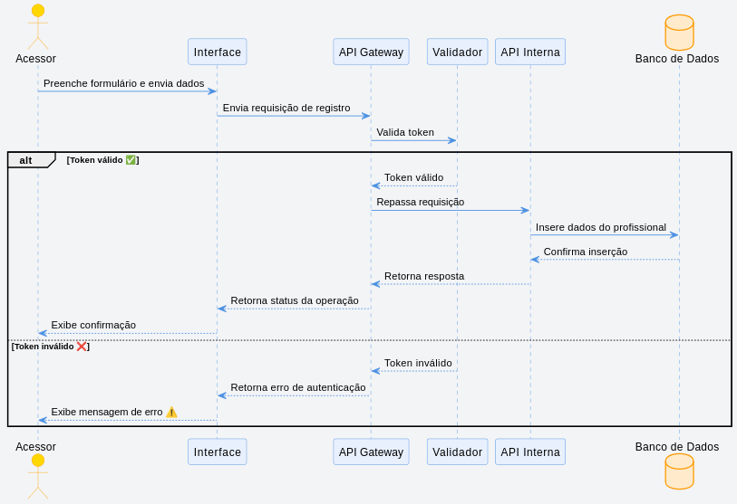 
Fonte: Material produzido pelos autores (2025) 

## 5.2.2 Diagrama de Sequência da UML de Associação de Profissional ao Aluno

Figura x - Diagrama de Associação de Profissional ao Aluno 
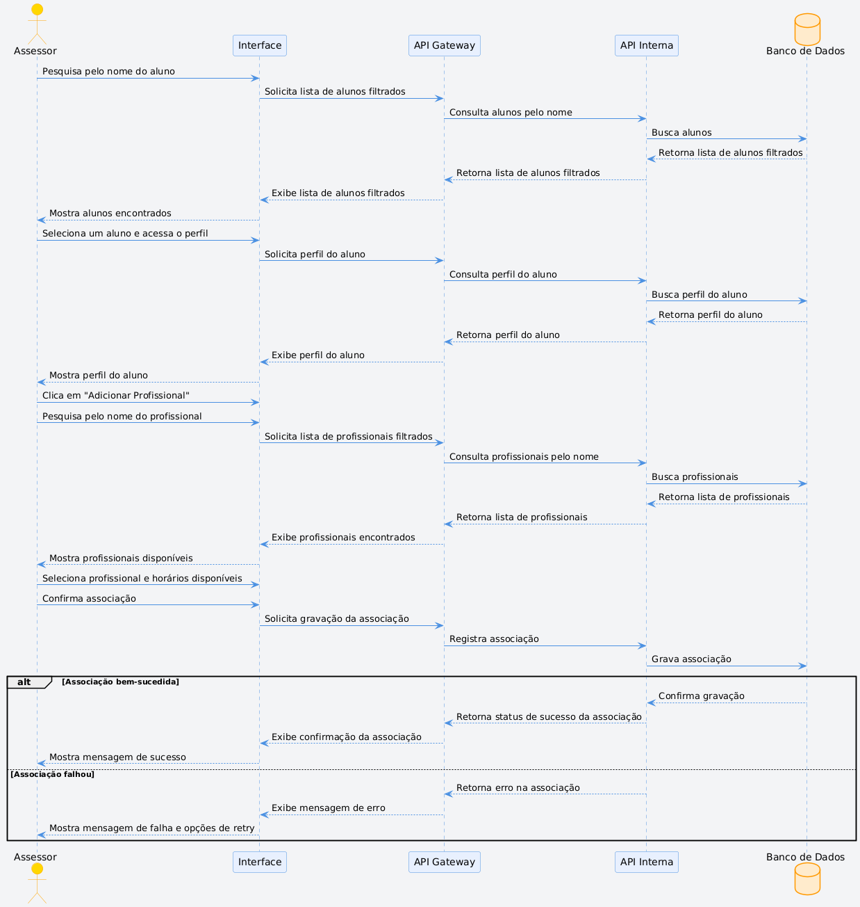 
Fonte: Material produzido pelos autores (2025) 

## 5.2.3 Diagramas de Sequência da UML de Filtragem de Alunos

Figura X - Diagrama de filtragem de alunos 
 
Fonte: Material produzido pelos autores (2025) 

## 5.2.4 Diagrama de Sequência da UML de Visualização de Dados Estatísticos

Figura x - Diagrama de Sequência - Gestora Admistrativa 
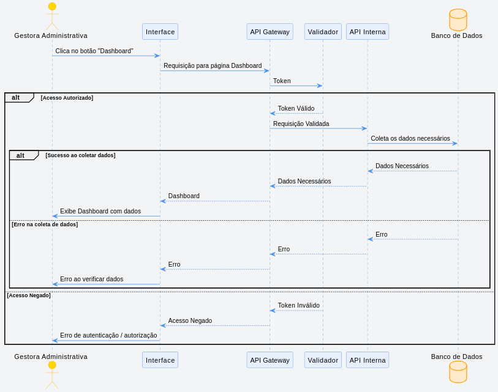 
Fonte: Material produzido pelos autores (2025) 

## 5.3 Descrição Textual dos Diagramas

&nbsp;&nbsp;&nbsp;&nbsp;Segue a descrição textual dos diagramas de sequência da UML, relacionando-os com uma User Story de alguma funcionalidade essencial do sistema e os RFs e RNFs atendidos.

## 5.3.1 - Descrição Textual do Diagrama de Registro de Profissionais

**Diagrama de Registro de Profissionais**
- User Story 01 ("Como assessora, quero registrar um profissional no banco de dados para manter o cadastro atualizado.")
- Requisitos Funcionais relacionados ao diagrama: 
  - **RF001 - Cadastro de Profissionais:** o diagrama representa o fluxo completo de interações entre o usuário assessor e o sistema para cadastrar um novo profissional no sistema. 
  - **RF005 - Autenticação e Autorização de Usuários:** ao enviar a requisição à API Gateway, realiza-se uma verificação de Token para que o sistema certifique-se que a requisição foi feita por um usuário autorizado com acesso de assessor.

- Requisitos não funcionais relacionados ao diagrama:
  - **RNF01 - Tempo de Resposta:** apesar de haver uma sequência de interações, todo o fluxo, do começo ao fim, deve levar menos de 0,8 segundo.
  - **RNF04 - Segurança:** ao fazer a verificação do Token, há uma resposta negativa caso o usuário não tenha permissão para realizar essa requisição.
  - **RNF05 - Proteção de Dados:** todos os dados dos profissionais que serão armazenados seguirão as diretrizes da LGPD.
  - **RNF09 - Alertas Claros:** caso haja algum problema na requisição, como no caso de um usuário não autorizado, a interface deve comunicar o usuário de maneira clara.
  - **RNF13 & RNF02 - Acessibilidade:** toda a interface utilizada para o cadastro segue diretrizes de acessibilidade, embora não esteja diretamente representado no diagrama.

## 5.3.2 - Descrição Textual do Diagrama de Associação de Profissional ao Aluno

- User Story 02 (" Como Assessor de Inclusão, quero associar um profissional a um aluno no sistema, utilizando comandos de leitor de tela, para garantir que o aluno receba o suporte necessário.")
- Requisitos Funcionais relacionados ao diagrama:
  - **RF002 - Associação de Alunos a Profissionais:** o diagrama representa todo o fluxo de associação de um aluno a um profissional, desde a busca pelo aluno até a confirmação da associação.
  - **RF007 - Pesquisa e Filtros Avançados:** o assessor realiza buscas filtradas tanto para alunos quanto para profissionais, facilitando a localização das informações.

- Requisitos Não Funcionais relacionados ao diagrama:
  - **RNF01 - Tempo de Resposta:** o diagrama apresenta várias interações entre a interface, API Gateway e API Interna, e todas as consultas e respostas devem ser processadas em menos de 0,8 segundo.
  - **RNF03 - Eficiência na Navegação:** o diagrama mostra que o assessor pode encontrar um aluno e um profissional rapidamente, garantindo que a busca seja feita em no máximo três cliques.
  - **RNF04 - Segurança:** o sistema precisa garantir que apenas usuários autorizados possam acessar as informações de alunos e realizar associações. Isso acontece por meio de validações de Tokens a cada requisição.
  - **RNF10 - Alertas Claros:** caso haja algum problema na requisição, como no caso de um usuário não autorizado, a interface deve comunicar o usuário de maneira clara.
  - **RNF11 - Compatibilidade com API:** a integração com a API do Centro Paula Souza precisa ser contínua e confiável, garantindo a integridade dos dados recuperados.
  - **RNF13 & RNF02 - Acessibilidade:** toda a interface utilizada para o cadastro segue diretrizes de acessibilidade, embora não esteja diretamente representado no diagrama.

## 5.3.3 - Descrição Textual do Diagrama de Filtragem de Alunos

- User Story 03 ("Como gestor de unidade, quero filtrar um(a) aluno(a) da minha unidade para encontrá-lo(la) rapidamente")
- Requisitos Funcionais relacionados ao diagrama: 
  - **RF004 - Acompanhamento de Alunos com Deficiência:** a busca de alunos pode incluir filtros específicos para alunos com deficiência. Isso permite que o gestor encontre rapidamente alunos que necessitam de suporte adicional.
  - **RF005 - Autenticação e Autorização de Usuários:** o diagrama começa com o **Gestor de Unidade (Valdemar Souza)** fazendo login na plataforma, tratando da autenticação e autorização de usuários. O sistema valida as credenciais do gestor antes de permitir o acesso à funcionalidade de busca.
  - **RF007 - Pesquisa e Filtros Avançados:** a funcionalidade de busca de alunos, que é o foco principal da User Story, está diretamente relacionada a esse requisito. O diagrama mostra o gestor inserindo o nome ou outro filtro do aluno, e o sistema processando essa busca, retornando os resultados correspondentes.

- Requisitos Não Funcionais relacionados ao diagrama: 

  - **RNF01 - Tempo de Resposta:** o diagrama de sequência mostra que a busca de alunos deve ser rápida e eficiente. O RNF01 estabelece que o tempo de resposta máximo para consultas de dados deve ser de 0,8 segundo, o que é essencial para garantir que o gestor possa encontrar o aluno rapidamente, conforme a User Story.
  - **RNF03 - Usabilidade (Número de Cliques):** o RNF04 estabelece que os usuários devem conseguir encontrar alunos e profissionais com, no máximo, 3 cliques. O diagrama de sequência reflete isso ao mostrar um fluxo simples e direto para a busca de alunos, desde o login até a exibição dos resultados.
  - **RNF04 - Segurança (Controle de Acesso):** o RNF05 garante que cada tipo de usuário tenha acesso somente às suas respectivas funcionalidades. No diagrama, o gestor de unidade só pode acessar a funcionalidade de busca depois que o validador valida o token de acesso.
  - **RNF10 - Validação de Dados:** durante a busca, os dados retornados devem passar por validação para garantir a integridade e confiabilidade das informações apresentadas ao gestor.
  - **RNF11 - Compatibilidade com API Existente:** a integração com a API do Centro Paula Souza, mencionada no RF003, também está relacionada ao RNF02, que exige que a aplicação seja compatível com APIs existentes e mantenha a integridade dos dados durante a integração.
  - **RNF13 & RNF02 - Acessibilidade:** toda a interface utilizada para o cadastro segue diretrizes de acessibilidade, embora não esteja diretamente representado no diagrama.

  ## 5.3.4 - Descrição Textual do Diagrama de Visualização de Dados Estatísticos

- Como gestora administrativa, quero visualizar dados estatísticos dos alunos com deficiência do CPS, para que eu possa analisar os atendimentos e tomar decisões estratégicas.

- Requisitos Funcionais relacionados ao diagrama:
  - **RF003 - Dashboard de Business Intelligence:** o diagrama descreve o passo a passo da Gestora Administrativa ao acessar o dashboard para visualização dos dados.
  - **RF004 - Acompanhamento de Alunos com Deficiência:** embora não esteja diretamente representado no diagrama, ao analisar os dados estatísticos, pode-se tirar _insights_  relevantes para o acompanhamento dos alunos.
  - **RF005 - Autenticação e Autorização de Usuários:** o diagrama pressupõe que o usuário já tenha realizado a autenticação, o que gera um token que é validado após a tentativa de acesso.

- Requisitos Não Funcionais relacionados ao diagrama:
  - **RNF01 - Tempo de Resposta:** embora não esteja representado diretamente no diagrama, o tempo máximo de resposta após o usuário clicar para acessar o dashboard é de 0,8 segundo em caso de falha ou sucesso na autenticação.
  - **RNF03 - Usabilidade:** segundo o diagrama, a Gestora Administrativa acessa o dashboard com apenas um único clique do mouse.
  - **RNF04 - Segurança:** há uma etapa de validação do token de acesso do usuário antes da requisição na API interna do sistema, assim garantindo que somente usuários autorizados acessem os dados estatísticos.
  - **RNF05 - Privacidade:** ao utilizar a camada de validação de token, garante que apenas usuários autorizados acessem os dados e não será exibido nenhum dado pessoal ou sensível para o gestor administrativo.
  - **RNF08 - Disponibilidade:** o diagrama pressupõe que o sistema deve estar no ar quando o usuário faz a requisição.
  - **RNF09 - Mensagens de Erro:** caso o usuário não seja autorizado a relizar aquela requisição ou o sistema houve algum problema ao acessar os dados, o usuário receberá uma mensagem de erro correspondente.
  - **RNF10 - Integridade:** com a visualização dos dados, é necessário que eles estejam sempre atualizados e íntegros. De modo que seja possível a criação de um dashboard para _insights_.
  - **RNF13 & RNF02 - Acessibilidade:** a interface do sistema segue as diretrizes de acessibilidade, porém não é possível representar no diagrama.

# 6. Mapeamento Técnico de Infraestrutura e Implantação

## 6.1 Diagrama de Implantação da UML

Figura x - Diagrama de Implantação 
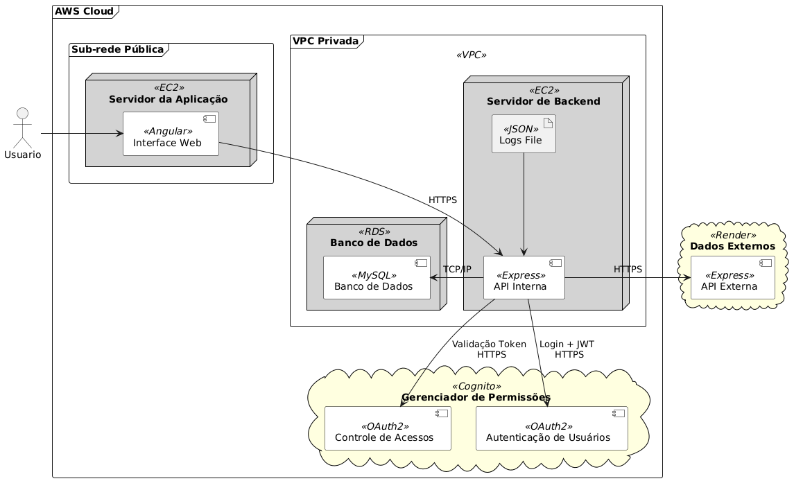 
Fonte: Material produzido pelos autores (2025) 

### 6.1.1 Infraestrutura

#### 6.1.1.1 **Servidores e Recursos de Computação**
- **Servidores EC2 (Servidor da Aplicação e Backend)**:
  - **Tecnologia:** Instâncias EC2 da AWS separadas para hospedagem do servidor da aplicação/interface e servidor de backend.
  - **Função:** O _Front-end_ e o _Back-end_ serão implementados nessas instâncias EC2, responsáveis pela execução das interações com o usuário e lógicas de negócio, respectivamente.
  - **Escalabilidade:** Utilização do _Auto Scaling Groups_ para aumentar ou diminuir a capacidade de acordo com a demanda.
  - **Logs File:** Armazenará os logs de alterações do banco de dados, comunicando-se diretamente com a API. Seu ciclo de vida é de 5mb. Para monitoramento e análise em tempo real, a AWS **CloudWatch** pode ser configurada para centralizar os logs de maneira eficiente, eliminando a necessidade de armazenamento local.
  - **Rede Virtual Privada (VPC):** Os servidores EC2 e o banco de dados RDS serão implementados dentro de uma VPC. Isso garante que a comunicação entre as instâncias da aplicação, o banco de dados e outros recursos sejam feitos de forma segura e isolada, protegendo os dados e controlando o acesso por meio de regras de segurança.

#### 6.1.1.2 **Topologia de Rede e Comunicação entre os Componentes**

A **topologia de rede** e a **comunicação entre os componentes** seguem uma arquitetura cliente-servidor distribuída dentro de uma VPC isolada, garantindo segurança e eficiência na troca de dados.

- **Cliente (Interface Web) → Servidor da Aplicação (EC2):**
  - O **usuário** interage com a interface web hospedada em uma instância EC2. 
  - A comunicação entre o **cliente** e o **servidor da aplicação** é feita via **HTTPS**, garantindo a criptografia dos dados em trânsito através do protocolo **TLS**.
  
- **Servidor da Aplicação → Backend (API Interna, EC2):**
  - O **servidor da aplicação** se comunica com o **backend**, que também reside em uma instância EC2, utilizando **HTTPS** para proteger os dados.
  
- **Backend (API Interna) → Banco de Dados (RDS):**
  - O **backend** se comunica com o banco de dados **RDS MySQL** via **TCP/IP** dentro da VPC. A comunicação pode ser criptografada utilizando **SSL/TLS** para garantir a segurança dos dados.

- **API Interna → Gerenciador de Permissões (AWS Cognito):**
  - O **backend** valida as permissões de acesso dos usuários através do **AWS Cognito**. A comunicação é realizada via **HTTPS** com o uso de tokens **JWT** (JSON Web Token) para garantir a autenticidade do usuário.

- **API Interna → API Externa (Render):**
  - O **backend** se comunica com a **API Externa** (Render) para integração com sistemas de terceiros via **HTTPS**.

#### 6.1.1.3 **Banco de Dados**
- **RDS (Banco de Dados MySQL)**:
  - **Tecnologia:** AWS RDS com MySQL.
  - **Função:** Armazenamento e gerenciamento de dados do sistema.
  - **Escalabilidade:** Adição de réplicas de leitura, aumentando a capacidade de leitura de dados conforme necessário com o _Auto Scaling_.
  - **Segurança:** O banco de dados está isolado dentro da VPC, o que garante uma camada adicional de segurança e controle de tráfego, protegendo as informações sensíveis.

#### 6.1.1.4 **Gerenciamento de Permissões e Autenticação**
- **AWS Cognito (Gerenciador de Permissões)**:
  - **Tecnologia:** AWS Cognito para controle de autenticação de usuários e gerenciamento de permissões com JWT.
  - **Função:** Autenticação via OAuth2, gerenciando o acesso dos usuários aos sistemas.
  - **Segurança:** Implementação de segurança com JWT (_JSON Web Token_) para garantir que os usuários autenticados tenham acesso adequado.

#### 6.1.1.5 **API Externa**
- **Render (Express API)**:
  - **Tecnologia:** Express API hospedado no Render.
  - **Função:** Integrar a aplicação com sistemas externos via API.

## 6.2 Justificativa das Escolhas de Implantação

&nbsp;&nbsp;&nbsp;&nbsp;As escolhas de implantação foram todas baseadas nos requisitos não funcionais da aplicação, principalmente os que levam em conta segurança e performance.

##### **RNF01 - Tempo de Resposta Máximo para Consultas**
- **Justificativa**: A escolha de _AWS EC2_ para servidores de aplicação, tanto back-end quanto front-end, em conjunto com a escalabilidade horizontal, assegura que o sistema tenha capacidade de resposta rápida, distribuindo a carga de trabalho e mantendo tempos de resposta otimizados, abaixo de 0,8 segundo.

##### **RNF04 - Controle de Acesso por Tipo de Usuário**
- **Justificativa**: A integração com _AWS Cognito_ para autenticação e autorização com _JWT_ garante que cada tipo de usuário tenha acesso somente às funcionalidades autorizadas, respeitando os requisitos de segurança e controle de acesso.

##### **RNF05 - Proteção de Dados Pessoais**
- **Justificativa**: Utilizando protocolos criptografados, como _HTTPS_, e _AWS RDS_ para armazenamento, o sistema assegura que os dados de alunos e profissionais sejam protegidos, seguindo as normas de segurança da _LGPD_.

##### **RNF06 - Manutenibilidade e Padrão de Modularidade**
- **Justificativa**: Com a modularidade do código e a separação das partes em serviços diferentes de nuvem da AWS, fica fácil a sua manutenção e através do _Amazon IAM_ (_Identity and Access Management_) o acesso e manutenção na própria nuvem são facilitados e, ao mesmo tempo, controlados.

##### **RNF08 - Disponibilidade Alinhada com as Necessidades Operacionais**
- **Justificativa**: A infraestrutura na AWS com escalabilidade horizontal garante alta disponibilidade, atendendo às necessidades operacionais de 8:00 às 18:00, ou por mais tempo caso necessário, sem interrupções, utilizando Auto Scaling e Amazon CloudWatch para monitoramento.

##### **RNF10 - Validação de Dados**
- **Justificativa**: A validação de dados será feita tanto na interface do usuário quanto na API Interna, com a sua respectiva lógica de negócio, garantindo que somente dados válidos sejam armazenados no banco, assegurando integridade e a funcionalidade do sistema.

##### **RNF11 - Integração com API do Centro Paula Souza**
- **Justificativa**: A integração com a API do Centro Paula Souza, representada pela "Api Externa" no diagrama é essencial para o funcionamento do sistema, por isso, o diagrama foi projetado e pensado em utilizá-la.

##### **RNF12 - Backups Automáticos**
- **Justificativa**: Ao utilizar o _Amazon RDS_ para armazenamento dos dados, é possível configurar backups automáticos com retenção de até 35 dias, garantindo que o banco possa ser restaurado em caso de falha ou perda de dados.

## 6.3 Considerações sobre Desempenho e Segurança

&nbsp;&nbsp;&nbsp;&nbsp;As escolhas de tecnologias e infraestrutura foram realizadas com atenção especial aos requisito de segurança e desempnho do sistema.

### 6.3.1 Desempenho
&nbsp;&nbsp;&nbsp;&nbsp;A arquitetura foi projetado para garantir alta disponibilidade, escalabilidade e eficiência, de acordo com os requisitos do sistema. Abaixo estão considerações de desempenho:

- **1 - Escalabilidade Horizontal (Auto-Scaling):** As instâncias EC2 e RDS utilizam o Auto-Scaling, o que garante que a infraestrutura seja capaz de se ajustar automatiamente à carga de trabalho. Além disso, as réplicas de leitura no RDS ajudam a distribuir a carga de consultas de leitura, o que aumenta a eficiência no acesso dos dados, permitindo que a aplicação manipule grandes volumes de tráfego sem prejudicar a performance.

- **2 - Distribuição de Carga e Processamento:** O uso do AWS Cognito e da API Externa (API do CPS) permite uma divisão eficiente de carga entre os diferentes componentes do sistema. O Cognito lida com a autenticação e o gerenciamento de tokens, enquanto as demais requisições são divididas entre as APIs interna e externa.

- **3 - Manutenção e Monitoramento:** A infraestrutura de logs e o uso de ferramentas de monitoramento da AWS como o CloudWatch permitem identificar gargalos no desempenho, ajudando a otimização contínua do sistema.

### 6.3.2 Segurança

&nbsp;&nbsp;&nbsp;&nbsp;A segurança da aplicação foi considerada em diferentes níveis para proteger os dados e mitigar riscos de ataques. Abaixo estão as implementações voltadas para a segurança:

- **1 - Isolamento de Infraestrutura com VPC:** A aplicação está hospedada em uma VPC (_Virtual Private Cloud_), que proporciona um ambiente isolado para serviços críticos, protegendo-os contra acessos não autorizados da internet. Dentro da VPC foram implementadas duas sub-redes:
  - **Sub-rede Pública:** Onde o servidor de aplicação da interface está hospedado, permitindo acesso dos usuários.
  - **Sub-rede Privada:** Onde o servidor de _back-end_ e o banco de dados estão hospedados, garantindo que apenas serviços internos possam acessá-los.
- **2 - Proteção das Comunicações:** Todas as comunicações utilizam protocolos de comunicação seguros:
  - **HTTPS** entre o _front-end_ e o _back-end_, garantindo a criptografia dos dados transmitidos por TLS (_Transport Layer Security_).
  - **Autenticação com JWT** para validar usuários e evitar acessos não autorizados.
  - **Criptografia em trânsito** através de TLS nas conexões com o banco de dados para evitar interceptação de dados.
  - **Criptografia em repouso** no banco de dados utilizando AWS KMS (_Key Managment Service_).
- **3 - Controle de Acesso e Autenticação Segura:** A autenticação de usuários é gerenciada pelo AWS Cognito, utilizando OAuth2 para fornecer acesso seguro. Isso permite um gerenciamento eficiente de credenciais e tokens, implementação de autenticação multifator (MFA) e controle das permissões com base nos perfis de usuário. Além disso, o _back-end_ valida todos os tokens recebidos antes de processar qualquer requisição.
- **4 - Proteção Contra Ataques** Para mitigar ameaças como ataques DDoS, SQL Injection e Cross-Site Scripting (XSS), podem ser adotadas as seguintes estratégias:
  - **AWS WAF (_Web Application Firewall_):** para filtrar tráfego malicioso.
  - **Rate Limiting e Throttling:** na API para evitar sobrecarga e/ou abuso de requisições.
  - **Monitoramento contínuo com AWS GuardDuty:** para detectar acessos suspeitos.
- **5 - Logs de Alterações e Backups:** Com todas as alterações registradas, é possível identificar caso haja alguma alteração maliciosa em algum arquivo no banco de dados e agir contra esse acesso, além de reverter os danos com os backups automáticos.

# 7. Projeto Visual da Solução

## 7.1 Desenvolvimento de Wireframes

&nbsp;&nbsp;&nbsp;&nbsp;O _Wireframe_, protótipo de baixa fidelidade, foi desenvolvidos utilizando a ferramenta [Figma](https://www.figma.com/) que é amplamente utilizada no mercado. Com ela, também foi possível fazer o _Wireframe Flow_ que demonstra como é o fluxo de utilização do usuário, ao clicar em cada botão da aplicação. Tudo pode ser visualizado [neste link](https://www.figma.com/design/Dh3whOUONs9F1R0HpX1jlH/LinkUp?node-id=7-40559&t=ZiXU0hTNdn7z8nHQ-1). Abaixo está uma breve descrição de cada tela principal.

### 7.1.1 Dashboard Estatístico

Figura x - Wireframe Dashboard Estatístico 
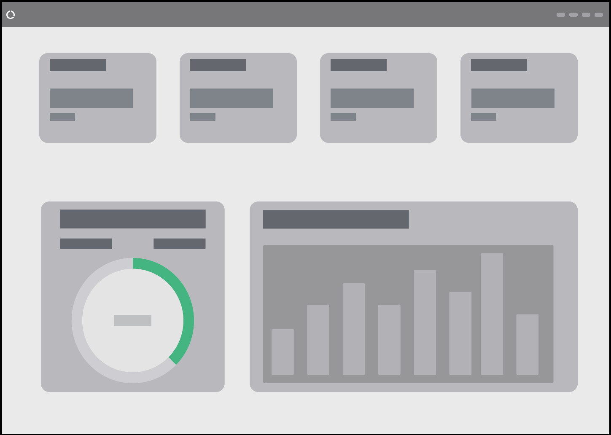 
Fonte: Material produzido pelos autores (2025) 

&nbsp;&nbsp;&nbsp;&nbsp;O dashboard estatístico está representado acima. Nele conterá algumas informações numéricas, como número total de alunos atendidos. Logo abaixo, ficam posicionados alguns gráficos para relacionar informações entre unidades ou profissionais. 

----

### 7.1.2  Filtro de Alunos

Figura x - Wireframe Filtro Alunos 
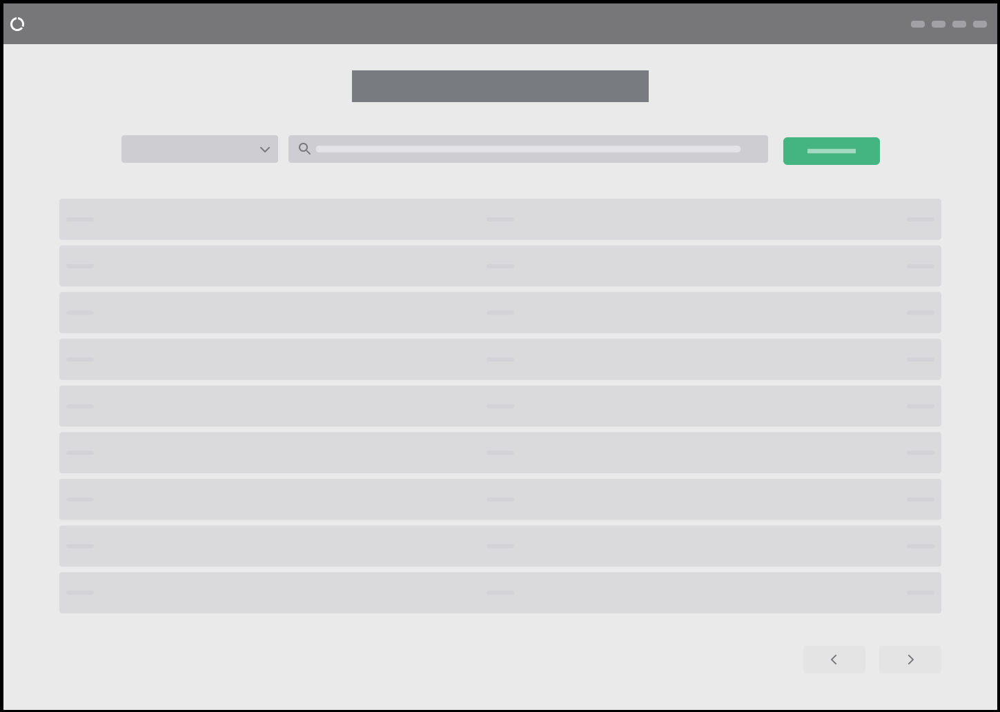 
Fonte: Material produzido pelos autores (2025) 

&nbsp;&nbsp;&nbsp;&nbsp;A tela de filtro de alunos será acessada quando precisar consultar dados de algum aluno e/ou conectá-lo a algum profissional de atendimento. Nela ficará uma lista de alunos da unidade, separados por páginas, com uma barra de pesquisa para procurar o nome do aluno, agilizando a busca. O filtro à esquerda da barra de pesquisa serve para escolher a unidade dos alunos exibidos.

----

### 7.1.3 Pop-up de Perfil 

Figura x - Wireframe Pop-up do Perfil do Aluno 
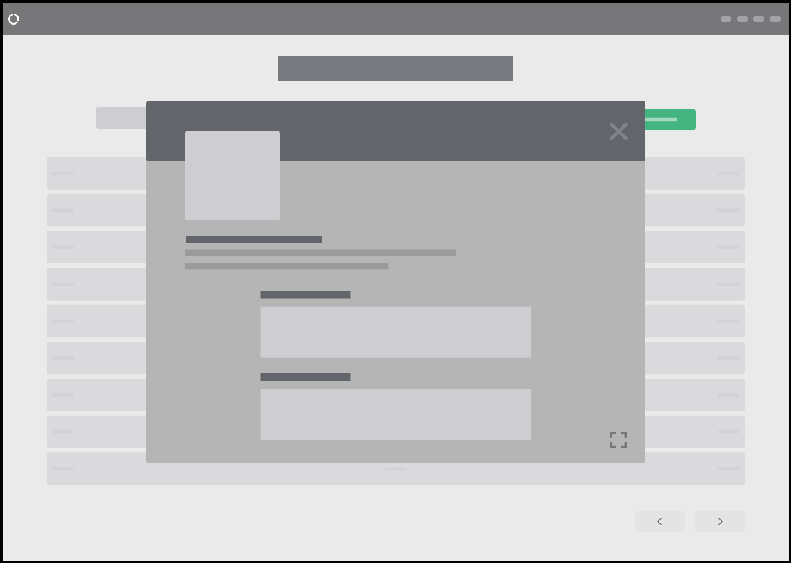 
Fonte: Material produzido pelos autores (2025) 

&nbsp;&nbsp;&nbsp;&nbsp;O pop-up do perfil do aluno aparece ao clicar em um aluno selecionado. Ela é uma pré-visualização do perfil completo dele para que o usuário se certifique de que é o aluno correto a selecionar. Nesta tela haverá o nome do aluno, sua foto e informações como deficiência, curso, turno e unidade. Vale mencionar que esse pop-up também é aparece ao selecionar um profissional.

----

### 7.1.4 Wireframe Perfil do Aluno

Figura x - Wireframe Perfil do Aluno 
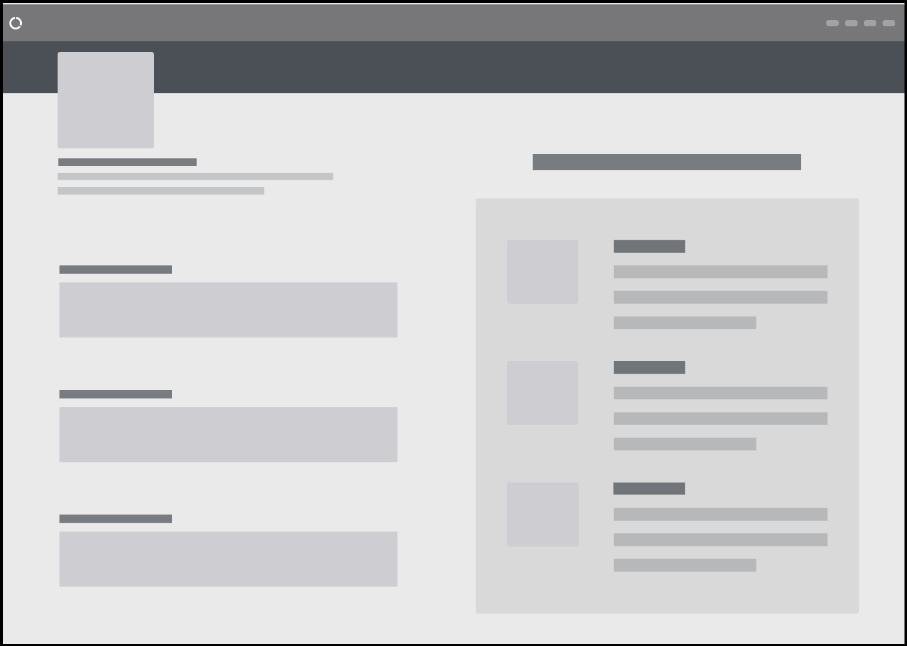 
Fonte: Material produzido pelos autores (2025) 

&nbsp;&nbsp;&nbsp;&nbsp; A tela acima representa o perfil do aluno. Após o pop-up, ao clicar no ícone de expandir, abre esta tela. Nela contém todas as informações do aluno, na parte esquerda, e os atendimentos dele com profissionais especializados, na direita. Também há um botão, na parte superior direita, para adicionar um profissional para atender o aluno.

## 7.2 Desenvolvimento de Mockups

## 7.2.1 Primeira versão da aplicação web

&nbsp;&nbsp;&nbsp;&nbsp; Para a primeira etapa do desenvolvimento, foram criadas algumas telas para demonstrar a navegação, a usablidade e a experiência do usuário. As telas incluem a página de perfil do aluno, o filtro de alunos, o pop-up de perfil do aluno e o dashboard estatístico.

&nbsp;&nbsp;&nbsp;&nbsp; A apresentação completa dos _mockups_ pode ser visualizada diretamente pelo [link do Figma](https://www.figma.com/design/Dh3whOUONs9F1R0HpX1jlH/LinkUp?node-id=154-8177&p=f&t=J13h7P6hOsOVYcEz-0).  

### 7.2.1.1 Página de Perfil do Aluno

&nbsp;&nbsp;&nbsp;&nbsp; A página de perfil do aluno oferece uma visão completa sobre o estudante, incluindo dados pessoais, deficiências e informações acadêmicas. Além disso, optamos uma seção específica para exibir os atendimentos recebidos, categorizados de acordo com o tipo de suporte oferecido.

&nbsp;&nbsp;&nbsp;&nbsp; A interface também permite que novos atendimentos sejam adicionados facilmente, garantindo um acompanhamento detalhado do aluno. O layout foi projetado para ser acessível e visualmente organizado, melhorando a experiência de quem gerencia essas informações.

Figura X - Página de perfil do aluno 
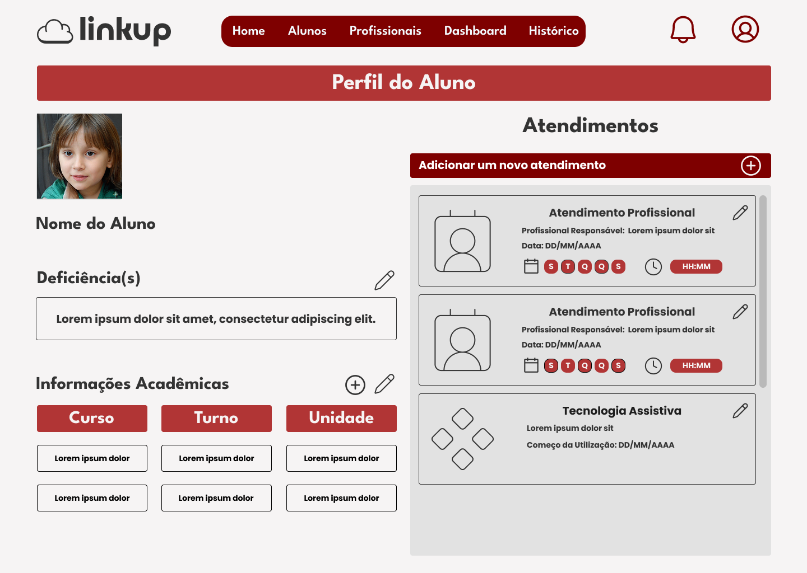 
Fonte: Material produzido pelos autores (2025)

### 7.2.1.2 Tela de Listagem e Filtro de Alunos

&nbsp;&nbsp;&nbsp;&nbsp; A tela de listagem e filtro de alunos permite que o usuário pesquise e filtre alunos de forma simples e rápida. A interface foi projetada para ser intuitiva e organizada, garantindo que as informações fiquem acessíveis sem sobrecarregar o usuário com informações que atrapalhem o objetivo.

&nbsp;&nbsp;&nbsp;&nbsp; A listagem exibe o nome do aluno e a sua unidade, apresentados em uma estrutura simples e direta. Um campo de pesquisa foi incluído para facilitar a localização de alunos específicos.

Figura X - Tela de filtro de alunos 
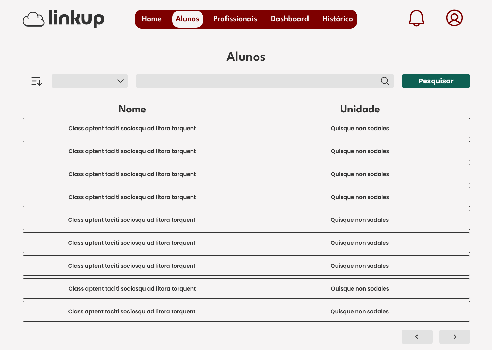 
Fonte: Material produzido pelos autores (2025)

### 7.2.1.3 Pop-up de Perfil do Aluno

&nbsp;&nbsp;&nbsp;&nbsp; Ao clicar em um aluno na listagem, um pop-up com detalhes é exibido com nome, deficiências cadastradas e dados acadêmicos. Esse design permite que o usuário visualize rapidamente as informações sem precisar navegar para outra página, tornando a interação mais ágil. Ao clicar no ícone de expansão, o usuário é levado para a tela de completa de Perfil do Aluno.

&nbsp;&nbsp;&nbsp;&nbsp; A interface do pop-up mantém o estilo visual do sistema, garantindo coerência no design e usabilidade intuitiva.

Figura X - Pop-up de perfil do aluno 
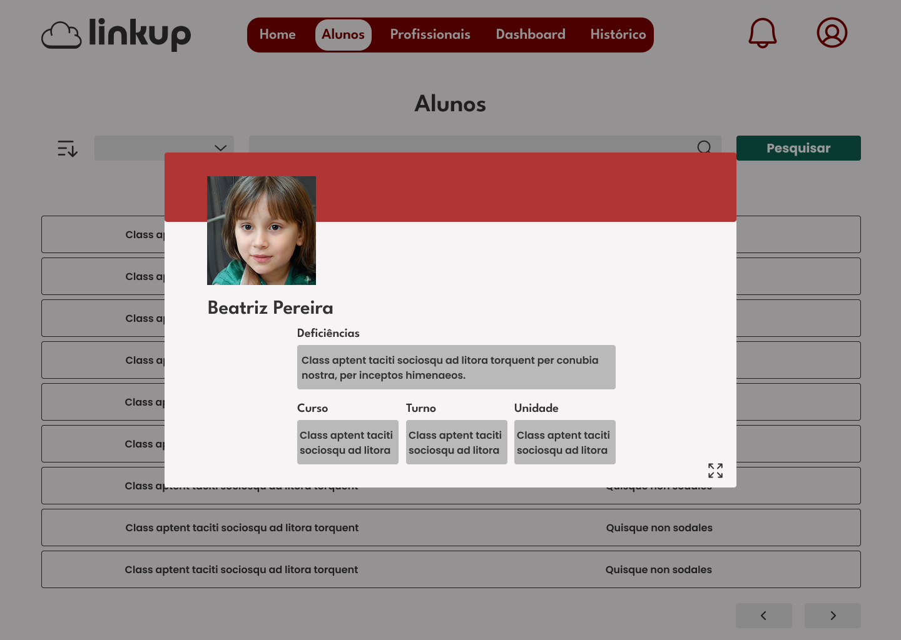 
Fonte: Material produzido pelos autores (2025)

### 7.2.1.4 Dashboard Estatístico

&nbsp;&nbsp;&nbsp;&nbsp; O dashboard foi projetado para oferecer uma visão geral dos principais indicadores do sistema. Ele apresenta informações resumidas sobre o status do sistema, gráficos de desempenho e acesso rápido a áreas importantes, como profissionais, alunos, histórico e documentos.

&nbsp;&nbsp;&nbsp;&nbsp; Os gráficos foram desenvolvidos para exibir informações de maneira clara e dinâmica, permitindo que o usuário compreenda rapidamente os dados representados. Além disso, há um painel lateral que proporciona acesso rápido a funcionalidades do sistema.

Figura X - Dashboard Estatístico 
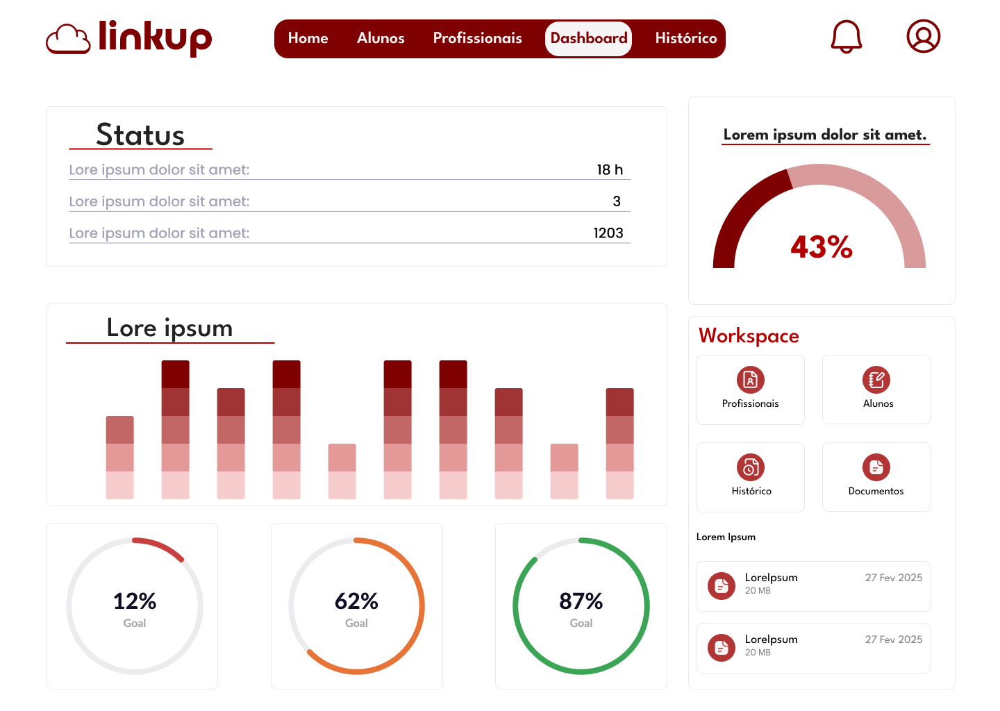 
Fonte: Material produzido pelos autores (2025)

&nbsp;&nbsp;&nbsp;&nbsp; Essas telas demonstram a funcionalidade do sistema, que torna a navegação intuitiva e ajuda o usuário a acessarem informações relevantes de forma simples. A implementação dessas telas busca uma experiência mais fluida e dinâmica para o usuário, o que facilita a gestão dos alunos e atendimentos a ser realizada de maneira clara e organizada. Além disso, essas novas funcionalidades criam uma base sólida para futuras melhorias, permitindo que o sistema continue evoluindo para atender as necessidades do usuário de maneira mais completa.

## 7.3 Guia Visual

&emsp;O _Guia Visual_, documento que define a identidade visual do projeto, foi desenvolvido utilizando a ferramenta [Figma](https://www.figma.com/). Nele, foram estabelecidas diretrizes como tipografia, paleta de cores e ícones, garantindo consistência no design. Além disso, o _Guia de Estilos_ criado possibilita a padronização de elementos gráficos em toda a aplicação. Tudo pode ser visualizado [neste link](https://www.figma.com/design/Dh3whOUONs9F1R0HpX1jlH/LinkUp?node-id=93-1096&t=1arFbCPYQBf12Gm1-1).  

Abaixo estão imagens de algumas seções dos componentes do guia.

### 7.3.1 Tipografia

&emsp;As fontes escolhidas foram Poppins e League Spartan, combinando modernidade e legibilidade. Poppins traz um visual versátil e profissional, enquanto League Spartan, com seu estilo geométrico, adiciona personalidade e impacto ao design do projeto.

Figura X - Tipografia Poppins 
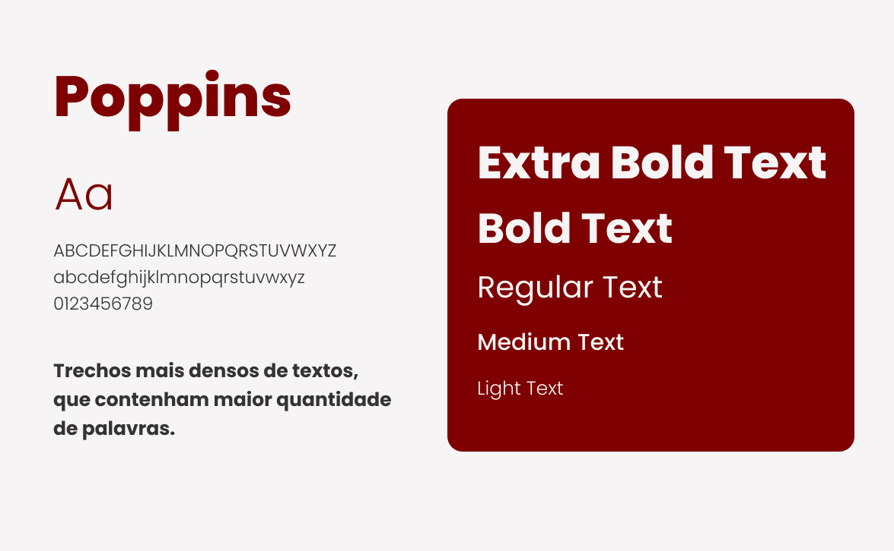 
Fonte: Material produzido pelos autores (2025)

Figura X - Tipografia League Spartan 
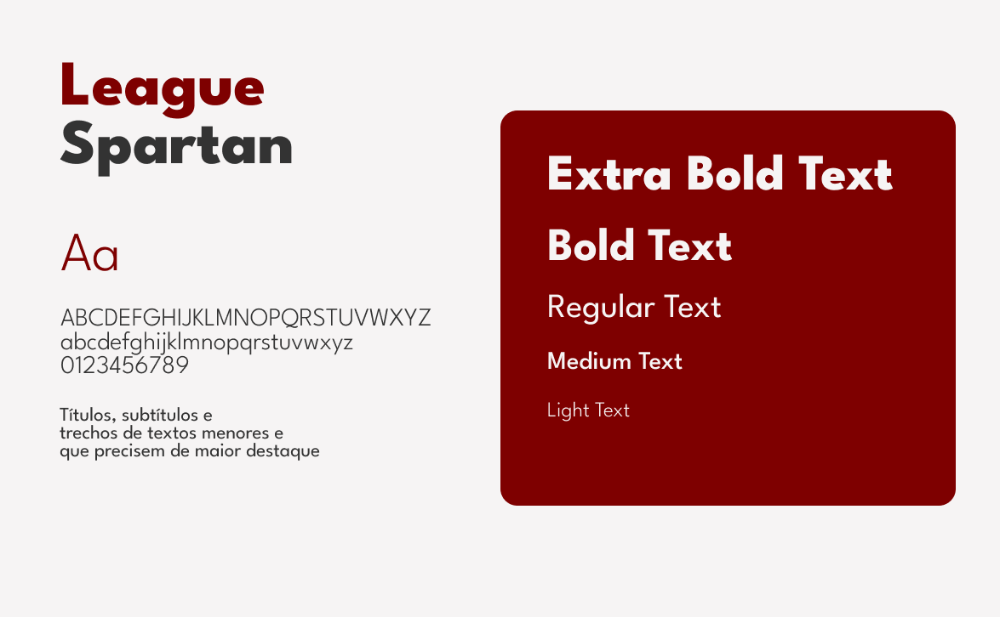 
Fonte: Material produzido pelos autores (2025)

### 7.3.2 Paleta de Cores

&emsp;Criamos um branding exclusivo para o LinkUp, inspirado na identidade visual do Centro Paula Souza, especialmente nos tons de vermelho. Equilibramos tradição e inovação com um design moderno e monocromático, garantindo harmonia visual e acessibilidade.

Figura X - Cores Utilizadas 
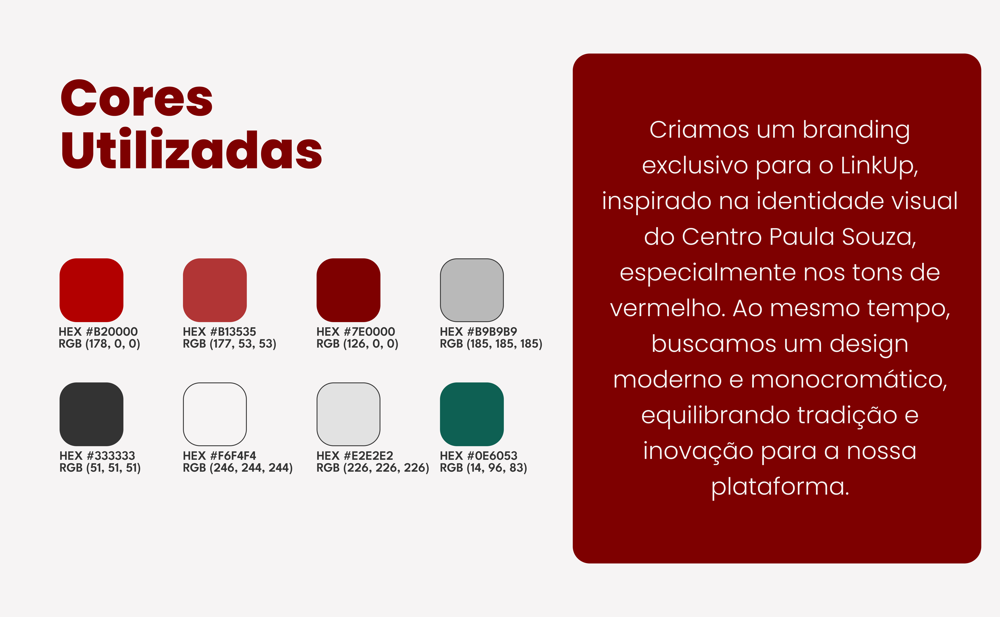 
Fonte: Material produzido pelos autores (2025)

Figura X - Aplicação das Cores 
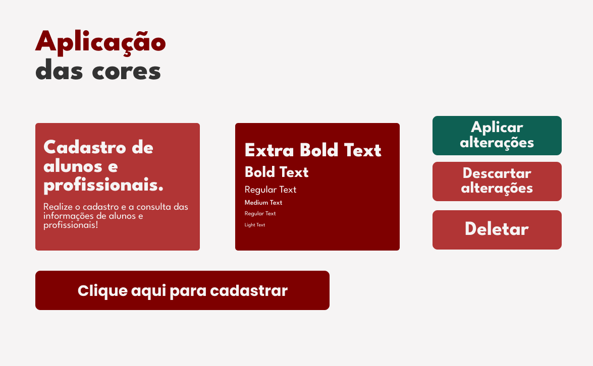 
Fonte: Material produzido pelos autores (2025)

&emsp;A imagem acima apresenta exemplos de aplicação das cores em diferentes elementos da interface, como botões e componentes. Essa padronização garante consistência visual, facilitando a navegação e reforçando a identidade do projeto.

# 8. Desenvolvimento do Projeto

_conteúdo_

## 8.1 Arquitetura de Codificação e Estrutura de Diretórios

_conteúdo_

## 8.2 Desenvolvimento de Features

&nbsp;&nbsp;&nbsp;&nbsp;Cada Sprint entrega um conjunto de funcionalidades incrementais e testadas, permitindo a evolução contínua do sistema. A Sprint 3 focou na implementação e integração de funcionalidades essenciais para a gestão de usuários e profissionais.

<a href="https://drive.google.com/file/d/1ooYFw8dt1JtjlphX6Dx-DK80j-JlKJMt/view?usp=sharing">Assista ao vídeo de demonstração da Sprint 3</a>

## 8.2.1 Sprint 3

### Overview do Desenvolvimento

&nbsp;&nbsp;&nbsp;&nbsp;Nesta Sprint, foram desenvolvidas e integradas funcionalidades fundamentais para o backend e frontend do sistema. O foco principal foi a criação de um fluxo básico de usuários e profissionais, garantindo a estruturação inicial do projeto.

### Backend
- Implementação do CRUD completo para Profissionais, permitindo criação, leitura, atualização e remoção de registros.
- Integração do cadastro de usuários ao banco de dados, possibilitando a criação de contas e autenticação.
- Conexão com um banco de dados hospedado na Aiven, um provedor gratuito de MySQL utilizado para testes. A AWS será considerada para o futuro ambiente de produção.

### Frontend
- Desenvolvimento das principais páginas e funcionalidades da interface, incluindo:
  - Página inicial (Home)
  - Página de login
  - Cadastro de usuários
  - Listagem e cadastro de profissionais
- Integração do frontend com o backend para consumo das APIs de usuários e profissionais.

### Próximos Passos
- Melhorar a estrutura e a escalabilidade da aplicação visando a migração futura do banco de dados para a AWS.
- Refinamento da interface do usuário para melhor experiência e usabilidade.
- Implementação de testes para garantir a estabilidade das funcionalidades desenvolvidas.
=======
_conteúdo_

## 8.2.2 Sprint 4

_conteúdo_

## 8.2.3 Sprint 5

_conteúdo_

## 8.3 Testes Unitários e de Integração

### 8.3.1 Testes Unitários
#### 8.3.1.1 Relatório de cobertura de testes

Este documento apresenta o relatório de cobertura de testes gerado pelo **Jest**, detalhando a cobertura de código por diretório e arquivo.

##### Resumo da Cobertura

| Diretório/Arquivo         | % Stmts | % Branch | % Funcs | % Lines | Linhas não cobertas |
|---------------------------|---------|----------|---------|---------|----------------------|
| **Todos os arquivos**     | **98.83** | **90.47** | **100** | **100** | - |
| **controllers/**          | **100**  | **100**   | **100** | **100** | - |
| ├── `ProfissionalController.ts` | 100 | 100 | 100 | 100 | - |
| **models/**               | **96.29** | **71.42** | **100** | **100** | - |
| ├── `Profissional.ts`     | 96.29 | 71.42 | 100 | 100 | 26-59 |
| **utils/**                | **100**  | **100**   | **100** | **100** | - |
| ├── `asyncHandler.ts`     | 100 | 100 | 100 | 100 | - |

Fonte: Relatório gerado automaticamente pelo Jest

#### Análise

- **Controllers:** O diretório `controllers/` possui **100%** de cobertura em todos os critérios, indicando que todos os trechos de código foram testados.

- **Models:** O diretório `models/` possui **96.29%** de cobertura de instruções e **71.42%** de cobertura de branches. O arquivo `Profissional.ts` apresenta algumas linhas não testadas no intervalo **26-59**. Essas linhas na verdade representam parte do repositório, que é uma simulação do banco de dados.
- **Utils:** O diretório `utils/` também possui **100%** de cobertura, garantindo que todas as funções auxiliares foram devidamente testadas.

#### 8.3.1.2 Conclusão e Próximos Passos

- A cobertura geral é **excelente** (**98.83%** de instruções e **100%** de funções).
- Manter a cobertura alta ao adicionar novas funcionalidades e refatorações.

#### 8.3.1.3 Execução dos Testes

A execução dos testes unitários utilizaram do Jest. O passo a passo para executar os testes é:

1. Abra o terminal ou PowerShell
2. Acesse a pasta /src/backend do repositório com o comando `cd <path_to_repo>/src/backend`
3. Instale e atualize os pacotes com `npm install`
4. Execute os testes através do comando `npm test`

Todos os testes executados passaram e estão representados na imagem abaixo: 

Figura X - Execução dos Testes no Terminal 
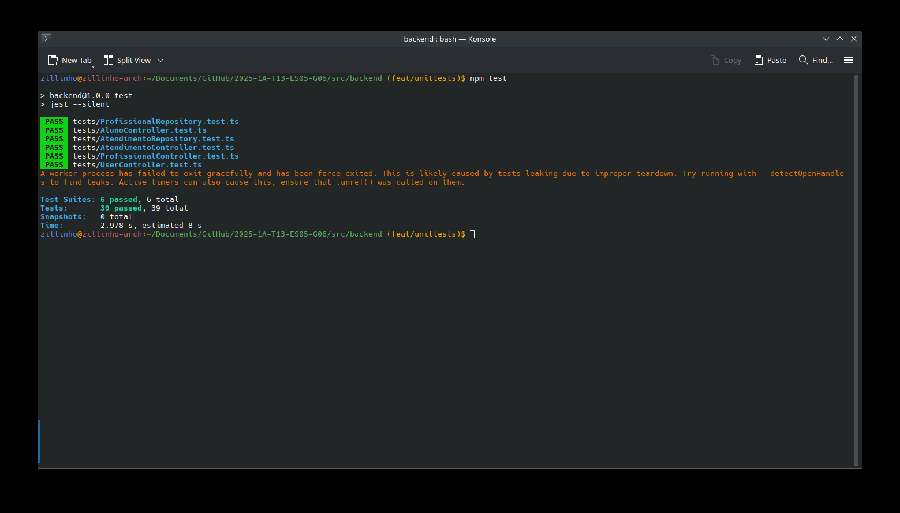 
Fonte: Material produzido pelos autores (2025)

## 8.4 Documentações automáticas

_conteúdo_

# 9. Planejamento e Execução de Testes

&nbsp;&nbsp;&nbsp;&nbsp; O planejamento e a execução de testes são essenciais para garantir a qualidade, confiabilidade e usabilidade do sistema. Para isso, serão realizados testes funcionais, não funcionais e de usabilidade, abrangendo desde a verificação das funcionalidades até a avaliação do desempenho, segurança e experiência do usuário. 

&nbsp;&nbsp;&nbsp;&nbsp; O planejamento e a execução de testes garantem que o sistema atenda aos requisitos definidos e seja utilizável pelos diferentes perfis de usuários. Os testes foram organizados em categorias funcionais, não funcionais e de usabilidade, considerando a técnica do funil [(saiba mais)](https://www.nngroup.com/articles/the-funnel-technique-in-qualitative-user-research/).

## 9.1 Testes Funcionais

 Os testes funcionais validam o comportamento esperado do sistema com base nos **Requisitos Funcionais (RFs)** estabelecidos. O objetivo desses testes é garantir que todas as funcionalidades atendam aos requisitos de negócio e projeto, verificando a correção das operações realizadas, o fluxo dos dados e a resposta do sistema em diferentes cenários.

Os testes foram planejados com casos positivos e negativos, cobrindo diferentes contextos de uso. Cada teste apresenta:
- **O requisito funcional associado**
- **Uma descrição detalhada do teste**
- **As pré-condições necessárias**
- **Os critérios de aceitação**
- **Os critérios de falha**

Os resultados desses testes permitirão validar o funcionamento correto do sistema antes da sua entrega.

### **9.1.1 Planejamento**

A tabela a seguir apresenta os testes planejados para validar os **Requisitos Funcionais (RFs)** do sistema.

| Caso de Teste | RF#   | Descrição do Teste | Pré-condição | Caso de Aceite | Caso de Recusa |
|--------------|------|------------------|--------------|----------------|----------------|
| **CT001** | **RF001** | Testar o cadastro de um novo profissional. | O sistema está online e o usuário tem permissão para cadastrar profissionais. | O profissional é cadastrado com sucesso e aparece na lista de profissionais. | O sistema exibe uma mensagem de erro ou nada acontece após tentar cadastrar. |
| **CT002** | **RF002** | Testar a associação de um aluno a um profissional. | O aluno e o profissional já estão cadastrados no sistema. | A associação é criada com sucesso e aparece na lista de associações. | O sistema exibe uma mensagem de erro ou nada acontece após tentar associar. |
| **CT003** | **RF003** | Testar a exibição do dashboard de BI. | O sistema possui dados de alunos, unidades e gestão. | O dashboard é exibido com gráficos e tabelas atualizados. | O dashboard não é exibido ou os dados estão incorretos. |
| **CT004** | **RF004** | Testar o acompanhamento de um aluno com deficiência. | O aluno e o profissional já estão cadastrados e associados. | O histórico e o status do aluno são exibidos corretamente. | O sistema exibe uma mensagem de erro ou dados incorretos. |
| **CT005** | **RF005** | Testar a autenticação de um usuário. | O usuário possui credenciais válidas. | O usuário é autenticado com sucesso e tem acesso às funcionalidades permitidas. | O sistema exibe uma mensagem de erro ou o acesso é negado. |
| **CT006** | **RF006** | Testar a edição de perfil de um usuário. | O usuário está autenticado e possui permissão para editar o perfil. | As informações do perfil são atualizadas com sucesso. | O sistema exibe uma mensagem de erro ou as informações não são atualizadas. |
| **CT007** | **RF007** | Testar a pesquisa de alunos e profissionais. | O sistema possui dados de alunos e profissionais cadastrados. | Os resultados da pesquisa são exibidos corretamente. | O sistema exibe uma mensagem de erro ou resultados incorretos. |
| **CT008** | **RF008** | Testar a visualização do histórico de alterações. | O sistema possui registros de alterações. | O histórico de alterações é exibido corretamente. | O sistema exibe uma mensagem de erro ou o histórico não é exibido. |

Cada caso de teste será executado considerando **cenários positivos e negativos**, garantindo que o sistema se comporte corretamente em diferentes condições.

## 9.1.2 Resultados

_conteúdo_

## 9.2 Testes de RNFs

Os testes de requisitos não funcionais validam aspectos de **desempenho, acessibilidade, segurança, compatibilidade e confiabilidade** do sistema, garantindo que ele funcione corretamente além das suas funcionalidades básicas.

Os testes planejados cobrem:
- **Eficiência de desempenho**: Tempo de resposta do sistema sob diferentes cargas.
- **Usabilidade e acessibilidade**: Uso adequado por pessoas com deficiência visual e operacionalidade eficiente.
- **Segurança**: Proteção de dados, autenticação e níveis de acesso.
- **Compatibilidade**: Funcionamento correto em múltiplos navegadores e integração com APIs externas.
- **Confiabilidade**: Disponibilidade do sistema e sua capacidade de recuperação de falhas.

Cada teste inclui:
- **O requisito não funcional associado**
- **Uma descrição detalhada do teste**
- **As pré-condições necessárias**
- **Os critérios de aceitação**
- **Os critérios de falha**

## 9.2.1 Planejamento

&nbsp;&nbsp;&nbsp;&nbsp;A tabela a seguir apresenta os testes planejados para validar os **Requisitos Não Funcionais (RNFs)** do sistema.

| Caso de Teste | RNF#   | Descrição do Teste | Pré-condição | Caso de Aceite | Caso de Recusa |
|--------------|------|------------------|--------------|----------------|----------------|
| **CT-001** | **RNF01** | Testar o tempo de resposta para consultas de dados. | O sistema está operando com carga normal e sob estresse. | Consultas são feitas em menos de 0,8 segundo. | Consultas excedem 0,8 segundo de tempo de resposta. |
| **CT-002** | **RNF02** | Testar usabilidade com leitor de tela e acessibilidade. | O leitor de tela está ativado. | Usuário com deficiência consegue usar a aplicação sem dificuldades. | Usuário com deficiência não consegue utilizar a aplicação. |
| **CT-003** | **RNF03** | Testar se o assessor encontra alunos e profissionais com, no máximo, 3 cliques. | Usuário assessor logado no sistema. | Usuário encontra alunos e profissionais com até 3 cliques. | Usuário precisa de mais de 3 cliques para encontrar alunos e profissionais. |
| **CT-004** | **RNF04** | Testar níveis de acesso dos usuários para garantir segurança. | Perfis de usuários criados com permissões diferenciadas. | Cada tipo de login acessa apenas suas funcionalidades. | Um tipo de login acessa informações de outro perfil. |
| **CT-005** | **RNF05** | Testar segurança da transmissão de dados contra interceptação. | O sistema está em funcionamento normal. | O invasor não consegue obter os dados brutos. | O invasor consegue acessar os dados brutos. |
| **CT-006** | **RNF06** | Testar a modularidade e documentação do código ao adicionar uma nova funcionalidade. | O código está modularizado e documentado. | A funcionalidade é adicionada sem impactar outras partes do sistema. | A adição da funcionalidade gera erros nas demais funções. |
| **CT-007** | **RNF07** | Testar funcionamento da aplicação nos navegadores Chrome, Firefox, Edge e Safari. | A aplicação está acessível nos navegadores testados. | A aplicação funciona integralmente em todos os navegadores. | A aplicação apresenta falhas em um ou mais navegadores. |
| **CT-008** | **RNF08** | Monitorar a disponibilidade do sistema ao longo do tempo. | O sistema está em produção. | A aplicação mantém disponibilidade de 99,5% ou mais. | O sistema fica fora do ar por mais tempo que o permitido. |
| **CT-009** | **RNF09** | Testar exibição de mensagens claras em caso de erro. | O sistema está operando normalmente. | O sistema exibe mensagens de erro claras e compreensíveis. | O sistema não exibe mensagens ou elas são confusas. |
| **CT-010** | **RNF10** | Testar atualização simultânea do mesmo dado em dois dispositivos. | Dois dispositivos acessando a aplicação ao mesmo tempo. | O sistema valida corretamente os dados e mantém a integridade. | A aplicação permite atualizações incorretas ou inconsistentes. |
| **CT-011** | **RNF11** | Testar a integração com a API do Centro Paula Souza. | O sistema está online e a API do Centro Paula Souza está disponível. | Os dados dos alunos são retornados corretamente e sem erros. | O sistema exibe uma mensagem de erro informando falha na integração. |
| **CT-012** | **RNF12** | Testar o backup automático de dados. | O sistema está configurado para realizar backups periódicos. | O backup ocorre na frequência estabelecida e pode ser restaurado corretamente. | O sistema não realiza o backup ou os dados não podem ser restaurados. |
| **CT-013** | **RNF13** | Testar os requisitos de acessibilidade (WCAG). | O sistema está implementado conforme as diretrizes WCAG. | Usuários com deficiência conseguem utilizar a aplicação sem barreiras. | O sistema apresenta dificuldades de navegação ou acessibilidade deficiente. |

&nbsp;&nbsp;&nbsp;&nbsp;Os testes planejados garantem que o sistema atenda aos requisitos de **desempenho, usabilidade, segurança e confiabilidade**, assegurando sua **eficiência, acessibilidade e estabilidade**.

## 9.2.2 Resultados

_conteúdo_

## 9.3 Testes de Usabilidade

&nbsp;&nbsp;&nbsp;&nbsp; Os testes serão conduzidos com diferentes perfis de usuários, incluindo gestores administrativos, gestores de unidade e assessores, além de considerarem acessibilidade para pessoas com deficiência visual que utilizam leitores de tela.

&nbsp;&nbsp;&nbsp;&nbsp; Os testes de usabilidade seguem o modelo de **teste de caixa preta** e são exclusivamente qualitativos, focando na interação dos usuários com o sistema e na identificação de dificuldades durante a execução de tarefas.

&nbsp;&nbsp;&nbsp;&nbsp; Os resultados permitirão identificar dificuldades e ajustar o sistema conforme as necessidades dos perfis testados. Os principais critérios avaliados são:

- **Eficácia**: Mede a taxa de sucesso na execução de uma tarefa. Um teste eficaz verifica se o usuário conseguiu concluir a tarefa sem erros ou interrupções.
- **Eficiência**: Avalia o esforço necessário para completar uma tarefa, considerando tempo e recursos utilizados.
- **Satisfação**: Reflete a percepção do usuário sobre a facilidade e conforto na execução da tarefa.

## 9.3.1 Planejamento

&nbsp;&nbsp;&nbsp;&nbsp; Os testes foram estruturados para representar situações reais de uso, considerando diferentes perfis de usuários e cenários aplicáveis.

#### 9.3.1.1 Definir o Público-Alvo

&nbsp;&nbsp;&nbsp;&nbsp; Os testes serão realizados com:

- **Gestor Administrativo (GA):** Usuário responsável pelo gerenciamento geral do sistema.
- **Gestor Unidade (GU):** Usuário que administra uma unidade específica e gerencia os atendimentos.
- **Assessor:** Profissional responsável pelo acompanhamento e execução dos atendimentos.
- **Usuários com deficiência visual:** Todos os testes serão conduzidos considerando acessibilidade via leitores de tela.

#### 9.3.1.2 Roteiro de Testes por Tipo de Usuário

&nbsp;&nbsp;&nbsp;&nbsp; Os testes foram classificados conforme os critérios de **eficácia, eficiência e satisfação**, descritos no planejamento.

### **Roteiro de Testes para Gestor Administrativo (GA)**

| Passo | Atividade | Critério Avaliado | Pergunta ao Usuário |
|-------|-----------|-------------------|----------------------|
| 1 | Acessar a Home e verificar os menus e atalhos. | Eficiência | Os menus estão organizados de forma intuitiva? |
| 2 | Cadastrar um novo profissional. | Eficácia | O processo de cadastro foi concluído sem dificuldades? Agora cadastre um novo profissional. |
| 3 | Filtrar profissionais por unidade e cargo. | Eficiência | Os filtros retornaram os resultados esperados? Agora filtre os profissionais da unidade XPTO. |
| 4 | Consultar atendimentos registrados no sistema. | Eficácia | As informações do atendimento estão bem organizadas? Agora encontre o aluno XPTO. |
| 5 | Testar uso com leitor de tela. | Satisfação | Você conseguiu navegar sem dificuldades usando o leitor de tela? |

### **Roteiro de Testes para Gestor Unidade (GU)**

| Passo | Atividade | Critério Avaliado | Pergunta ao Usuário |
|-------|-----------|-------------------|----------------------|
| 1 | Navegar entre os menus da unidade. | Eficiência | A interface é intuitiva? Agora navegue até a seção de relatórios. |
| 2 | Cadastrar um novo aluno. | Eficácia | O cadastro do aluno foi direto? Agora cadastre um aluno chamado XPTO. |
| 3 | Vincular um profissional a um atendimento. | Eficácia | A vinculação do profissional foi simples? Agora vincule o aluno XPTO a um profissional. |
| 4 | Avaliar a usabilidade do Dashboard. | Eficiência | As informações do Dashboard foram fáceis de interpretar? |
| 5 | Testar navegação com leitor de tela. | Satisfação | O sistema ofereceu uma boa experiência de acessibilidade? |

### **Roteiro de Testes para Assessor**

| Passo | Atividade | Critério Avaliado | Pergunta ao Usuário |
|-------|-----------|-------------------|----------------------|
| 1 | Filtrar atendimentos por aluno. | Eficiência | Foi fácil encontrar o atendimento desejado? Agora encontre o atendimento do aluno XPTO. |
| 2 | Criar um novo atendimento e adicionar observações. | Eficácia | O sistema permitiu adicionar informações sem dificuldades? Agora registre um novo atendimento. |
| 3 | Editar um atendimento existente. | Eficácia | O processo de edição foi intuitivo? Agora edite um atendimento existente. |
| 4 | Preencher formulários na interface. | Eficiência | O preenchimento foi rápido e eficiente? |
| 5 | Utilizar leitor de tela. | Satisfação | Houve alguma dificuldade ao usar o leitor de tela? |

#### 9.3.1.3 Perguntas para Entrevista Pós-Teste

Cada participante responderá perguntas estruturadas sobre a usabilidade do sistema:

1. A interface foi intuitiva e de fácil navegação?
2. Alguma funcionalidade apresentou dificuldades de uso?
3. O sistema apresentou informações claras e compreensíveis?
4. Para usuários com deficiência visual, houve barreiras de acessibilidade?
5. O sistema é parecido com algum já utilizado por vocês no Centro Paula Souza?
6. Dessas atividades que você realizou no teste, qual você acredita que realizaria com mais frequência na sua rotina de trabalho?
7. O que poderia ser melhorado para tornar a experiência mais eficiente?

## 9.3.2 Resultados

_conteúdo_

# 10. Procedimentos de Implantação

_conteúdo_

## 10.1 Implantação e Configuração do Banco de Dados

_conteúdo_

## 10.2 Implantação do Protótipo para uso por equipe de desenvolvimento

_conteúdo_

# Referências

_conteúdo_
