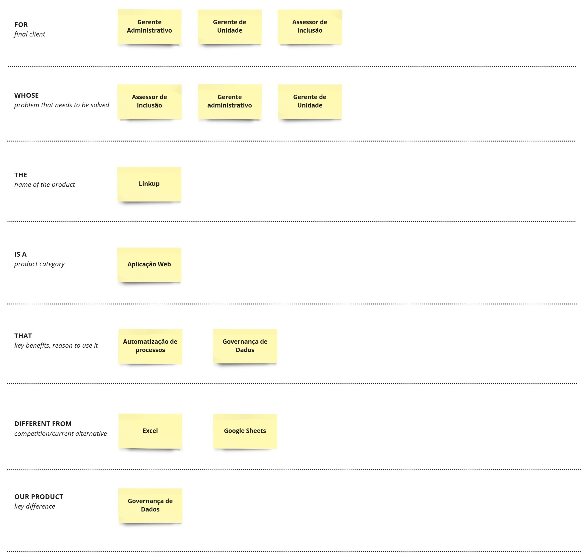
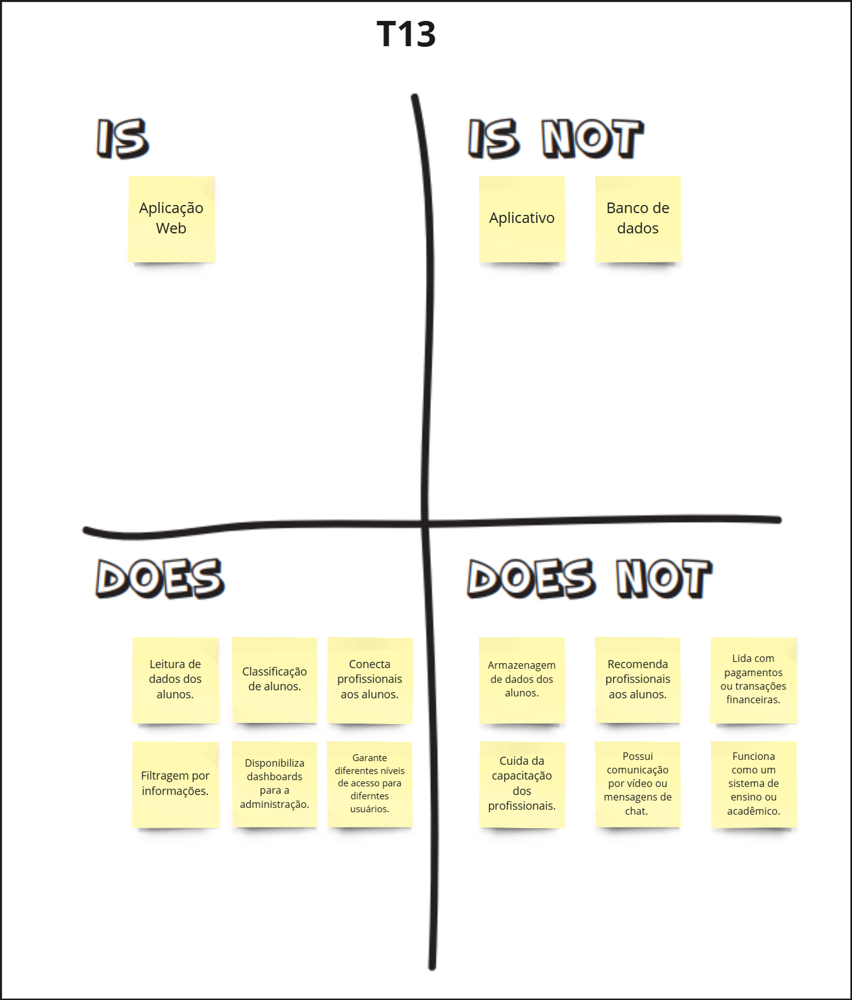
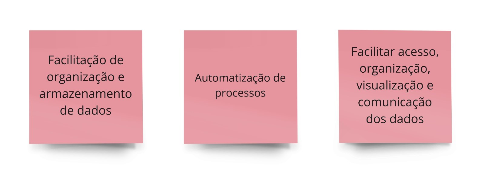
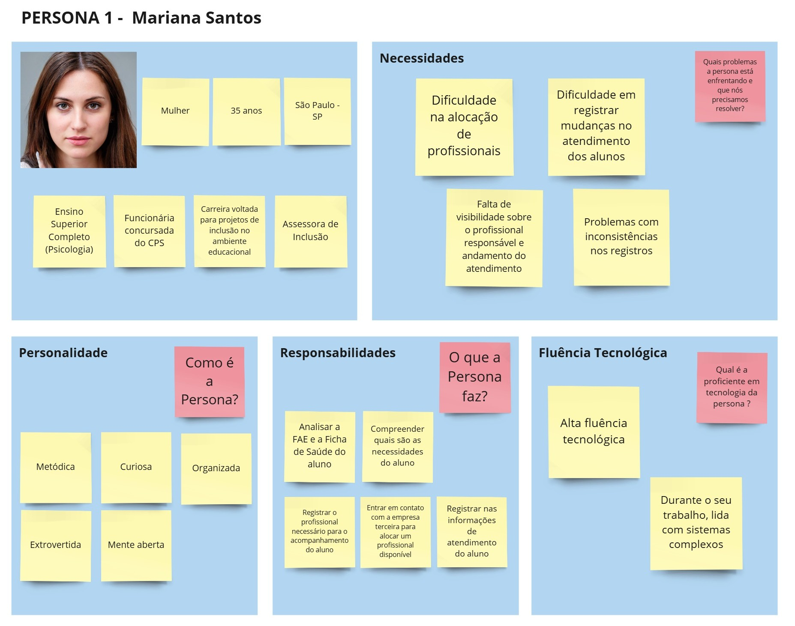
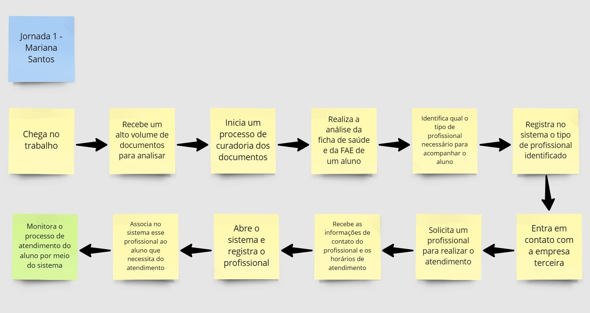
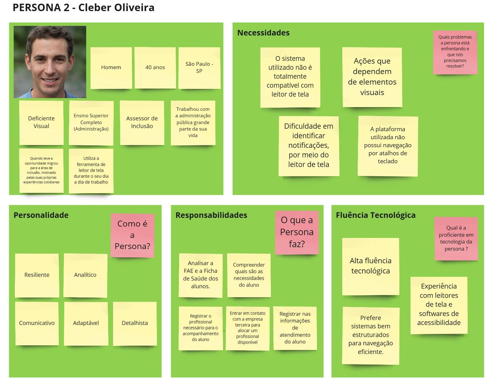
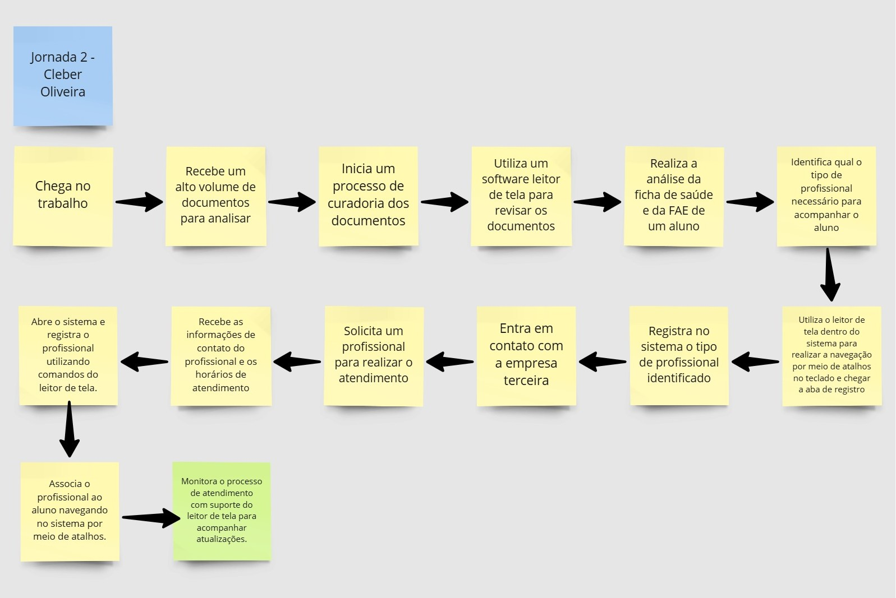
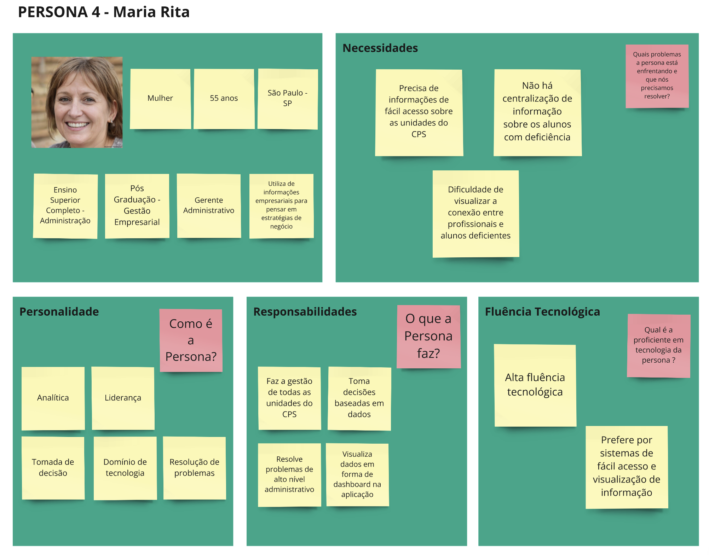

<Table>
  <tr>
    <td><a href= "https://www.cps.sp.gov.br/"></td>
    <td>
      
    </td>
  </tr>
</table>

# Nome do Projeto: <nome do projeto>

## Nome do Grupo: <nome do grupo>

## Integrantes:

- <a href="https://www.linkedin.com/in/username/">Nome</a>
- <a href="https://www.linkedin.com/in/username/">Nome</a>
- <a href="https://www.linkedin.com/in/username/">Nome</a>
- <a href="https://www.linkedin.com/in/username/">Nome</a>
- <a href="https://www.linkedin.com/in/username/">Nome</a>
- <a href="https://www.linkedin.com/in/username/">Nome</a>
- <a href="https://www.linkedin.com/in/username/">Nome</a>

# Sumário

- [1. Introdução](#1-introdução)
  - [1.1 Termos e Abreviações](#11-termos-e-abreviações)
  - [1.2 Objetivo do Documento](#12-objetivo-do-documento)
- [2. Entendimento do Projeto e do Negócio](#2-entendimento-do-projeto-e-do-negócio)
  - [2.1 Contexto da Indústria do Parceiro](#21-contexto-da-indústria-do-parceiro)
  - [2.2 Problema](#22-problema)
  - [2.3 Visão do Projeto e do Produto](#23-visão-do-projeto-e-do-produto)
  - [2.4 Personas e Jornada do Usuário](#24-personas-e-jornada-do-usuário)
  - [2.5 Modelagem do Fluxo de Negócio](#25-modelagem-do-fluxo-de-negócio)
    - [2.5.1 Fluxo de Negócio Atual (AS-IS)](#251-fluxo-de-negócio-atual-as-is)
    - [2.5.2 Fluxo de Negócio Proposto (TO-BE)](#252-fluxo-de-negócio-proposto-to-be)
  - [2.6 Matriz de Risco do Projeto](#26-matriz-de-risco-do-projeto)
  - [2.7 Ideação](#27-ideação)
    - [2.7.1 Brainstorming de features](#271-brainstorming-de-features)
    - [2.7.2 Sequenciamento/Priorização de entregas](#272-sequenciamentopriorização-de-entregas)
  - [2.8 Canvas do Projeto](#28-canvas-do-projeto)
- [3. Requisitos do Projeto](#3-requisitos-do-projeto)
  - [3.1 Requisitos Funcionais (RFs)](#31-requisitos-funcionais-rfs)
  - [3.2 Requisitos Não Funcionais (RNFs)](#32-requisitos-não-funcionais-rnfs)
  - [3.3 Correlação RFs e RNFs](#33-correlação-rfs-e-rnfs)
- [4. Modelagem de Dados](#4-modelagem-de-dados)
  - [4.1 Modelo Conceitual de Dados](#41-modelo-conceitual-de-dados)
  - [4.2 Modelo Lógico de Dados](#42-modelo-lógico-de-dados)
  - [4.3 Modelo Físico de Dados](#43-modelo-físico-de-dados)
- [5. Solução Técnica (Design)](#5-solução-técnica-design)
  - [5.1 Diagrama de Componentes da UML](#51-diagrama-de-componentes-da-uml)
  - [5.2 Diagramas de Sequência da UML](#52-diagramas-de-sequência-da-uml)
  - [5.3 Descrição Textual dos Diagramas](#53-descrição-textual-dos-diagramas)
- [6. Mapeamento Técnico de Infraestrutura e Implantação](#6-mapeamento-técnico-de-infraestrutura-e-implantação)
  - [6.1 Diagrama de Implantação da UML](#61-diagrama-de-implantação-da-uml)
  - [6.2 Justificativa das Escolhas de Implantação](#62-justificativa-das-escolhas-de-implantação)
  - [6.3 Considerações sobre Desempenho e Segurança](#63-considerações-sobre-desempenho-e-segurança)
- [7. Projeto Visual da Solução](#7-projeto-visual-da-solução)
  - [7.1 Desenvolvimento de Wireframes](#71-desenvolvimento-de-wireframes)
  - [7.2 Desenvolvimento de Mockups](#72-desenvolvimento-de-mockups)
  - [7.3 Guia Visual](#73-guia-visual)
- [8. Desenvolvimento do Projeto](#8-desenvolvimento-do-projeto)
  - [8.1 Arquitetura de Codificação e Estrutura de Diretórios](#81-arquitetura-de-codificação-e-estrutura-de-diretórios)
  - [8.2 Desenvolvimento de Features](#82-desenvolvimento-de-features)
    - [8.2.1 Sprint 3](#821-sprint-3)
    - [8.2.2 Sprint 4](#822-sprint-4)
    - [8.2.3 Sprint 5](#823-sprint-5)
  - [8.3 Testes Unitários e de Integração](#83-testes-unitários-e-de-integração)
  - [8.4 Documentações automáticas](#84-documentações-automáticas)
- [9. Planejamento e Execução de Testes](#9-planejamento-e-execução-de-testes)
  - [9.1 Testes Funcionais](#91-testes-funcionais)
    - [9.1.1 Planejamento](#911-planejamento)
    - [9.1.2 Resultados](#912-resultados)
  - [9.2 Testes de RNFs](#92-testes-de-rnfs)
    - [9.2.1 Planejamento](#921-planejamento)
    - [9.2.2 Resultados](#922-resultados)
  - [9.3 Testes de Usabilidade](#93-testes-de-usabilidade)
    - [9.3.1 Planejamento](#931-planejamento)
    - [9.3.2 Resultados](#932-resultados)
- [10. Procedimentos de Implantação](#10-procedimentos-de-implantação)
  - [10.1 Implantação e Configuração do Banco de Dados](#101-implantação-e-configuração-do-banco-de-dados)
  - [10.2 Implantação do Protótipo para uso por equipe de desenvolvimento](#102-implantação-do-protótipo-para-uso-por-equipe-de-desenvolvimento)
- [Referências](#referências)

# 1. Introdução
_conteúdo_

## 1.1 Termos e Abreviações
_conteúdo_

## 1.2 Objetivo do Documento
_conteúdo_

# 2. Entendimento do Projeto e do Negócio
_conteúdo_

## 2.1 Contexto da Indústria do Parceiro
O Centro Paula Souza está inserido na indústria da educação técnica e superior tecnológica, um setor estratégico para o desenvolvimento econômico e social. Com as Etecs (Escolas Técnicas) e Fatecs (Faculdades de Tecnologia), a instituição atende à crescente demanda por formação qualificada, alinhada às necessidades do mercado de trabalho local, com cursos que na maior parte das vezes estão alinhados com a maior necessidade produtiva do local da Fatec/Etec. A educação profissional vem se tornando cada vez mais importante diante das transformações tecnológicas e produtivas, como é o caso da digitalização de processos. Nesse contexto, as Etecs e Fatecs desempenham um papel fundamental na capacitação de profissionais para setores como tecnologia, indústria, gestão e serviços, contribuindo para a inovação e competitividade das empresas e para o fortalecimento da economia.

## 2.2 Problema
&emsp;O principal problema é a necessidade de um ambiente de gestão para os atendimentos realizados pela Assessoria de Inclusão do Centro Paula Souza. A ausência de um sistema integrado dificulta o controle das informações sobre os alunos atendidos, os profissionais responsáveis e os tipos de suporte prestados. O uso de formulários digitais e planilhas torna o processo suscetível a erros, inconsistências e falta de rastreabilidade, comprometendo a qualidade do acompanhamento. Além disso, a ausência de uma ferramenta de análise de dados impede uma visão estratégica sobre o impacto das ações realizadas, dificultando a tomada de decisão por parte dos gestores.

## 2.3 Visão do Projeto e do Produto
## 2.3.1 Visão do Produto
Criamos aplicação web que permite realizar o registro da conexão entre os alunos do Centro Paula Souza a profissionais especializados. Além disso, gestores acessam um dashboard com estatísticas detalhadas. O sistema facilita o acompanhamento e suporte a alunos com deficiência, promovendo inclusão.

Figura x - Visão do Produto 
 
Fonte: Material produzido pelos autores (2025) 

## 2.3.2 É - Não é - Faz - Não faz
Nosso projeto é uma aplicação web que permite realizar o registro da conexão entre os alunos do Centro Paula Souza a profissionais especializados. O sistema permite gerenciar profissionais e visualizar dados via dashboard. **Faz** gestão de associações e estatísticas. **Não faz** controle acadêmico. O Lean Inception ajudou a delimitar funcionalidades essenciais para tornar o produto eficiente.

Figura x - É - Não é - Faz - Não faz 
 
Fonte: Material produzido pelos autores (2025) 

## 2.3.3 Objetivos do Produto
A imagem representa os objetivos da solução: facilitar o acompanhamento de alunos com deficiência, garantir suporte especializado e fornecer estatísticas para gestão. Nossa plataforma possibilita associar alunos a profissionais, gerenciar dados e visualizar métricas estratégicas. O Business Intelligence embutido garante decisões informadas para gestores administrativos e unidades educacionais.

Figura x - Objetivos do Produto 
 
Fonte: Material produzido pelos autores (2025) 

## 2.4 Personas e Jornada do Usuário

## 2.4.1 Persona 1 - Mariana Santos
&nbsp;&nbsp;&nbsp;&nbsp;A seguir, apresenta-se a persona Mariana Santos, criada com base no workshop realizado com o parceiro. 

Figura x - Persona 1 - Mariana Santos 
 
Fonte: Material produzido pelos autores (2025) 

  
&nbsp;&nbsp;&nbsp;&nbsp;Além disso, segue abaixo a sua jornada do usuário durante o processo de alocação de profissionais.
  

Figura x - Jornada do Usuário - Mariana Santos 
 
Fonte: Material produzido pelos autores (2025) 

  
## 2.4.2 Persona 2 - Cleber Oliveira
&nbsp;&nbsp;&nbsp;&nbsp;A seguir, apresenta-se a persona Cleber Oliveira, criada com base no workshop realizado com o parceiro, buscando evidenciar a necessidade apresentada de um sistema compatível com um leitor de tela. 

Figura x - Persona 2 - Cleber Oliveira 
 
Fonte: Material produzido pelos autores (2025) 

&nbsp;&nbsp;&nbsp;&nbsp;Além disso, segue abaixo a sua jornada do usuário durante o processo de alocação de profissionais.

Figura x - Jornada do Usuário - Cleber Oliveira 
 
Fonte: Material produzido pelos autores (2025) 

## 2.4.4 Persona 4 - Maria Rita
&nbsp;&nbsp;&nbsp;&nbsp;A seguir, apresenta-se a persona Maria Rita, criada com base no workshop realizado com o parceiro, buscando evidenciar a necessidade apresentada de um dashboard com fácil visualização de dados com o objetivo de melhorar as decisões organizacionais.

Figura x - Persona 2 - Cleber Oliveira 
 
Fonte: Material produzido pelos autores (2025) 

&nbsp;&nbsp;&nbsp;&nbsp;Além disso, segue abaixo a sua jornada do usuário durante o processo visualização de dados por meio do dashboard.

Figura x - Jornada do Usuário - Cleber Oliveira 
 
Fonte: Material produzido pelos autores (2025) 

## 2.5 Modelagem do Fluxo de Negócio
_conteúdo_

## 2.5.1 Fluxo de Negócio Atual (AS-IS)
_conteúdo_

## 2.5.2 Fluxo de Negócio Proposto (TO-BE)
_conteúdo_

## 2.6 Matriz de Risco do Projeto
_conteúdo_

## 2.7 Ideação
_conteúdo_

## 2.7.1 Brainstorming de features
_conteúdo_

## 2.7.2 Sequenciamento/Priorização de entregas
_conteúdo_

## 2.8 Canvas do Projeto
_conteúdo_

# 3. Requisitos do Projeto
_conteúdo_

## 3.1 Requisitos Funcionais (RFs)
_conteúdo_ 

## 3.2 Requisitos Não Funcionais (RNFs)
_conteúdo_

## 3.3 Correlação RFs e RNFs
_conteúdo_

# 4. Modelagem de Dados
_conteúdo_

## 4.1 Modelo Conceitual de Dados
_conteúdo_

## 4.2 Modelo Lógico de Dados
_conteúdo_

## 4.3 Modelo Físico de Dados
_conteúdo_

**Nota:** Insira uma explicação e direcionamento para o readme.md da pasta database.

# 5. Solução Técnica (Design)
_conteúdo_

## 5.1 Diagrama de Componentes da UML
_conteúdo_

## 5.2 Diagramas de Sequência da UML
_conteúdo_

## 5.3 Descrição Textual dos Diagramas
_conteúdo_

# 6. Mapeamento Técnico de Infraestrutura e Implantação
_conteúdo_

## 6.1 Diagrama de Implantação da UML
_conteúdo_

## 6.2 Justificativa das Escolhas de Implantação
_conteúdo_

## 6.3 Considerações sobre Desempenho e Segurança
_conteúdo_

# 7. Projeto Visual da Solução
_conteúdo_

## 7.1 Desenvolvimento de Wireframes
_conteúdo_

## 7.2 Desenvolvimento de Mockups
_conteúdo_

## 7.3 Guia Visual
_conteúdo_

# 8. Desenvolvimento do Projeto
_conteúdo_

## 8.1 Arquitetura de Codificação e Estrutura de Diretórios
_conteúdo_

## 8.2 Desenvolvimento de Features
_conteúdo_

**Nota:** Insira uma explicação de entregas em cada Sprint.

## 8.2.1 Sprint 3
_conteúdo_

## 8.2.2 Sprint 4
_conteúdo_

## 8.2.3 Sprint 5
_conteúdo_

## 8.3 Testes Unitários e de Integração
_conteúdo_

## 8.4 Documentações automáticas
_conteúdo_

# 9. Planejamento e Execução de Testes
_conteúdo_

## 9.1 Testes Funcionais
_conteúdo_

## 9.1.1 Planejamento
_conteúdo_

## 9.1.2 Resultados
_conteúdo_

## 9.2 Testes de RNFs
_conteúdo_

## 9.2.1 Planejamento
_conteúdo_

## 9.2.2 Resultados
_conteúdo_

## 9.3 Testes de Usabilidade
_conteúdo_

## 9.3.1 Planejamento
_conteúdo_

## 9.3.2 Resultados
_conteúdo_

# 10. Procedimentos de Implantação
_conteúdo_

## 10.1 Implantação e Configuração do Banco de Dados
_conteúdo_

## 10.2 Implantação do Protótipo para uso por equipe de desenvolvimento
_conteúdo_

# Referências
_conteúdo_

