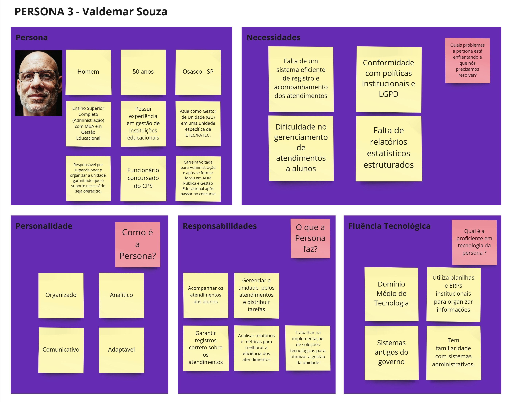
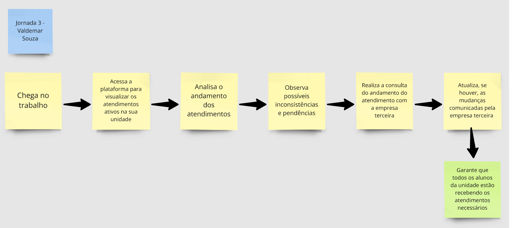
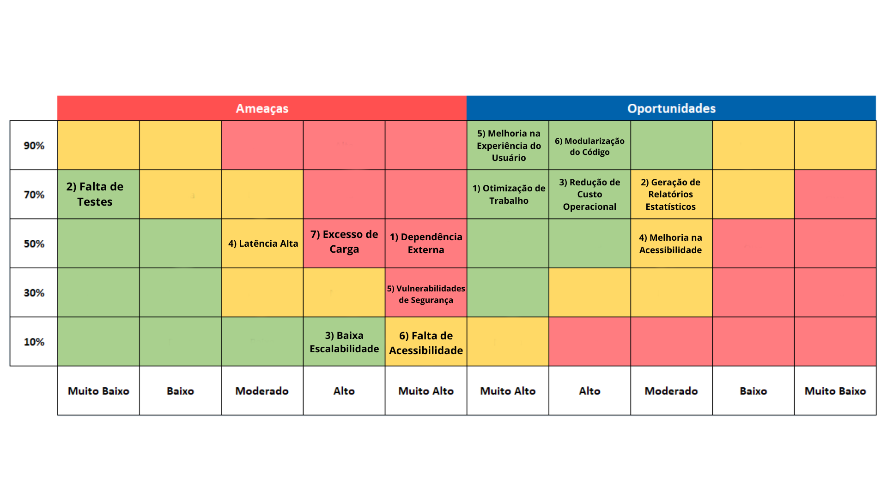
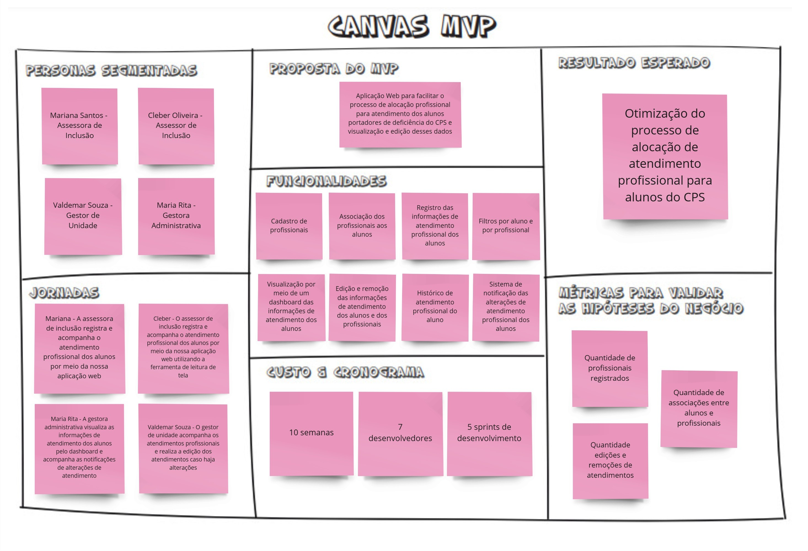

<Table>
  <tr>
    <td><a href= "https://www.cps.sp.gov.br/"></td>
    <td>
      
    </td>
  </tr>
</table>

# Nome do Projeto: <nome do projeto>

## Nome do Grupo: <nome do grupo>

## Integrantes:

- <a href="https://www.linkedin.com/in/username/">Nome</a>
- <a href="https://www.linkedin.com/in/username/">Nome</a>
- <a href="https://www.linkedin.com/in/username/">Nome</a>
- <a href="https://www.linkedin.com/in/username/">Nome</a>
- <a href="https://www.linkedin.com/in/username/">Nome</a>
- <a href="https://www.linkedin.com/in/username/">Nome</a>
- <a href="https://www.linkedin.com/in/username/">Nome</a>

# Sumário

- [1. Introdução](#1-introdução)
  - [1.1 Termos e Abreviações](#11-termos-e-abreviações)
  - [1.2 Objetivo do Documento](#12-objetivo-do-documento)
- [2. Entendimento do Projeto e do Negócio](#2-entendimento-do-projeto-e-do-negócio)
  - [2.1 Contexto da Indústria do Parceiro](#21-contexto-da-indústria-do-parceiro)
  - [2.2 Problema](#22-problema)
  - [2.3 Visão do Projeto e do Produto](#23-visão-do-projeto-e-do-produto)
  - [2.4 Personas e Jornada do Usuário](#24-personas-e-jornada-do-usuário)
  - [2.5 Modelagem do Fluxo de Negócio](#25-modelagem-do-fluxo-de-negócio)
    - [2.5.1 Fluxo de Negócio Atual (AS-IS)](#251-fluxo-de-negócio-atual-as-is)
    - [2.5.2 Fluxo de Negócio Proposto (TO-BE)](#252-fluxo-de-negócio-proposto-to-be)
  - [2.6 Matriz de Risco do Projeto](#26-matriz-de-risco-do-projeto)
  - [2.7 Ideação](#27-ideação)
    - [2.7.1 Brainstorming de features](#271-brainstorming-de-features)
    - [2.7.2 Sequenciamento/Priorização de entregas](#272-sequenciamentopriorização-de-entregas)
  - [2.8 Canvas do Projeto](#28-canvas-do-projeto)
- [3. Requisitos do Projeto](#3-requisitos-do-projeto)
  - [3.1 Requisitos Funcionais (RFs)](#31-requisitos-funcionais-rfs)
  - [3.2 Requisitos Não Funcionais (RNFs)](#32-requisitos-não-funcionais-rnfs)
  - [3.3 Correlação RFs e RNFs](#33-correlação-rfs-e-rnfs)
- [4. Modelagem de Dados](#4-modelagem-de-dados)
  - [4.1 Modelo Conceitual de Dados](#41-modelo-conceitual-de-dados)
  - [4.2 Modelo Lógico de Dados](#42-modelo-lógico-de-dados)
  - [4.3 Modelo Físico de Dados](#43-modelo-físico-de-dados)
- [5. Solução Técnica (Design)](#5-solução-técnica-design)
  - [5.1 Diagrama de Componentes da UML](#51-diagrama-de-componentes-da-uml)
  - [5.2 Diagramas de Sequência da UML](#52-diagramas-de-sequência-da-uml)
  - [5.3 Descrição Textual dos Diagramas](#53-descrição-textual-dos-diagramas)
- [6. Mapeamento Técnico de Infraestrutura e Implantação](#6-mapeamento-técnico-de-infraestrutura-e-implantação)
  - [6.1 Diagrama de Implantação da UML](#61-diagrama-de-implantação-da-uml)
  - [6.2 Justificativa das Escolhas de Implantação](#62-justificativa-das-escolhas-de-implantação)
  - [6.3 Considerações sobre Desempenho e Segurança](#63-considerações-sobre-desempenho-e-segurança)
- [7. Projeto Visual da Solução](#7-projeto-visual-da-solução)
  - [7.1 Desenvolvimento de Wireframes](#71-desenvolvimento-de-wireframes)
  - [7.2 Desenvolvimento de Mockups](#72-desenvolvimento-de-mockups)
  - [7.3 Guia Visual](#73-guia-visual)
- [8. Desenvolvimento do Projeto](#8-desenvolvimento-do-projeto)
  - [8.1 Arquitetura de Codificação e Estrutura de Diretórios](#81-arquitetura-de-codificação-e-estrutura-de-diretórios)
  - [8.2 Desenvolvimento de Features](#82-desenvolvimento-de-features)
    - [8.2.1 Sprint 3](#821-sprint-3)
    - [8.2.2 Sprint 4](#822-sprint-4)
    - [8.2.3 Sprint 5](#823-sprint-5)
  - [8.3 Testes Unitários e de Integração](#83-testes-unitários-e-de-integração)
  - [8.4 Documentações automáticas](#84-documentações-automáticas)
- [9. Planejamento e Execução de Testes](#9-planejamento-e-execução-de-testes)
  - [9.1 Testes Funcionais](#91-testes-funcionais)
    - [9.1.1 Planejamento](#911-planejamento)
    - [9.1.2 Resultados](#912-resultados)
  - [9.2 Testes de RNFs](#92-testes-de-rnfs)
    - [9.2.1 Planejamento](#921-planejamento)
    - [9.2.2 Resultados](#922-resultados)
  - [9.3 Testes de Usabilidade](#93-testes-de-usabilidade)
    - [9.3.1 Planejamento](#931-planejamento)
    - [9.3.2 Resultados](#932-resultados)
- [10. Procedimentos de Implantação](#10-procedimentos-de-implantação)
  - [10.1 Implantação e Configuração do Banco de Dados](#101-implantação-e-configuração-do-banco-de-dados)
  - [10.2 Implantação do Protótipo para uso por equipe de desenvolvimento](#102-implantação-do-protótipo-para-uso-por-equipe-de-desenvolvimento)
- [Referências](#referências)

# 1. Introdução
_conteúdo_

## 1.1 Termos e Abreviações
_conteúdo_

## 1.2 Objetivo do Documento
_conteúdo_

# 2. Entendimento do Projeto e do Negócio
_conteúdo_

## 2.1 Contexto da Indústria do Parceiro
O Centro Paula Souza está inserido na indústria da educação técnica e superior tecnológica, um setor estratégico para o desenvolvimento econômico e social. Com as Etecs (Escolas Técnicas) e Fatecs (Faculdades de Tecnologia), a instituição atende à crescente demanda por formação qualificada, alinhada às necessidades do mercado de trabalho local, com cursos que na maior parte das vezes estão alinhados com a maior necessidade produtiva do local da Fatec/Etec. A educação profissional vem se tornando cada vez mais importante diante das transformações tecnológicas e produtivas, como é o caso da digitalização de processos. Nesse contexto, as Etecs e Fatecs desempenham um papel fundamental na capacitação de profissionais para setores como tecnologia, indústria, gestão e serviços, contribuindo para a inovação e competitividade das empresas e para o fortalecimento da economia.

## 2.2 Problema
&emsp;O principal problema é a necessidade de um ambiente de gestão para os atendimentos realizados pela Assessoria de Inclusão do Centro Paula Souza. A ausência de um sistema integrado dificulta o controle das informações sobre os alunos atendidos, os profissionais responsáveis e os tipos de suporte prestados. O uso de formulários digitais e planilhas torna o processo suscetível a erros, inconsistências e falta de rastreabilidade, comprometendo a qualidade do acompanhamento. Além disso, a ausência de uma ferramenta de análise de dados impede uma visão estratégica sobre o impacto das ações realizadas, dificultando a tomada de decisão por parte dos gestores.

## 2.3 Visão do Projeto e do Produto
## 2.3.1 Visão do Produto
Criamos aplicação web que permite realizar o registro da conexão entre os alunos do Centro Paula Souza a profissionais especializados. Além disso, gestores acessam um dashboard com estatísticas detalhadas. O sistema facilita o acompanhamento e suporte a alunos com deficiência, promovendo inclusão.

Figura x - Visão do Produto 
 
Fonte: Material produzido pelos autores (2025) 

## 2.3.2 É - Não é - Faz - Não faz
Nosso projeto é uma aplicação web que permite realizar o registro da conexão entre os alunos do Centro Paula Souza a profissionais especializados. O sistema permite gerenciar profissionais e visualizar dados via dashboard. **Faz** gestão de associações e estatísticas. **Não faz** controle acadêmico. O Lean Inception ajudou a delimitar funcionalidades essenciais para tornar o produto eficiente.

Figura x - É - Não é - Faz - Não faz 
 
Fonte: Material produzido pelos autores (2025) 

## 2.3.3 Objetivos do Produto
A imagem representa os objetivos da solução: facilitar o acompanhamento de alunos com deficiência, garantir suporte especializado e fornecer estatísticas para gestão. Nossa plataforma possibilita associar alunos a profissionais, gerenciar dados e visualizar métricas estratégicas. O Business Intelligence embutido garante decisões informadas para gestores administrativos e unidades educacionais.

Figura x - Objetivos do Produto 
 
Fonte: Material produzido pelos autores (2025) 

## 2.4 Personas e Jornada do Usuário

## 2.4.1 Persona 1 - Mariana Santos
&nbsp;&nbsp;&nbsp;&nbsp;A seguir, apresenta-se a persona Mariana Santos, criada com base no workshop realizado com o parceiro. 

Figura x - Persona 1 - Mariana Santos 
 
Fonte: Material produzido pelos autores (2025) 

  
&nbsp;&nbsp;&nbsp;&nbsp;Além disso, segue abaixo a sua jornada do usuário durante o processo de alocação de profissionais.
  

Figura x - Jornada do Usuário - Mariana Santos 
 
Fonte: Material produzido pelos autores (2025) 

  
## 2.4.2 Persona 2 - Cleber Oliveira
&nbsp;&nbsp;&nbsp;&nbsp;A seguir, apresenta-se a persona Cleber Oliveira, criada com base no workshop realizado com o parceiro, buscando evidenciar a necessidade apresentada de um sistema compatível com um leitor de tela. 

Figura x - Persona 2 - Cleber Oliveira 
 
Fonte: Material produzido pelos autores (2025) 

&nbsp;&nbsp;&nbsp;&nbsp;Além disso, segue abaixo a sua jornada do usuário durante o processo de alocação de profissionais.

Figura x - Jornada do Usuário - Cleber Oliveira 
 
Fonte: Material produzido pelos autores (2025) 

## 2.4.3 Persona 3 - Valdemar Souza

&nbsp;&nbsp;&nbsp;&nbsp;A seguir, apresenta-se a persona Valdemar Souza, criada com base no workshop realizado com o parceiro, buscando evidenciar a necessidade apresentada de um sistema eficiente de gerenciamento de atendimentos, com relatórios estruturados.

Figura x - Persona 3 - Valdemar Souza 
 
Fonte: Material produzido pelos autores (2025) 

&nbsp;&nbsp;&nbsp;&nbsp;Além disso, segue abaixo a sua jornada do usuário durante o processo de gerenciamento dos atendimentos na unidade.

Figura x - Jornada do Usuário - Valdemar Souza 
 

## 2.4.4 Persona 4 - Maria Rita
&nbsp;&nbsp;&nbsp;&nbsp;A seguir, apresenta-se a persona Maria Rita, criada com base no workshop realizado com o parceiro, buscando evidenciar a necessidade apresentada de um dashboard com fácil visualização de dados com o objetivo de melhorar as decisões organizacionais.

Figura x - Persona 2 - Cleber Oliveira 
 
Fonte: Material produzido pelos autores (2025) 

&nbsp;&nbsp;&nbsp;&nbsp;Além disso, segue abaixo a sua jornada do usuário durante o processo visualização de dados por meio do dashboard.

Figura x - Jornada do Usuário - Cleber Oliveira 
 
Fonte: Material produzido pelos autores (2025) 

## 2.5 Modelagem do Fluxo de Negócio
_conteúdo_

## 2.5.1 Fluxo de Negócio Atual (AS-IS)
_conteúdo_

## 2.5.2 Fluxo de Negócio Proposto (TO-BE)
_conteúdo_

## 2.6 Matriz de Risco do Projeto

Figura X - Matriz de risco do projeto
 
 

 
 
Fonte: Material produzido pelo grupo LinkUp (2024)

| #   | Ameaças                                                      | Análise do Risco                                                               | Nível de Risco | Probabilidade de acontecer | Plano de Ação                                                                                                       |
| --- | ------------------------------------------------------------ | ------------------------------------------------------------------------------ | -------------- | -------------------------- | ------------------------------------------------------------------------------------------------------------------- |
| 01  | Mudanças nos Requisitos                                            | Podem causar retrabalho e atrasos  | Moderado           | 10%                        | Definir muito bem os requisitos do projeto, alinhando sempre com os stakeholders.                             |
| 02  | Dependência Externa | Caso haja problema na API externa, também haverá mal funcinoamento na aplicação.             | Muito Alto           | 50%                        | Criar uma página de instrução ao usuário para caso isso aconteça.                      |
| 03  | Falta de Testes                    | Devido ao curto prazo de entrega, os testes podem ser muito superficiais, podendo ter algum erro em uma parte da aplicação não coberta pelos testes.   | Muito Baixo     | 70%                        | Priorizar as partes essenciais do programa para a realização dos testes.                                           |
| 04  | Baixa Escalabilidade                 | Pode impedir o crescimento contínuo da solução ao ser implementada.      | Alto       | 10%                        | Projetar a solução de forma escalável, garantindo que possa suportar grandes volumes de usuários e dados.                                  |
| 05  | Atraso na Implementação                    | Atrasos podem ocorrer durante o desenvolvimento do projeto.    | Baixo       | 30%                        | Organizar o desenvolvimento e monitorá-lo com frequência, sempre definindo prazos realistas de entrega.                                   |
| 06  | Latência Alta                            | A lentidão pode causar perda de tempo dos colaboradores, o que é o oposto do que a solução busca.  | Moderado           | 50%                        | Implementar cache, processamento assíncrono e retries, tentando garantir uma experiência estável mesmo com a dependência da API externa.                                     |
| 07  | Vulnerabilidades de Cibersegurança   | Podem causar problemas com a justiça brasileira por conter dados pessoais.                               | Muito Alto          | 30%                        |  Aplicar boas práticas de segurança, como criptografia de dados e controle de acesso rigoroso. Além de utilizar ferramentas confiáveis de autenticação.                  |
| 08  | Falta de Acessibilidade   | Caso tenha algum colaborador com deficiência, pode não conseguir utilizar a aplicação.                               | Muito Alto          | 10%                        |  Desenvolver o sistema tendo como base a NBR ISO 9241-171 para que o sistema seja inclusivo.                 |
| 09  | Excesso de Carga   | Com muitos usuários simultâneos, o servidor pode ser sobrecarregado, causando falhas na aplicação.                              | Alto          | 50%                        |  Utilizar balanceamento de carga e arquitetura escalável para suportar picos de acesso.                  |

| #   | Oportunidades                                      | Análise da Oportunidade                                                                 | Nível de Oportunidade | Probabilidade de acontecer | Plano de Ação                                                                                    |
| --- | -------------------------------------------------- | --------------------------------------------------------------------------------------- | --------------------- | -------------------------- | ------------------------------------------------------------------------------------------------ |
| 01  | Otimização de Trabalho                | Colaboradores conseguirão realizar o trabalho mais rápido.                   | Muito Alto                  | 70%                        | Implementar formas de otimizar o desempenho da aplicação. |
| 02  | Geração de Relatórios Estatísticos | Permite análises de dados futuras.                         | Moderado                  | 70%                        | Implementar dashboards na aplicação.     |
| 03  | Redução de Custo Operacional.                        | A substituição de planilhas por um banco de dados relacional diminui o armazenamento da nuvem.                   | Alto              | 70%                        | Criar um banco de dados de maneira a otimizar o espaço.                  |
| 04  | Melhoria na Acessibilidade                           | Permite que usuários com deficiência utilizem o sistema.                                           | Moderado                  | 50%                        | Desenvolver desde o início pensando em acessibilidade, centralizado na NBR ISO 9241-171.                     |
| 05  | Melhoria na Experiência do Usuário             | Permite que o colaborador tenha mais facilidade ao utilizar uma interface mais intuitiva que as planilhas.      | Muito Alto                 | 90%                        | Aplicar um design limpo, mas com constraste para acessibilidade.           |
| 06  | Modulaização do Código                     | Torna o código de fácil manutenção e escalável. | Alto            | 90%                        | Desenvolver com boas práticas, como a separação do código em funções e objetos.       |

## 2.7 Ideação
_conteúdo_

## 2.7.1 Brainstorming de features
_conteúdo_

## 2.7.2 Sequenciamento/Priorização de entregas
_conteúdo_

## 2.8 Canvas do Projeto
&nbsp;&nbsp;&nbsp;&nbsp;Segue abaixo, o canvas MVP da aplicação web desenvolvido a partir das atividades realizadas durante o Lean Inception proposto no workshop com o parceiro.

Figura x - Canvas MVP do projeto 
 
Fonte: Material produzido pelos autores (2025) 

# 3. Requisitos do Projeto
_conteúdo_

## 3.1 Requisitos Funcionais (RFs)

Os requisitos funcionais definem as principais funcionalidades do sistema, detalhando o que ele deve realizar para atender às necessidades dos usuários. Nesta seção, são descritas as operações disponíveis, incluindo cadastro e associação de dados, integração com a API externa e funcionalidades voltadas à gestão e acompanhamento dos alunos pelo Business Intelligence. Aqui estão os Requisitos:

Tabela x - Requisitos Funcionais 

| ID    | Título                                    | Descrição (5W2H)                                                                                                                                                                                                 |
|-------|------------------------------------------|-----------------------------------------------------------------------------------------------------------------------------------------------------------------------------------------------------------------|
| RF001 | Cadastro de Profissionais               | **What**: Criar, ler, atualizar e deletar profissionais na base de dados.   **Why**: Para manter um registro atualizado dos profissionais que auxiliam os alunos.   **Who**: Mariana Santos (Assessora de Inclusão).   **Where**: Na aplicação web.   **When**: Sempre que um novo profissional for contratado ou houver mudanças.   **How**: Através de um formulário na interface do usuário.   **How Much**: Sem custo adicional para o usuário. |
| RF002 | Associação de Alunos a Profissionais    | **What**: Associar um aluno do Centro Paula Souza a um profissional.   **Why**: Para garantir que cada aluno com deficiência tenha um profissional responsável.   **Who**: Mariana Santos (Assessora de Inclusão).   **Where**: Na aplicação web.   **When**: Após o cadastro do aluno e do profissional.   **How**: Através de uma interface que permita selecionar um aluno e um profissional.   **How Much**: Sem custo adicional para o usuário. |
| RF003 | Integração com API do Centro Paula Souza | **What**: Obter dados dos alunos via API.   **Why**: Para acessar informações atualizadas dos alunos diretamente da base do Centro Paula Souza.   **Who**: Sistema (backend).   **Where**: Na aplicação web.   **When**: Sempre que um aluno for consultado ou associado.   **How**: Através de chamadas HTTP à API do Centro Paula Souza.   **How Much**: Sem custo adicional para o usuário. |
| RF004 | Dashboard de Business Intelligence      | **What**: Exibir estatísticas gerais e específicas sobre alunos, unidades e gestão.   **Why**: Para auxiliar gerentes na tomada de decisões.   **Who**: Maria Rita (Gerente administrativa).   **Where**: Na aplicação web.   **When**: Sempre que necessário, com atualizações em tempo real.   **How**: Através de gráficos e tabelas interativas.   **How Much**: Sem custo adicional para o usuário. |
| RF005 | Acompanhamento de Alunos com Deficiência | **What**: Permitir o acompanhamento e auxílio a alunos com deficiência.   **Why**: Para garantir que os alunos recebam o suporte necessário.   **Who**: Mariana Santos (Assessora de Inclusão).   **Where**: Na aplicação web.   **When**: Durante todo o período de acompanhamento do aluno.   **How**: Através de uma interface que exiba o histórico e o status do aluno.   **How Much**: Sem custo adicional para o usuário. |
| RF006 | Autenticação e Autorização de Usuários  | **What**: Permitir que usuários se autentiquem e tenham acesso controlado às funcionalidades.   **Why**: Para garantir a segurança e privacidade dos dados.   **Who**: Todos os usuários.   **Where**: Na aplicação web.   **When**: No login e durante o uso da aplicação.   **How**: Através de um sistema de login com senha e níveis de permissão.   **How Much**: Sem custo adicional para o usuário. |
| RF007 | Gerenciamento de Perfis de Usuários     | **What**: Permitir que certos usuários editem perfis (ex: nome, e-mail, senha).   **Why**: Para garantir que os dados dos usuários estejam atualizados.   **Who**: Todos os usuários.   **Where**: Na aplicação web.   **When**: Sempre que um usuário precisar atualizar informações.   **How**: Através de uma interface de edição de perfil.   **How Much**: Sem custo adicional para o usuário. |
| RF008 | Pesquisa e Filtros Avançados            | **What**: Permitir a pesquisa e filtragem de alunos e profissionais.   **Why**: Para facilitar a localização de informações específicas.   **Who**: Todos os usuários.   **Where**: Na aplicação web.   **When**: Sempre que o usuário precisar buscar informações.   **How**: Através de campos de pesquisa e filtros dinâmicos.   **How Much**: Sem custo adicional para o usuário. |
| RF009 | Histórico de Alterações                 | **What**: Manter um registro das alterações feitas no sistema (ex: cadastros, associações).   **Why**: Para auditoria e rastreabilidade.   **Who**: Administradores do sistema.   **Where**: Na aplicação web.   **When**: Sempre que uma alteração for feita.   **How**: Através de um log de atividades.   **How Much**: Sem custo adicional para o usuário. |
| RF010 | Backup Automático de Dados              | **What**: Realizar backups automáticos da base de dados.   **Why**: Para prevenir perda de dados.   **Who**: Sistema (backend).   **Where**: No servidor da aplicação.   **When**: Diariamente ou conforme configurado.   **How**: Através de scripts automatizados.   **How Much**: Custo variável conforme a infraestrutura necessária. |
| RF011 | Acessibilidade                          | **What**: Garantir que a aplicação seja acessível para pessoas com deficiência.   **Why**: Para cumprir normas de acessibilidade e inclusão.   **Who**: Todos os usuários.   **Where**: Na aplicação web.   **When**: Durante todo o uso da aplicação.   **How**: Seguindo diretrizes WCAG (Web Content Accessibility Guidelines).   **How Much**: Sem custo adicional para o usuário. |

Fonte: Material produzido pelos autores (2025) 

Tabela x - Testes associados aos Requisitos Funcionais 

## Tabela de Testes para Requisitos Funcionais

| ID    | Teste                                                                 | Pré-condição                                                                 | Caso de Aceite                                                                 | Caso de Recusa                                                                 |
|-------|----------------------------------------------------------------------|------------------------------------------------------------------------------|--------------------------------------------------------------------------------|--------------------------------------------------------------------------------|
| RF001 | Testar o cadastro de um novo profissional.                           | O sistema está online e o usuário tem permissão para cadastrar profissionais. | O profissional é cadastrado com sucesso e aparece na lista de profissionais.   | O sistema exibe uma mensagem de erro e o profissional não é cadastrado. Outra possibilidade é que nada acontece depois de tentar cadastrar.       |
| RF002 | Testar a associação de um aluno a um profissional.                   | O aluno e o profissional já estão cadastrados no sistema.                    | A associação é criada com sucesso e aparece na lista de associações.           | O sistema exibe uma mensagem de erro e a associação não é criada. Outra possibilidade é que nada acontece depois de tentar associar um profissional a um aluno.              |
| RF003 | Testar a integração com a API do Centro Paula Souza.                 | A API do Centro Paula Souza está disponível e acessível.                      | Os dados dos alunos são obtidos com sucesso e exibidos no sistema.              | O sistema exibe uma mensagem de erro e/ou os dados não são obtidos.                |
| RF004 | Testar a exibição do dashboard de BI.                                | O sistema possui dados de alunos, unidades e gestão.                         | O dashboard é exibido com gráficos e tabelas atualizados.                       | O dashboard não é exibido ou os dados estão incorretos.                         |

Fonte: Material produzido pelos autores (2025) 

## 3.2 Requisitos Não Funcionais (RNFs)
_conteúdo_

## 3.3 Correlação RFs e RNFs
_conteúdo_

# 4. Modelagem de Dados
_conteúdo_

## 4.1 Modelo Conceitual de Dados
_conteúdo_

## 4.2 Modelo Lógico de Dados
_conteúdo_

## 4.3 Modelo Físico de Dados
_conteúdo_

**Nota:** Insira uma explicação e direcionamento para o readme.md da pasta database.

# 5. Solução Técnica (Design)
_conteúdo_

## 5.1 Diagrama de Componentes da UML
_conteúdo_

## 5.2 Diagramas de Sequência da UML
_conteúdo_

## 5.3 Descrição Textual dos Diagramas
_conteúdo_

# 6. Mapeamento Técnico de Infraestrutura e Implantação
_conteúdo_

## 6.1 Diagrama de Implantação da UML
_conteúdo_

## 6.2 Justificativa das Escolhas de Implantação
_conteúdo_

## 6.3 Considerações sobre Desempenho e Segurança
_conteúdo_

# 7. Projeto Visual da Solução
_conteúdo_

## 7.1 Desenvolvimento de Wireframes
_conteúdo_

## 7.2 Desenvolvimento de Mockups
_conteúdo_

## 7.3 Guia Visual
_conteúdo_

# 8. Desenvolvimento do Projeto
_conteúdo_

## 8.1 Arquitetura de Codificação e Estrutura de Diretórios
_conteúdo_

## 8.2 Desenvolvimento de Features
_conteúdo_

**Nota:** Insira uma explicação de entregas em cada Sprint.

## 8.2.1 Sprint 3
_conteúdo_

## 8.2.2 Sprint 4
_conteúdo_

## 8.2.3 Sprint 5
_conteúdo_

## 8.3 Testes Unitários e de Integração
_conteúdo_

## 8.4 Documentações automáticas
_conteúdo_

# 9. Planejamento e Execução de Testes
_conteúdo_

## 9.1 Testes Funcionais
_conteúdo_

## 9.1.1 Planejamento
_conteúdo_

## 9.1.2 Resultados
_conteúdo_

## 9.2 Testes de RNFs
_conteúdo_

## 9.2.1 Planejamento
_conteúdo_

## 9.2.2 Resultados
_conteúdo_

## 9.3 Testes de Usabilidade
_conteúdo_

## 9.3.1 Planejamento
_conteúdo_

## 9.3.2 Resultados
_conteúdo_

# 10. Procedimentos de Implantação
_conteúdo_

## 10.1 Implantação e Configuração do Banco de Dados
_conteúdo_

## 10.2 Implantação do Protótipo para uso por equipe de desenvolvimento
_conteúdo_

# Referências
_conteúdo_

