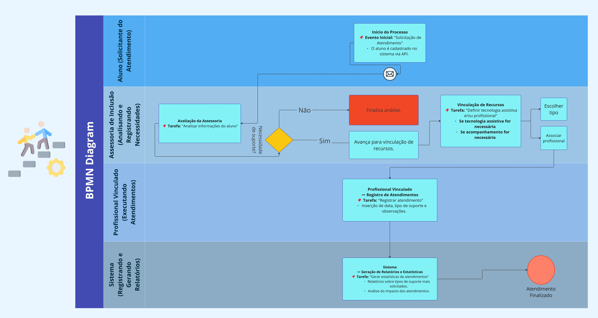
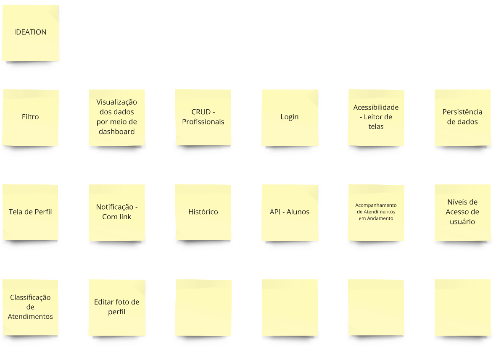
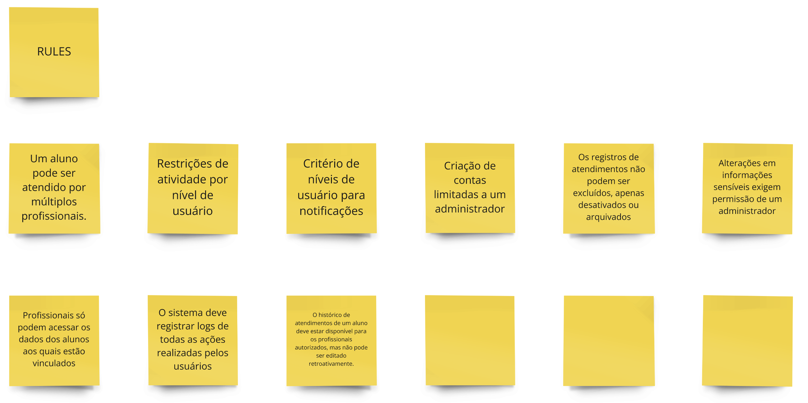
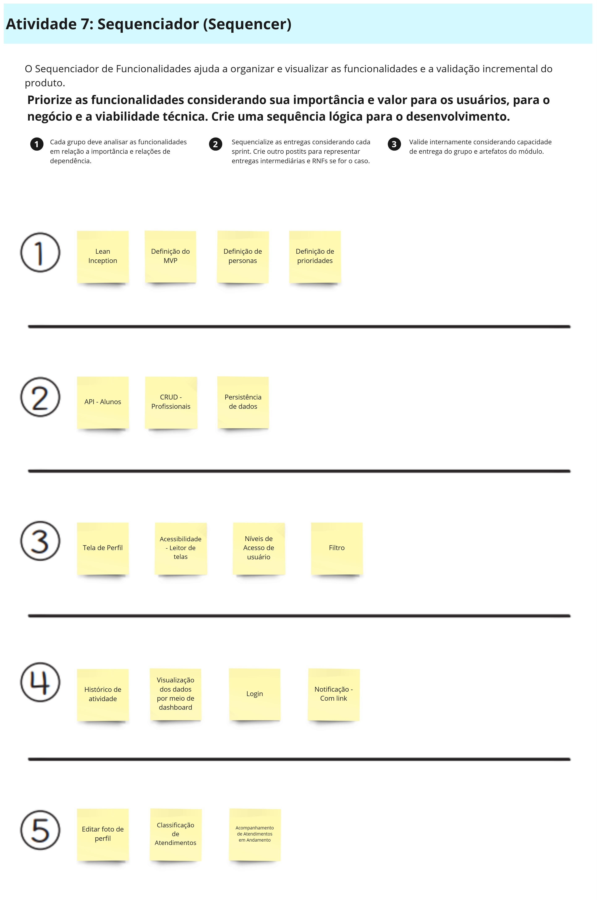
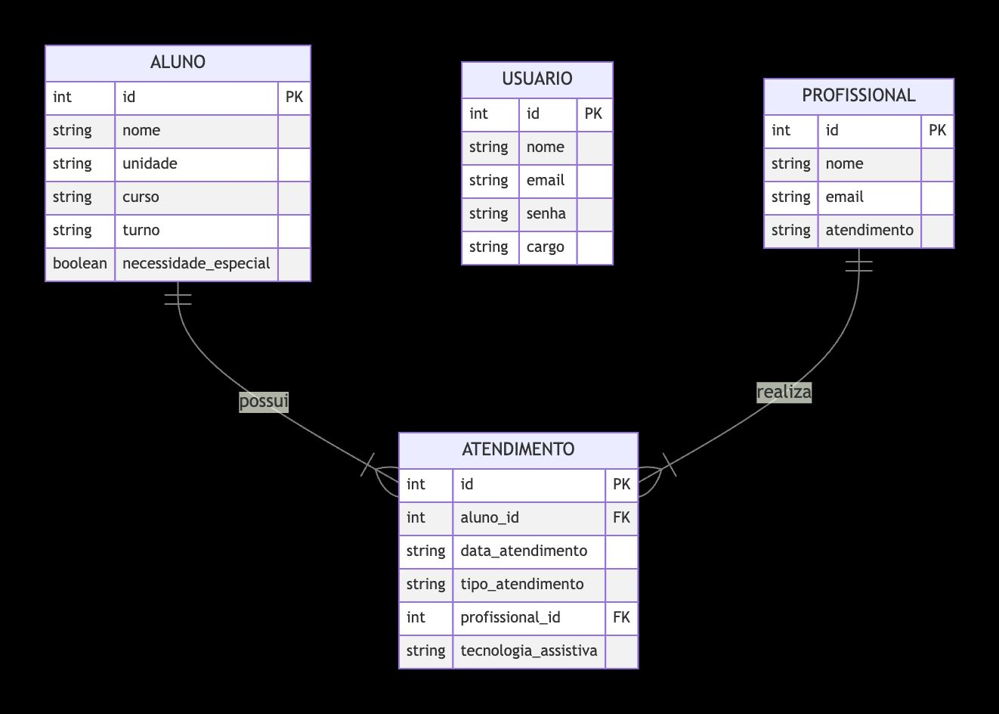
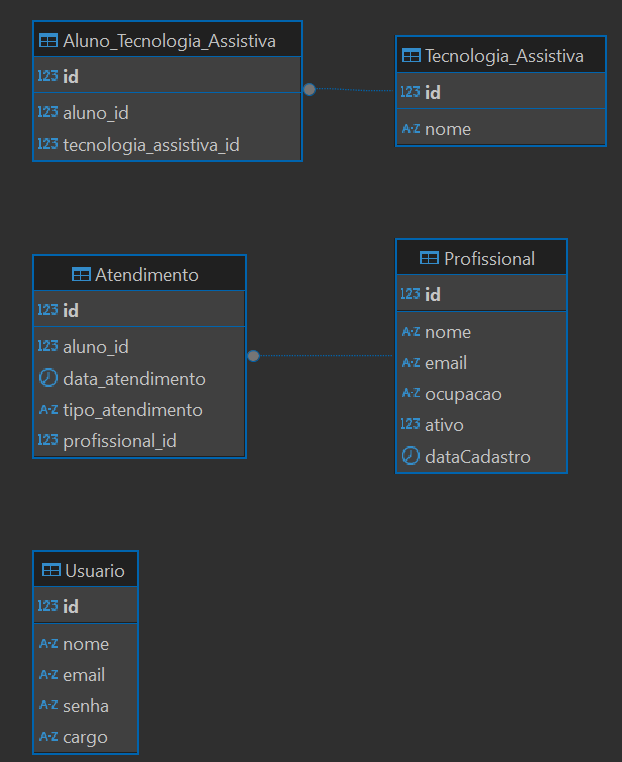
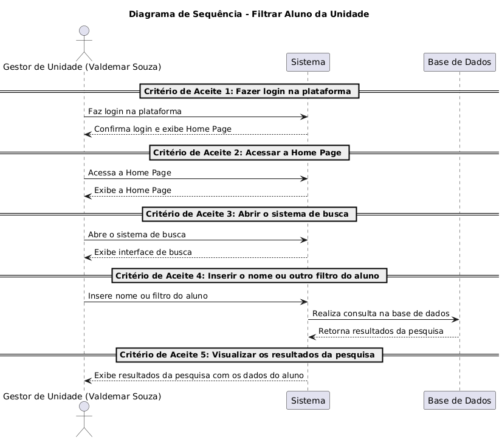

<Table>
  <tr>
    <td><a href= "https://www.cps.sp.gov.br/"></td>
    <td>
      
    </td>
  </tr>
</table>

# Nome do Projeto: LinkUp

## Nome do Grupo: LinkUp

## Integrantes:

- <a href="https://www.linkedin.com/in/arthur-bretas/">Arthur Bretas Oliveira</a>
- <a href="https://www.linkedin.com/in/felipe-zillo-72b367247/">Felipe Gutierres Zillo</a>
- <a href="https://www.linkedin.com/in/kauarodrigues/">Kauã Rodrigues dos Santos</a>
- <a href="https://www.linkedin.com/in/lucca-henrique-pereira/">Lucca Henrique Pereira</a>
- <a href="https://www.linkedin.com/in/milena-castro-vieira/">Milena Aparecida Vieira Castro</a>
- <a href="https://www.linkedin.com/in/rodrigo-lee/">Rodrigo Hu Tchie Lee</a>
- <a href="https://www.linkedin.com/in/vitor-balbo/">Vitor Margarido Balbo</a>

# Sumário

- [1. Introdução](#1-introdução)
  - [1.1 Termos e Abreviações](#11-termos-e-abreviações)
  - [1.2 Objetivo do Documento](#12-objetivo-do-documento)
- [2. Entendimento do Projeto e do Negócio](#2-entendimento-do-projeto-e-do-negócio)
  - [2.1 Contexto da Indústria do Parceiro](#21-contexto-da-indústria-do-parceiro)
  - [2.2 Problema](#22-problema)
  - [2.3 Visão do Projeto e do Produto](#23-visão-do-projeto-e-do-produto)
  - [2.4 Personas e Jornada do Usuário](#24-personas-e-jornada-do-usuário)
  - [2.5 Modelagem do Fluxo de Negócio](#25-modelagem-do-fluxo-de-negócio)
    - [2.5.1 Fluxo de Negócio Atual (AS-IS)](#251-fluxo-de-negócio-atual-as-is)
    - [2.5.2 Fluxo de Negócio Proposto (TO-BE)](#252-fluxo-de-negócio-proposto-to-be)
  - [2.6 Matriz de Risco do Projeto](#26-matriz-de-risco-do-projeto)
  - [2.7 Ideação](#27-ideação)
    - [2.7.1 Brainstorming de features](#271-brainstorming-de-features)
    - [2.7.2 Sequenciamento/Priorização de entregas](#272-sequenciamentopriorização-de-entregas)
  - [2.8 Canvas do Projeto](#28-canvas-do-projeto)
- [3. Requisitos do Projeto](#3-requisitos-do-projeto)
  - [3.1 Requisitos Funcionais (RFs)](#31-requisitos-funcionais-rfs)
  - [3.2 Requisitos Não Funcionais (RNFs)](#32-requisitos-não-funcionais-rnfs)
  - [3.3 Correlação RFs e RNFs](#33-correlação-rfs-e-rnfs)
- [4. Modelagem de Dados](#4-modelagem-de-dados)
  - [4.1 Modelo Conceitual de Dados](#41-modelo-conceitual-de-dados)
  - [4.2 Modelo Lógico de Dados](#42-modelo-lógico-de-dados)
  - [4.3 Modelo Físico de Dados](#43-modelo-físico-de-dados)
- [5. Solução Técnica (Design)](#5-solução-técnica-design)
  - [5.1 Diagrama de Componentes da UML](#51-diagrama-de-componentes-da-uml)
  - [5.2 Diagramas de Sequência da UML](#52-diagramas-de-sequência-da-uml)
  - [5.3 Descrição Textual dos Diagramas](#53-descrição-textual-dos-diagramas)
- [6. Mapeamento Técnico de Infraestrutura e Implantação](#6-mapeamento-técnico-de-infraestrutura-e-implantação)
  - [6.1 Diagrama de Implantação da UML](#61-diagrama-de-implantação-da-uml)
  - [6.2 Justificativa das Escolhas de Implantação](#62-justificativa-das-escolhas-de-implantação)
  - [6.3 Considerações sobre Desempenho e Segurança](#63-considerações-sobre-desempenho-e-segurança)
- [7. Projeto Visual da Solução](#7-projeto-visual-da-solução)
  - [7.1 Desenvolvimento de Wireframes](#71-desenvolvimento-de-wireframes)
  - [7.2 Desenvolvimento de Mockups](#72-desenvolvimento-de-mockups)
  - [7.3 Guia Visual](#73-guia-visual)
- [8. Desenvolvimento do Projeto](#8-desenvolvimento-do-projeto)
  - [8.1 Arquitetura de Codificação e Estrutura de Diretórios](#81-arquitetura-de-codificação-e-estrutura-de-diretórios)
  - [8.2 Desenvolvimento de Features](#82-desenvolvimento-de-features)
    - [8.2.1 Sprint 3](#821-sprint-3)
    - [8.2.2 Sprint 4](#822-sprint-4)
    - [8.2.3 Sprint 5](#823-sprint-5)
  - [8.3 Testes Unitários e de Integração](#83-testes-unitários-e-de-integração)
  - [8.4 Documentações automáticas](#84-documentações-automáticas)
- [9. Planejamento e Execução de Testes](#9-planejamento-e-execução-de-testes)
  - [9.1 Testes Funcionais](#91-testes-funcionais)
    - [9.1.1 Planejamento](#911-planejamento)
    - [9.1.2 Resultados](#912-resultados)
  - [9.2 Testes de RNFs](#92-testes-de-rnfs)
    - [9.2.1 Planejamento](#921-planejamento)
    - [9.2.2 Resultados](#922-resultados)
  - [9.3 Testes de Usabilidade](#93-testes-de-usabilidade)
    - [9.3.1 Planejamento](#931-planejamento)
    - [9.3.2 Resultados](#932-resultados)
- [10. Procedimentos de Implantação](#10-procedimentos-de-implantação)
  - [10.1 Implantação e Configuração do Banco de Dados](#101-implantação-e-configuração-do-banco-de-dados)
  - [10.2 Implantação do Protótipo para uso por equipe de desenvolvimento](#102-implantação-do-protótipo-para-uso-por-equipe-de-desenvolvimento)
- [Referências](#referências)

# 1. Introdução

## 1.1 Termos e Abreviações

- CPS: Centro Paula Souza

## 1.2 Objetivo do Documento

&nbsp;&nbsp;&nbsp;&nbsp;Este documento tem como objetivo apresentar o processo de desenvolvimento do projeto Linkup em parceria com o Centro Paula Souza, para o desenvolvimento de um sistema de gerenciamento dos atendimentos profissionais dos alunos portadores de deficiência das ETECs e FATECs que compõem o centro.

# 2. Entendimento do Projeto e do Negócio

## 2.1 Contexto da Indústria do Parceiro

O Centro Paula Souza está inserido na indústria da educação técnica e superior tecnológica, um setor estratégico para o desenvolvimento econômico e social. Com as Etecs (Escolas Técnicas) e Fatecs (Faculdades de Tecnologia), a instituição atende à crescente demanda por formação qualificada, alinhada às necessidades do mercado de trabalho local, com cursos que na maior parte das vezes estão alinhados com a maior necessidade produtiva do local da Fatec/Etec. A educação profissional vem se tornando cada vez mais importante diante das transformações tecnológicas e produtivas, como é o caso da digitalização de processos. Nesse contexto, as Etecs e Fatecs desempenham um papel fundamental na capacitação de profissionais para setores como tecnologia, indústria, gestão e serviços, contribuindo para a inovação e competitividade das empresas e para o fortalecimento da economia.

## 2.2 Problema

&emsp;O principal problema é a necessidade de um ambiente de gestão para os atendimentos realizados pela Assessoria de Inclusão do Centro Paula Souza. A ausência de um sistema integrado dificulta o controle das informações sobre os alunos atendidos, os profissionais responsáveis e os tipos de suporte prestados. O uso de formulários digitais e planilhas torna o processo suscetível a erros, inconsistências e falta de rastreabilidade, comprometendo a qualidade do acompanhamento. Além disso, a ausência de uma ferramenta de análise de dados impede uma visão estratégica sobre o impacto das ações realizadas, dificultando a tomada de decisão por parte dos gestores.

## 2.3 Visão do Projeto e do Produto

## 2.3.1 Visão do Produto

Criamos aplicação web que permite realizar o registro da conexão entre os alunos do Centro Paula Souza a profissionais especializados. Além disso, gestores acessam um dashboard com estatísticas detalhadas. O sistema facilita o acompanhamento e suporte a alunos com deficiência, promovendo inclusão.

Figura x - Visão do Produto 
 
Fonte: Material produzido pelos autores (2025) 

## 2.3.2 É - Não é - Faz - Não faz

Nosso projeto é uma aplicação web que permite realizar o registro da conexão entre os alunos do Centro Paula Souza a profissionais especializados. O sistema permite gerenciar profissionais e visualizar dados via dashboard. **Faz** gestão de associações e estatísticas. **Não faz** controle acadêmico. O Lean Inception ajudou a delimitar funcionalidades essenciais para tornar o produto eficiente.

Figura x - É - Não é - Faz - Não faz 
 
Fonte: Material produzido pelos autores (2025) 

## 2.3.3 Objetivos do Produto

A imagem representa os objetivos da solução: facilitar o acompanhamento de alunos com deficiência, garantir suporte especializado e fornecer estatísticas para gestão. Nossa plataforma possibilita associar alunos a profissionais, gerenciar dados e visualizar métricas estratégicas. O Business Intelligence embutido garante decisões informadas para gestores administrativos e unidades educacionais.

Figura x - Objetivos do Produto 
 
Fonte: Material produzido pelos autores (2025) 

## 2.4 Personas, Jornada do Usuário e User Stories

## 2.4.1 Persona 1 - Mariana Santos

&nbsp;&nbsp;&nbsp;&nbsp;A seguir, apresenta-se a persona Mariana Santos, criada com base no workshop realizado com o parceiro.

Figura x - Persona 1 - Mariana Santos 
 
Fonte: Material produzido pelos autores (2025) 

  
&nbsp;&nbsp;&nbsp;&nbsp;Além disso, segue abaixo a sua jornada do usuário durante o processo de alocação de profissionais.
  

Figura x - Jornada do Usuário - Mariana Santos 
 
Fonte: Material produzido pelos autores (2025) 

&nbsp;&nbsp;&nbsp;&nbsp; Segue abaixo a User Stories da Mariana com a função de registrar um profissional ao banco de dados.

Tabela X - Tabela User Stories Acessora 1

| Identificação        | US01                                                                                                |
| -------------------- | --------------------------------------------------------------------------------------------------- |
| Persona              | Mariana Santos - Assessora de Inclusão                                                               |
| User Story           | Como acessora, quero registrar um profissional no banco de dados para manter o cadastro atualizado. |
| Critério de aceite 1 | Fazer login na plataforma.                                                                          |
| Critério de aceite 2 | Acessar a Home Page.                                                                                |
| Critério de aceite 3 | Navegar até a página de cadastro de profissionais.                                                  |
| Critério de aceite 4 | Preencher os dados obrigatórios do profissional.                                                    |
| Critério de aceite 5 | Confirmar o cadastro e garantir que os dados sejam salvos no banco de dados.                        |

Fonte: Material produzido pelos autores (2024)

## 2.4.2 Persona 2 - Cleber Oliveira
&nbsp;&nbsp;&nbsp;&nbsp;A seguir, apresenta-se a persona Cleber Oliveira, criada com base no workshop realizado com o parceiro, buscando evidenciar a necessidade apresentada de um sistema compatível com um leitor de tela.

Figura x - Persona 2 - Cleber Oliveira 
 
Fonte: Material produzido pelos autores (2025) 

&nbsp;&nbsp;&nbsp;&nbsp;Além disso, segue abaixo a sua jornada do usuário durante o processo de alocação de profissionais.

Figura x - Jornada do Usuário - Cleber Oliveira 
 
Fonte: Material produzido pelos autores (2025) 

Tabela X - Tabela User Story Cleber Oliveira

Tabela X - Tabela User Stories Assessor de Inclusão

| Identificação        | US02                                                                                                   |
| -------------------- | ------------------------------------------------------------------------------------------------------ |
| Persona              | Cleber Oliveira - Assessor de Inclusão                                                                |
| User Story           | Como Assessor de Inclusão, quero associar um profissional a um aluno no sistema, utilizando comandos de leitor de tela, para garantir que o aluno receba o suporte necessário. |
| Critério de aceite 1 | Ativar um leitor de tela compatível, como NVDA ou JAWS.                                               |
| Critério de aceite 2 | Navegar pela interface do sistema utilizando apenas comandos do leitor de tela e teclado.             |
| Critério de aceite 3 | Acessar a funcionalidade de associação de profissionais a alunos por meio de navegação sequencial.    |
| Critério de aceite 4 | Buscar e selecionar um aluno e um profissional utilizando comandos do teclado.                        |
| Critério de aceite 5 | Confirmar a associação e receber uma mensagem de sucesso audível pelo leitor de tela.                 |

Fonte: Material produzido pelos autores (2025)

## 2.4.3 Persona 3 - Valdemar Souza

&nbsp;&nbsp;&nbsp;&nbsp;A seguir, apresenta-se a persona Valdemar Souza, criada com base no workshop realizado com o parceiro, buscando evidenciar a necessidade apresentada de um sistema eficiente de gerenciamento de atendimentos, com relatórios estruturados.

Figura x - Persona 3 - Valdemar Souza 
 
Fonte: Material produzido pelos autores (2025) 

&nbsp;&nbsp;&nbsp;&nbsp; Segue abaixo a User Story da Mariana com a função de registrar um profissional ao banco de dados.

Tabela X - Tabela User Stories Gestor de Unidade

| Identificação        | USXX                                                                                                      |
| -------------------- | ------------------------------------------------------------------------------------------------------ |
| Persona              | Valdemar Souza                                                                                        |
| User Story           | Como gestor de unidade, quero filtrar um(a) aluno(a)  da minha unidade para encontrá-lo(la) rapidamente     |
| Critério de aceite 1 | Fazer login na plataforma                                                                              |
| Critério de aceite 2 | Acessar a Home Page                                                                                    |
| Critério de aceite 3 | Abrir o sistema de busca                                                                               |
| Critério de aceite 4 | Inserir o nome ou outro filtro do aluno para realizar a busca                                             |
| Critério de aceite 5 | Visualizar os resultados da pesquisa com os dados do aluno                                             |

Fonte: Material produzido pelos autores (2025)

&nbsp;&nbsp;&nbsp;&nbsp;Além disso, segue abaixo a sua jornada do usuário durante o processo de gerenciamento dos atendimentos na unidade.

Figura x - Jornada do Usuário - Valdemar Souza 
 

## 2.4.4 Persona 4 - Maria Rita

&nbsp;&nbsp;&nbsp;&nbsp;A seguir, apresenta-se a persona Maria Rita, criada com base no workshop realizado com o parceiro, buscando evidenciar a necessidade apresentada de um dashboard com fácil visualização de dados com o objetivo de melhorar as decisões organizacionais.

Figura x - Persona 2 - Cleber Oliveira 
 
Fonte: Material produzido pelos autores (2025) 

&nbsp;&nbsp;&nbsp;&nbsp;Além disso, segue abaixo a sua jornada do usuário durante o processo visualização de dados por meio do dashboard.

Figura x - Jornada do Usuário - Cleber Oliveira 
 
Fonte: Material produzido pelos autores (2025) 

&nbsp;&nbsp;&nbsp;&nbsp;Produziu-se ainda uma user story para a persona.

Tabela x - Tabela User Story Maria Rita 

| Identificação        | US04                                                                                                   |
| -------------------- | ------------------------------------------------------------------------------------------------------ |
| Persona              | Maria Rita                                                                                              |
| User Story           | Como gestora administrativa, quero visualizar dados estatísticos dos alunos com deficiência do CPS, para que eu possa analisar os atendimentos e tomar decisões estratégicas.      |
| Critério de aceite 1 | Fazer login na plataforma.                                                                               |
| Critério de aceite 2 | Acessar a seção de dashboard.                                                                                   |
| Critério de aceite 3 | Filtrar os dados por unidade, tipo de deficiência, turno, entre outros.                                                                          |
| Critério de aceite 4 | Visualizar gráficos e tabelas com informações detalhadas.                                                         |

Fonte: Material produzido pelos autores (2025)

## 2.5 Modelagem do Fluxo de Negócio

&nbsp;&nbsp;&nbsp;&nbsp;A partir do workshop realizado com o parceiro, foi modelado o seguinte fluxo de negócio, baseado no entendimento do processo atual de alocação de profissionais para o atendimento dos alunos das FATECs e ETECs. A construção e aplicação do nosso sistema não altera o fluxo de negócio do parceiro. No entanto, com o uso da nossa aplicação, será possível substituir ferramentas como o Excel por uma solução personalizada, alinhada às necessidades específicas do parceiro.

Figura x - Fluxo de Negócio  
 
Fonte: Material produzido pelos autores (2025) 

## Objetivo do Processo

O fluxo representa as etapas para:

- Registrar os alunos no sistema via API.
- Avaliar suas necessidades de atendimento.
- Vincular recursos assistivos e profissionais.
- Registrar os atendimentos prestados.
- Gerar relatórios e estatísticas para acompanhamento.

---

## Descrição do Fluxo

### 1. Início do Processo

Evento Inicial: Solicitação de Atendimento

- O aluno é cadastrado via API integrada aos sistemas acadêmicos.

### 2. Avaliação da Assessoria de Inclusão

Tarefa: Analisar informações do aluno  
Decisão: O aluno necessita de suporte?

- Se Não: O fluxo finaliza a análise sem necessidade de acompanhamento.
- Se Sim: O aluno avança para vinculação de recursos.

### 3. Vinculação de Recursos

Tarefa: Definir Tecnologia Assistiva e/ou Profissional

- Se necessário, selecionar tipo de tecnologia assistiva.
- Se necessário, associar profissional de atendimento.

### 4. Registro de Atendimentos

Tarefa: Registrar atendimento

- O profissional insere os detalhes do atendimento, incluindo data, tipo de suporte e observações.

### 5. Geração de Relatórios e Estatísticas

Tarefa: Gerar estatísticas dos atendimentos

- O sistema coleta dados sobre os atendimentos prestados e disponibiliza para análise.

### 6. Fim do Processo

Evento Final: Encerramento do Atendimento

- O atendimento é registrado no sistema e pode ser consultado futuramente.

## 2.6 Matriz de Risco do Projeto

Figura X - Matriz de risco do projeto

Fonte: Material produzido pelo grupo LinkUp (2024)

Tabela X - Matriz de Risco do projeto

| #   | Ameaças                            | Análise do Risco                                                                                                                                     | Nível de Risco | Probabilidade de acontecer | Plano de Ação                                                                                                                                          |
| --- | ---------------------------------- | ---------------------------------------------------------------------------------------------------------------------------------------------------- | -------------- | -------------------------- | ------------------------------------------------------------------------------------------------------------------------------------------------------ |
| 01  | Mudanças nos Requisitos            | Podem causar retrabalho e atrasos                                                                                                                    | Moderado       | 10%                        | Definir muito bem os requisitos do projeto, alinhando sempre com os stakeholders.                                                                      |
| 02  | Dependência Externa                | Caso haja problema na API externa, também haverá mal funcinoamento na aplicação.                                                                     | Muito Alto     | 50%                        | Criar uma página de instrução ao usuário para caso isso aconteça.                                                                                      |
| 03  | Falta de Testes                    | Devido ao curto prazo de entrega, os testes podem ser muito superficiais, podendo ter algum erro em uma parte da aplicação não coberta pelos testes. | Muito Baixo    | 70%                        | Priorizar as partes essenciais do programa para a realização dos testes.                                                                               |
| 04  | Baixa Escalabilidade               | Pode impedir o crescimento contínuo da solução ao ser implementada.                                                                                  | Alto           | 10%                        | Projetar a solução de forma escalável, garantindo que possa suportar grandes volumes de usuários e dados.                                              |
| 05  | Atraso na Implementação            | Atrasos podem ocorrer durante o desenvolvimento do projeto.                                                                                          | Baixo          | 30%                        | Organizar o desenvolvimento e monitorá-lo com frequência, sempre definindo prazos realistas de entrega.                                                |
| 06  | Latência Alta                      | A lentidão pode causar perda de tempo dos colaboradores, o que é o oposto do que a solução busca.                                                    | Moderado       | 50%                        | Implementar cache, processamento assíncrono e retries, tentando garantir uma experiência estável mesmo com a dependência da API externa.               |
| 07  | Vulnerabilidades de Cibersegurança | Podem causar problemas com a justiça brasileira por conter dados pessoais.                                                                           | Muito Alto     | 30%                        | Aplicar boas práticas de segurança, como criptografia de dados e controle de acesso rigoroso. Além de utilizar ferramentas confiáveis de autenticação. |
| 08  | Falta de Acessibilidade            | Caso tenha algum colaborador com deficiência, pode não conseguir utilizar a aplicação.                                                               | Muito Alto     | 10%                        | Desenvolver o sistema tendo como base a NBR ISO 9241-171 para que o sistema seja inclusivo.                                                            |
| 09  | Excesso de Carga                   | Com muitos usuários simultâneos, o servidor pode ser sobrecarregado, causando falhas na aplicação.                                                   | Alto           | 50%                        | Utilizar balanceamento de carga e arquitetura escalável para suportar picos de acesso.                                                                 |

Fonte: Material produzido pelo grupo LinkUp (2024)

Tabela X - Matriz de Oportunidade do projeto

| #   | Oportunidades                      | Análise da Oportunidade                                                                                    | Nível de Oportunidade | Probabilidade de acontecer | Plano de Ação                                                                            |
| --- | ---------------------------------- | ---------------------------------------------------------------------------------------------------------- | --------------------- | -------------------------- | ---------------------------------------------------------------------------------------- |
| 01  | Otimização de Trabalho             | Colaboradores conseguirão realizar o trabalho mais rápido.                                                 | Muito Alto            | 70%                        | Implementar formas de otimizar o desempenho da aplicação.                                |
| 02  | Geração de Relatórios Estatísticos | Permite análises de dados futuras.                                                                         | Moderado              | 70%                        | Implementar dashboards na aplicação.                                                     |
| 03  | Redução de Custo Operacional.      | A substituição de planilhas por um banco de dados relacional diminui o armazenamento da nuvem.             | Alto                  | 70%                        | Criar um banco de dados de maneira a otimizar o espaço.                                  |
| 04  | Melhoria na Acessibilidade         | Permite que usuários com deficiência utilizem o sistema.                                                   | Moderado              | 50%                        | Desenvolver desde o início pensando em acessibilidade, centralizado na NBR ISO 9241-171. |
| 05  | Melhoria na Experiência do Usuário | Permite que o colaborador tenha mais facilidade ao utilizar uma interface mais intuitiva que as planilhas. | Muito Alto            | 90%                        | Aplicar um design limpo, mas com constraste para acessibilidade.                         |
| 06  | Modulaização do Código             | Torna o código de fácil manutenção e escalável.                                                            | Alto                  | 90%                        | Desenvolver com boas práticas, como a separação do código em funções e objetos.          |

Fonte: Material produzido pelo grupo LinkUp (2024)

## 2.7 Ideação

## 2.7.1 Brainstorming de features

&nbsp;&nbsp;&nbsp;&nbsp;Durante a fase de ideação do projeto, realizamos um brainstorming para definir requisitos e funcionalidades do sistema. O objetivo desse momento foi levantar ideias e estruturar os aspectos essenciais para garantir um desenvolvimento coerente com o projeto, alinhando às necessidades dos usuários.

&nbsp;&nbsp;&nbsp;&nbsp;No brainstorming, destacamos funcionalidades como filtros de pesquisa, visualização de dados em dashboards, CRUD dos profissionais, login e níveis de acesso, garantindo a segurança e organização do sistema. Além disso, consideramos a acessibilidade, com suporte para leitores de tela, e a persistência de dados, garantindo a integridade das informações armazenadas.

&nbsp;&nbsp;&nbsp;&nbsp;Outras funcionalidades essenciais levantadas foram a tela de perfil, incluindo a opção de edição de foto, notificações com links para ações rápidas, e o histórico de atendimentos. Também discutimos a necessidade de uma API que funcionará como uma ligação entre o banco de dados do Centro Paula Souza, referente aos alunos, e nossa aplicação.

Figura x - Brainstorming de features 
 
Fonte: Material produzido pelos autores (2025) 

&nbsp;&nbsp;&nbsp;&nbsp;O sistema permite que um aluno seja atendido por múltiplos profissionais, garantindo um acompanhamento mais completo e personalizado. No entanto, o acesso às informações e funcionalidades do sistema é controlado por níveis de usuário, restringindo determinadas ações conforme a permissão de cada perfil. Apenas administradores têm a autorização para criar novas contas, assegurando um controle centralizado sobre os acessos. Além disso, qualquer alteração em informações sensíveis requer a aprovação de um administrador, garantindo a segurança e integridade dos dados.

&nbsp;&nbsp;&nbsp;&nbsp;Para preservar a privacidade dos alunos, os profissionais só podem visualizar os dados dos estudantes aos quais estão vinculados. Os registros de atendimento não podem ser excluídos, apenas desativados ou arquivados, garantindo um histórico confiável e auditável. Esse histórico de atendimentos deve estar sempre acessível aos profissionais autorizados, mas não pode ser modificado retroativamente, assegurando a precisão das informações registradas.

&nbsp;&nbsp;&nbsp;&nbsp;Todas as ações realizadas pelos usuários no sistema devem ser registradas em logs, permitindo um monitoramento contínuo das atividades. Além disso, as notificações dentro do sistema devem seguir critérios baseados nos diferentes níveis de usuário, garantindo que as informações relevantes sejam enviadas às pessoas corretas conforme suas permissões e responsabilidades.

Figura x - Brainstorming de features 
 
Fonte: Material produzido pelos autores (2025) 

## 2.7.2 Sequenciamento/Priorização de entregas

Figura x - Sequenciamento/Priorização de entregas 
 
Fonte: Material produzido pelos autores (2025) 

### Sprint 1 - Entendimento do problema e definição do MVP

- Lean Inception
- Definição do MVP
- Definição de prioridades
- Definição de personas

### Sprint 2 - Infraestrutura Base

- Configuração da API - Alunos
- Implementação do CRUD - Profissionais
- Estruturação da Persistência de Dados

### Sprint 3 - Segurança e Acessibilidade

- Desenvolvimento da Tela de Perfil
- Implementação de Acessibilidade (Leitor de Telas)
- Definição dos Níveis de Acesso de Usuário
- Implementação de Filtro de Dados

### Sprint 4 - Monitoramento e Interação

- Criação do Histórico de Atividade
- Dashboard para Visualização de Dados
- Implementação do Login
- Sistema de Notificações com Link

### Sprint 5 - Personalização e Atendimento

- Funcionalidade para Edição da Foto de Perfil
- Implementação de Classificação de Atendimentos
- Desenvolvimento do Acompanhamento de Atendimentos em Andamento

## 2.8 Canvas do Projeto

&nbsp;&nbsp;&nbsp;&nbsp;Segue abaixo, o canvas MVP da aplicação web desenvolvido a partir das atividades realizadas durante o Lean Inception proposto no workshop com o parceiro.

Figura x - Canvas MVP do projeto 
 
Fonte: Material produzido pelos autores (2025) 

# 3. Requisitos do Projeto

## 3.1 Requisitos Funcionais (RFs)

Tabela X - Requisitos Funcionais 

| ID    | Título                                   | Descrição (5W2H)                                                                                                                                                                                                                                                                                                                                                                                                                                                                                                                                                                      |
| ----- | ---------------------------------------- | ------------------------------------------------------------------------------------------------------------------------------------------------------------------------------------------------------------------------------------------------------------------------------------------------------------------------------------------------------------------------------------------------------------------------------------------------------------------------------------------------------------------------------------------------------------------------------------- |
| RF001 | Cadastro de Profissionais                | **What**: Criar, ler, atualizar e deletar profissionais na base de dados.   **Why**: Para manter um registro atualizado dos profissionais que auxiliam os alunos.   **Who**: Mariana Santos, Cleber Oliveir (Assessores de Inclusão) e Maria Rita (Gestora administrativa), somente atualização: Valdemar Souza (Gestor de Unidade).   **Where**: Na aplicação web.   **When**: Sempre que um novo profissional for contratado ou houver mudanças.   **How**: Através de um formulário na interface do usuário.   **How Much**: Sem custo adicional para o usuário. |
| RF002 | Associação de Alunos a Profissionais     | **What**: Associar um aluno do Centro Paula Souza a um profissional.   **Why**: Para garantir que cada aluno com deficiência tenha um profissional responsável.   **Who**: Mariana Santos e Cleber Oliveira (Assessores de Inclusão).   **Where**: Na aplicação web.   **When**: Após o cadastro do aluno e do profissional.   **How**: Através de uma interface que permita selecionar um aluno e um profissional.   **How Much**: Sem custo adicional para o usuário.                                                                                             |
| RF003 | Integração com API do Centro Paula Souza | **What**: Obter dados dos alunos via API.   **Why**: Para acessar informações atualizadas dos alunos diretamente da base do Centro Paula Souza.   **Who**: Sistema (backend).   **Where**: Na aplicação web.   **When**: Sempre que um aluno for consultado ou associado.   **How**: Através de chamadas HTTP à API do Centro Paula Souza.   **How Much**: Sem custo adicional para o usuário.                                                                                                                                                                      |
| RF004 | Dashboard de Business Intelligence       | **What**: Exibir estatísticas gerais e específicas sobre alunos, unidades e gestão.   **Why**: Para auxiliar gerentes na tomada de decisões.   **Who**: Maria Rita (Gerente administrativa) e Valdemar Souza (Gestor de Unidade).   **Where**: Na aplicação web.   **When**: Sempre que necessário, com atualizações em tempo real.   **How**: Através de gráficos e tabelas interativas.   **How Much**: Sem custo adicional para o usuário.                                                                                                                       |
| RF005 | Acompanhamento de Alunos com Deficiência | **What**: Permitir o acompanhamento e auxílio a alunos com deficiência.   **Why**: Para garantir que os alunos recebam o suporte necessário.   **Who**: Todos os usuários.   **Where**: Na aplicação web.   **When**: Durante todo o período de acompanhamento do aluno.   **How**: Através de uma interface que exiba o histórico e o status do aluno.   **How Much**: Sem custo adicional para o usuário.                                                                                                                                                         |
| RF006 | Autenticação e Autorização de Usuários   | **What**: Permitir que usuários se autentiquem e tenham acesso controlado às funcionalidades.   **Why**: Para garantir a segurança e privacidade dos dados.   **Who**: Todos os usuários.   **Where**: Na aplicação web.   **When**: No login e durante o uso da aplicação.   **How**: Através de um sistema de login com senha e níveis de permissão.   **How Much**: Sem custo adicional para o usuário.                                                                                                                                                          |
| RF007 | Gerenciamento de Perfis de Usuários      | **What**: Permitir que certos usuários editem perfis (ex: nome, e-mail, senha).   **Why**: Para garantir que os dados dos usuários estejam atualizados.   **Who**: Todos os usuários.   **Where**: Na aplicação web.   **When**: Sempre que um usuário precisar atualizar informações.   **How**: Através de uma interface de edição de perfil.   **How Much**: Sem custo adicional para o usuário.                                                                                                                                                                 |
| RF008 | Pesquisa e Filtros Avançados             | **What**: Permitir a pesquisa e filtragem de alunos e profissionais.   **Why**: Para facilitar a localização de informações específicas.   **Who**: Todos os usuários.   **Where**: Na aplicação web.   **When**: Sempre que o usuário precisar buscar informações.   **How**: Através de campos de pesquisa e filtros dinâmicos.   **How Much**: Sem custo adicional para o usuário.                                                                                                                                                                               |
| RF009 | Histórico de Alterações                  | **What**: Manter um registro das alterações feitas no sistema (ex: cadastros, associações).   **Why**: Para auditoria e rastreabilidade.   **Who**: Administradores do sistema.   **Where**: Na aplicação web.   **When**: Sempre que uma alteração for feita.   **How**: Através de um log de atividades.   **How Much**: Sem custo adicional para o usuário.                                                                                                                                                                                                      |
| RF010 | Backup Automático de Dados               | **What**: Realizar backups automáticos da base de dados.   **Why**: Para prevenir perda de dados.   **Who**: Sistema (backend).   **Where**: No servidor da aplicação.   **When**: Diariamente ou conforme configurado.   **How**: Através de scripts automatizados.   **How Much**: Custo variável conforme a infraestrutura necessária.                                                                                                                                                                                                                           |
| RF011 | Acessibilidade                           | **What**: Garantir que a aplicação seja acessível para pessoas com deficiência.   **Why**: Para cumprir normas de acessibilidade e inclusão.   **Who**: Todos os usuários.   **Where**: Na aplicação web.   **When**: Durante todo o uso da aplicação.   **How**: Seguindo diretrizes WCAG (Web Content Accessibility Guidelines).   **How Much**: Sem custo adicional para o usuário.                                                                                                                                                                              |

Fonte: Material produzido pelos autores (2025) 

### Tabela de Testes para Requisitos Funcionais

Tabela X - Testes associados aos Requisitos Funcionais 

| Caso de Teste | RF#   | Descrição Teste                                      | Pré-condição                                                                  | Caso de Aceite                                                                  | Caso de Recusa                                                               |
| ------------- | ----- | ---------------------------------------------------- | ----------------------------------------------------------------------------- | ------------------------------------------------------------------------------- | ---------------------------------------------------------------------------- |
| CT001         | RF001 | Testar o cadastro de um novo profissional.           | O sistema está online e o usuário tem permissão para cadastrar profissionais. | O profissional é cadastrado com sucesso e aparece na lista de profissionais.    | O sistema exibe uma mensagem de erro ou nada acontece após tentar cadastrar. |
| CT002         | RF002 | Testar a associação de um aluno a um profissional.   | O aluno e o profissional já estão cadastrados no sistema.                     | A associação é criada com sucesso e aparece na lista de associações.            | O sistema exibe uma mensagem de erro ou nada acontece após tentar associar.  |
| CT003         | RF003 | Testar a integração com a API do Centro Paula Souza. | A API do Centro Paula Souza está disponível e acessível.                      | Os dados dos alunos são obtidos com sucesso e exibidos no sistema.              | O sistema exibe uma mensagem de erro e/ou os dados não são obtidos.          |
| CT004         | RF004 | Testar a exibição do dashboard de BI.                | O sistema possui dados de alunos, unidades e gestão.                          | O dashboard é exibido com gráficos e tabelas atualizados.                       | O dashboard não é exibido ou os dados estão incorretos.                      |
| CT005         | RF005 | Testar o acompanhamento de um aluno com deficiência. | O aluno e o profissional já estão cadastrados e associados.                   | O histórico e o status do aluno são exibidos corretamente.                      | O sistema exibe uma mensagem de erro ou dados incorretos.                    |
| CT006         | RF006 | Testar a autenticação de um usuário.                 | O usuário possui credenciais válidas.                                         | O usuário é autenticado com sucesso e tem acesso às funcionalidades permitidas. | O sistema exibe uma mensagem de erro ou o acesso é negado.                   |
| CT007         | RF007 | Testar a edição de perfil de um usuário.             | O usuário está autenticado e possui permissão para editar o perfil.           | As informações do perfil são atualizadas com sucesso.                           | O sistema exibe uma mensagem de erro ou as informações não são atualizadas.  |
| CT008         | RF008 | Testar a pesquisa de alunos e profissionais.         | O sistema possui dados de alunos e profissionais cadastrados.                 | Os resultados da pesquisa são exibidos corretamente.                            | O sistema exibe uma mensagem de erro ou resultados incorretos.               |
| CT009         | RF009 | Testar a visualização do histórico de alterações.    | O sistema possui registros de alterações.                                     | O histórico de alterações é exibido corretamente.                               | O sistema exibe uma mensagem de erro ou o histórico não é exibido.           |
| CT010         | RF010 | Testar a execução de um backup automático.           | O sistema está configurado para realizar backups automáticos.                 | O backup é realizado com sucesso e os dados são armazenados corretamente.       | O sistema exibe uma mensagem de erro ou o backup não é realizado.            |
| CT011         | RF011 | Testar a acessibilidade da aplicação.                | A aplicação está em conformidade com as diretrizes WCAG.                      | A aplicação é acessível para pessoas com deficiência.                           | A aplicação não atende a uma ou mais diretrizes de acessibilidade.           |

Fonte: Material produzido pelos autores (2025) 

## 3.2 Requisitos Não Funcionais (RNFs)

Tabela X - Requisitos não funcionais

| **RNF#** | **Descrição**                                                                                                                   | **Aspecto de qualidade**     | **Prioridade** |
| -------- | ------------------------------------------------------------------------------------------------------------------------------- | ---------------------------- | -------------- |
| RNF01    | A aplicação deve garantir que o tempo de resposta máximo para consultas de dados seja de 0,8 segundo.                           | Eficiência de performance    | Moderada       |
| RNF02    | A aplicação deve ser compatível com a API existente, com capacidade para integração contínua, mantendo a integridade dos dados. | Compatibilidade              | Alta           |
| RNF03    | A aplicação deve permitir que usuários com limitações visuais consigam utilizá-lo completamente.                                | Usabilidade                  | Alta           |
| RNF04    | A aplicação deve permitir que o assessor consiga encontrar os alunos e profissionais com, no máximo, 3 cliques.                 | Usabilidade                  | Baixa          |
| RNF05    | A aplicação deve garantir que cada tipo de usuário tenha acesso somente às suas respectivas funcionalidades.                    | Segurança                    | Alta           |
| RNF06    | A aplicação deve garantir que os dados de alunos e profissionais sejam armazenados e transmitidos de acordo com a LGPD.         | Segurança                    | Baixa          |
| RNF07    | O código da aplicação deve ser modular e bem documentado, facilitando futuras atualizações e correções de bugs.                 | Manutenibilidade             | Alta           |
| RNF08    | A aplicação deve ter funcionamento íntegro nos principais navegadores: Chrome, Firefox, Edge e Safari.                          | Compatibilidade              | Baixa          |
| RNF09    | A aplicação deve ter um SLA de disponibilidade mínima de 99,5%.                                                                 | Confiabilidade               | Baixa          |
| RNF10    | A aplicação deve emitir alertas com mensagens claras, em linguagem natural, em caso de erros e/ou falhas.                       | Confiabilidade               | Moderada       |
| RNF11    | A aplicação deve conter uma camada de validação dos dados, para suportar atualizações em tempo real, garantindo a integridade.  | Integridade e Funcionalidade | Moderada       |

Material produzido pelos autores (2025)

### Tabela de Testes para Requisitos Não Funcionais

Tabela X - Testes dos requisitos Não Funcionais

| **Caso de Teste** | **RNF#** | **Descrição do Teste**                                                               | **Pré-condição**                                         | **Caso de Aceite**                                                   | **Caso de Recusa**                                                          |
| ----------------- | -------- | ------------------------------------------------------------------------------------ | -------------------------------------------------------- | -------------------------------------------------------------------- | --------------------------------------------------------------------------- |
| CT-001            | RNF01    | Testar o tempo de resposta para consultas de dados.                                  | O sistema está operando com carga normal e sob estresse. | Consultas são feitas em menos de 0,8 segundo.                        | Consultas excedem 0,8 segundo de tempo de resposta.                         |
| CT-002            | RNF02    | Testar integração com a API e verificar integridade dos dados.                       | A API está disponível e funcional.                       | Os dados trocados não possuem erros ou irregularidades.              | Dados trocados são perdidos ou corrompidos.                                 |
| CT-003            | RNF03    | Testar usabilidade com leitor de tela e acessibilidade.                              | O leitor de tela está ativado.                           | Usuário com deficiência consegue usar a aplicação sem dificuldades.  | Usuário com deficiência não consegue utilizar a aplicação.                  |
| CT-004            | RNF04    | Testar se o assessor encontra alunos e profissionais com, no máximo, 3 cliques.      | Usuário assessor logado no sistema.                      | Usuário encontra alunos e profissionais com até 3 cliques.           | Usuário precisa de mais de 3 cliques para encontrar alunos e profissionais. |
| CT-005            | RNF05    | Testar níveis de acesso dos usuários para garantir segurança.                        | Perfis de usuários criados com permissões diferenciadas. | Cada tipo de login acessa apenas suas funcionalidades.               | Um tipo de login acessa informações de outro perfil.                        |
| CT-006            | RNF06    | Testar segurança da transmissão de dados contra interceptação.                       | O sistema está em funcionamento normal.                  | O invasor não consegue obter os dados brutos.                        | O invasor consegue acessar os dados brutos.                                 |
| CT-007            | RNF07    | Testar a modularidade e documentação do código ao adicionar uma nova funcionalidade. | O código está modularizado e documentado.                | A funcionalidade é adicionada sem impactar outras partes do sistema. | A adição da funcionalidade gera erros nas demais funções.                   |
| CT-008            | RNF08    | Testar funcionamento da aplicação nos navegadores Chrome, Firefox, Edge e Safari.    | A aplicação está acessível nos navegadores testados.     | A aplicação funciona integralmente em todos os navegadores.          | A aplicação apresenta falhas em um ou mais navegadores.                     |
| CT-009            | RNF09    | Monitorar a disponibilidade do sistema ao longo do tempo.                            | O sistema está em produção.                              | A aplicação mantém disponibilidade de 99,5% ou mais.                 | O sistema fica fora do ar por mais tempo que o permitido.                   |
| CT-010            | RNF10    | Testar exibição de mensagens claras em caso de erro.                                 | O sistema está operando normalmente.                     | O sistema exibe mensagens de erro claras e compreensíveis.           | O sistema não exibe mensagens ou elas são confusas.                         |
| CT-011            | RNF11    | Testar atualização simultânea do mesmo dado em dois dispositivos.                    | Dois dispositivos acessando a aplicação ao mesmo tempo.  | O sistema valida corretamente os dados e mantém a integridade.       | A aplicação permite atualizações incorretas ou inconsistentes.              |

Material produzido pelos autores (2025)

## 3.3 Correlação RFs e RNFs

Os requisitos não funcionais RNF07, referente a modularidade do código, e RNF09, referente a alta disponibilidade da aplicação, se aplicam a todos os requisitos funcionais porpostos. Os demais podem ser relacionados com seus respectivos requisitos na tabela abaixo:

Tabela X - Relação entre requisitos

| **Requisito Funcional**                          | **Requisitos Não Funcionais Associados** | **Justificativa**                                                                                                                                                                |
| ------------------------------------------------ | ---------------------------------------- | -------------------------------------------------------------------------------------------------------------------------------------------------------------------------------- |
| RF001 - Cadastro de Profissionais                | RNF04, RNF05, RNF06                      | Usabilidade aprimorada (RNF04), segurança para controle de acesso (RNF05) e conformidade com a LGPD (RNF06).                                                                     |
| RF002 - Associação de Alunos a Profissionais     | RNF01, RNF04, RNF05, RNF06, RNF11        | Tempo de resposta das pesquisas (RNF01), usabilidade aprimorada para buscas (RNF04), controle de acesso (RNF05), conformidade com a LGPD (RNF06) e validação dos dados (RNF11).  |
| RF003 - Integração com API do Centro Paulo Souza | RNF01, RNF02, RNF06, RNF10, RNF11        | Tempo de resposta das consultas (RNF01), compatibilidade com a API (RNF02), conformidade com a LGPD (RNF06), mensagens de erros (RNF10) e validação dos dados (RNF11).           |
| RF004 - Dashboard de Business Intelligence       | RNF01, RNF02, RNF05, , RNF10             | Tempo de resposta das consultas (RNF01), compatibilidade com a API (RNF02), controle de acesso (RNF05) e alertas de erros (RNF10)                                                |
| RF005 - Acompanhamento de Alunos com Deficiência | RNF03, RNF04, RNF05, RNF06,              | Acessibilidade para inclusão (RNF03), facilidade na busca de alunos (RNF04), controle de acesso por perfis (RNF05) e conformidade com LGPD (RNF06).                              |
| RF006 - Autenticação e autorização de usuários   | RNF06, RNF10                             | Conformidade com a LGPD (RNF06) e mensagens claras de erros (RNF10).                                                                                                             |
| RF007 - Gerenciamento de perfis de usuários      | RNF05, RNF06, RNF10                      | Controle de acesso (RNF05), conformidade com a LGPD (RNF06) e mensagens claras de erros (RNF10).                                                                                 |
| RF008 - Pesquisa e filtros avançados             | RNF01, RNF04, RNF06, RNF10, RNF11        | Tempo de resposta das pesquisas (RNF01), usabilidade aprimorada (RNF04), conformidade com a LGPD, mensagens de erro claras (RNF10) e atualização de dados em tempo real (RNF11). |
| RF009 - Histórico de alterações                  | RNF05, RNF06, RNF10                      | Controle de acesso (RNF05), conformidade com a LGPD (RNF06) e mensagens claras de erros (RNF10).                                                                                 |
| RF010 - Backup automático de dados               | RNF11                                    | Integridade dos dados em tempo real (RNF11).                                                                                                                                     |
| RF011 - Acessibilidade                           | RNF03, RNF04, RNF08                      | Garantia de acessibilidade (RNF03), usabilidade aprimorada (RNF04) e compatibilidade com navegadores (RNF08).                                                                    |

Material produzido pelos autores (2025)

# 4. Modelagem de Dados

_conteúdo_

## 4.1 Modelo Conceitual de Dados

Figura x - Modelo Conceitual de Dados 
 
Fonte: Material produzido pelos autores (2025) 

### 4.1.1. Identificação das Entidades

1. **ALUNO**  
   Refere-se à pessoa que será atendida no sistema, podendo possuir diversas características acadêmicas (unidade, curso) e informações de acessibilidade (necessidade especial).

2. **USUARIO**  
   Representa o usuário do sistema, que pode ser um colaborador, administrador(Gerente de Unidade, Gerente Administrativo) ou qualquer outro perfil com acesso ao sistema. Armazena credenciais de acesso (login, senha) e cargo/função.

3. **PROFISSIONAL**  
   Entidade que descreve o profissional responsável pelos atendimentos (por exemplo, um psicólogo, pedagogo ou outro tipo de especialista).

4. **ATENDIMENTO**  
   Entidade que registra cada ocorrência de atendimento ao Aluno, definindo as datas, tipo de atendimento, quem foi o profissional responsável e, se necessário, alguma tecnologia assistiva empregada.

---

### 4.1.2. Definição dos Atributos

Abaixo, detalham-se os principais atributos de cada entidade, descrevendo seu propósito no sistema.  

#### 4.1.2.1. ALUNO
- **id (PK)**: Identificador único do Aluno.  
- **nome**: Nome completo do Aluno.  
- **unidade**: Unidade na qual o Aluno está matriculado (por exemplo, Fatec ou Etec).  
- **curso**: Curso específico que o Aluno está cursando.  
- **turno**: Período em que o Aluno estuda (manhã, tarde, noite, integral ou EaD).  
- **necessidade_especial**: Indica se o Aluno possui alguma necessidade especial (true/false).

#### 4.1.2.2. USUARIO
- **id (PK)**: Identificador único do Usuário do sistema.  
- **nome**: Nome do Usuário (ex.: João da Silva).  
- **email**: Endereço de e-mail para contato e/ou login.  
- **senha**: Senha para acesso ao sistema (armazenada de forma segura).  
- **cargo**: Função ou nível de permissão dentro do sistema (ex.: “Administrador”, “Assessor”).

#### 4.1.2.3. PROFISSIONAL
- **id (PK)**: Identificador único do Profissional.  
- **nome**: Nome completo do Profissional.  
- **email**: Endereço de e-mail do Profissional.  
- **atendimento**: Uma descrição ou área em que o Profissional atua, ou campo para observações específicas.  

#### 4.1.2.4. ATENDIMENTO
- **id (PK)**: Identificador único para cada registro de atendimento.  
- **aluno_id (FK)**: Referência ao *id* do Aluno que recebeu o atendimento.  
- **data_atendimento**: Data em que o atendimento ocorreu.  
- **tipo_atendimento**: Tipo ou categoria do atendimento (ex.: pedagógico, psicológico, orientação etc.).  
- **profissional_id (FK)**: Referência ao *id* do Profissional que realizou o atendimento.  
- **tecnologia_assistiva**: Caso tenha sido diagnosticada a necessidade de alguma tecnologia assistiva (ex.: software leitor de tela, lupa digital), este campo registra seu nome ou identificação.

---

### 4.1.3. Estabelecimento das Relações

A seguir, explicamos como as entidades se relacionam, incluindo a cardinalidade (1:1, 1:N ou N:N) e a justificativa de cada vínculo:

1. **ALUNO** – **ATENDIMENTO**  
   - Relação **1:N** (um Aluno pode ter vários atendimentos).  
   - Do ponto de vista do banco de dados, `ATENDIMENTO` contém a chave estrangeira `aluno_id` que aponta para `ALUNO.id`.  
   - Exemplo: um Aluno pode ser atendido várias vezes ao longo do semestre, cada registro é um ATENDIMENTO diferente.

2. **PROFISSIONAL** – **ATENDIMENTO**  
   - Relação **1:N** (um Profissional pode realizar diversos atendimentos).  
   - `ATENDIMENTO` contém a chave estrangeira `profissional_id` apontando para `PROFISSIONAL.id`.  
   - Exemplo: o mesmo Profissional faz atendimentos semanais para alunos diferentes.

3. **ALUNO** – **USUARIO**  
   - No diagrama foi indicado como **1:1** (||--||). Contudo, esta relação depende das regras de negócio:
     - *1:1* se cada Aluno também tiver exatamente uma conta de usuário no sistema.  
     - *1:N* se um Aluno puder ter múltiplos logins/usuários (ou vice-versa).  
   - A ideia base é que, caso o Aluno precise acessar o sistema, seus dados de login podem estar vinculados a `USUARIO`.

*(Se no seu sistema for mais adequado que cada Aluno seja também um Usuário, mapeie isso como 1:1. Caso o Aluno não tenha login, mas existam muitos outros tipos de Usuário, poderá ser outra cardinalidade ou até mesmo entidades separadas.)*

---

### 4.1.4. Descrição Textual Completa

**Fluxo Geral**  
- Um **ALUNO** é a pessoa que será registrada no sistema com informações essenciais de identificação e de contexto acadêmico.  
- O **USUARIO** representa qualquer perfil no sistema (por exemplo, um administrador que gerencia cadastros, um atendente que registra atendimentos, ou o próprio Aluno que acessa para consultar dados).  
- Um **PROFISSIONAL** é responsável por realizar os atendimentos aos Alunos. Isso pode incluir professores especialistas, psicólogos ou outros membros de uma equipe multiprofissional.  
- Cada **ATENDIMENTO** é um registro histórico que descreve quando ocorreu, qual foi o tipo de atendimento (por exemplo, “Reunião Pedagógica”, “Suporte Psicológico”), qual Profissional realizou e, se necessário, qual tecnologia assistiva foi utilizada.

**Objetivos Atendidos pelos Requisitos**  
- **Rastreabilidade de Atendimentos**: A tabela `ATENDIMENTO` permite armazenar dados de todas as sessões ou encontros que o Aluno teve com um Profissional, atendendo à necessidade de histórico.  
- **Gestão de Usuários**: A tabela `USUARIO` viabiliza o controle de acesso, garantindo que diferentes perfis (incluindo potenciais administradores) se autentiquem no sistema e executem apenas as operações autorizadas.  
- **Registros Acadêmicos e de Acessibilidade**: A tabela `ALUNO` centraliza informações de curso, unidade, turno e se o Aluno possui necessidades especiais, fundamental para oferecer suporte adequado.  
- **Gerenciamento de Profissionais**: A tabela `PROFISSIONAL` mantém informações para identificar e contatar o responsável pelos atendimentos, associando cada atendimento a um profissional específico.  
- **Tecnologia Assistiva**: Um atributo em `ATENDIMENTO` chamado `tecnologia_assistiva` permite armazenar se algum recurso específico (por exemplo, um software leitor de tela, impressora em braile etc.) foi utilizado para atender às necessidades do Aluno.

## 4.2 Modelo Lógico de Dados

O banco de dados deste projeto foi estruturado para armazenar informações sobre alunos, profissionais, atendimentos e tecnologias assistivas. A estrutura permite registrar os atendimentos realizados entre um aluno e um profissional, visualizar e acompanhar informações.

## 4.2.1. Modelo Lógico
O modelo lógico do banco de dados é composto pelas seguintes entidades:

- **Usuário**: Representa os usuários do sistema, que podem ter diferentes cargos.
- **Aluno**: Contém informações sobre o aluno que recebe atendimento.
- **Profissional**: Contém informações sobre os profissionais que realizam atendimentos.
- **Atendimento**: Registra o atendimento entre um aluno e um profissional, incluindo a data e o tipo de atendimento.

## 4.2.2. Relacionamentos

- **Aluno e Atendimento**: Um aluno pode ter vários atendimentos. Cada atendimento está vinculado a um único aluno.
- **Profissional e Atendimento**: Um profissional pode realizar vários atendimentos. Cada atendimento está vinculado a um único profissional.
- **Atendimento e Tecnologia Assistiva**: Caso uma tecnologia assistiva seja utilizada, ela é referenciada dentro do atendimento.

## 4.2.3. Explicação sobre o Horário do Atendimento
O modelo do banco de dados garante que alunos e profissionais possam realizar atendimentos de forma estruturada, sem necessidade de uma tabela intermediária para agendamentos. O campo **data_atendimento** dentro da tabela **Atendimento** define diretamente o horário do atendimento, assegurando que aluno e profissional estejam juntos nesse período.

Isso significa que:
- Um **Aluno** e um **Profissional** são vinculados na tabela **Atendimento**.
- **data_atendimento** indica o momento exato do atendimento.
- Como o aluno e o profissional compartilham o mesmo registro na tabela **Atendimento**, isso garante que ambos têm um horário comum.

Figura x - Sequenciamento/Priorização de entregas 
 
Fonte: Material produzido pelos autores (2025) 

## 4.2.4. Estrutura das Tabelas
### **Usuário**
| Campo  | Tipo  | Descrição  |
|--------|------|--------------|
| id  | INT (PK) | Identificador único do usuário |
| nome  | VARCHAR  | Nome do usuário  |
| email  | VARCHAR  | Email do usuário  |
| senha  | VARCHAR  | Senha criptografada |
| cargo  | VARCHAR  | Cargo do usuário no sistema |

### **Aluno**
| Campo  | Tipo  | Descrição  |
|--------|------|--------------|
| id  | INT (PK) | Identificador único do aluno |
| nome  | VARCHAR  | Nome do aluno  |
| unidade  | VARCHAR  | Unidade educacional do aluno |
| curso  | VARCHAR  | Curso em que está matriculado |
| turno  | VARCHAR  | Período de estudos |
| necessidade_especial | VARCHAR | Indica qual deficiência o aluno possui |

### **Profissional**
| Campo  | Tipo  | Descrição  |
|--------|------|--------------|
| id  | INT (PK) | Identificador único do profissional |
| nome  | VARCHAR  | Nome do profissional |
| email  | VARCHAR  | Email do profissional |
| profissao | VARCHAR  | Profissão do profissional |

### **Atendimento**
| Campo  | Tipo  | Descrição  |
|--------|------|--------------|
| id  | INT (PK) | Identificador único do atendimento |
| aluno_id  | INT (FK) | Referência ao aluno atendido |
| profissional_id  | INT (FK) | Referência ao profissional responsável |
| data_atendimento  | DATETIME | Horário do atendimento |
| tipo_atendimento  | VARCHAR  | Tipo de atendimento realizado |
| tecnologia_assistiva | VARCHAR | Tecnologia assistiva usada |

## 4.3 Modelo Físico de Dados

_conteúdo_

**Nota:** Insira uma explicação e direcionamento para o readme.md da pasta database.

# 5. Solução Técnica (Design)

_conteúdo_

## 5.1 Diagrama de Componentes da UML

_conteúdo_

## 5.2 Diagramas de Sequência da UML

&emsp;A seguir se encontra o diagrama de sequência da UML para as User Stories de Valdemar Souza, Gestor de Unidade:

Figura X - Sequência da UML dos User Stories - Valdemar Souza 
 
Fonte: Material produzido pelos autores (2025) 

## 5.3 Descrição Textual dos Diagramas

_conteúdo_

# 6. Mapeamento Técnico de Infraestrutura e Implantação

_conteúdo_

## 6.1 Diagrama de Implantação da UML

_conteúdo_

## 6.2 Justificativa das Escolhas de Implantação

_conteúdo_

## 6.3 Considerações sobre Desempenho e Segurança

_conteúdo_

# 7. Projeto Visual da Solução

_conteúdo_

## 7.1 Desenvolvimento de Wireframes

_conteúdo_

## 7.2 Desenvolvimento de Mockups

_conteúdo_

## 7.3 Guia Visual

_conteúdo_

# 8. Desenvolvimento do Projeto

_conteúdo_

## 8.1 Arquitetura de Codificação e Estrutura de Diretórios

_conteúdo_

## 8.2 Desenvolvimento de Features

_conteúdo_

**Nota:** Insira uma explicação de entregas em cada Sprint.

## 8.2.1 Sprint 3

_conteúdo_

## 8.2.2 Sprint 4

_conteúdo_

## 8.2.3 Sprint 5

_conteúdo_

## 8.3 Testes Unitários e de Integração

_conteúdo_

## 8.4 Documentações automáticas

_conteúdo_

# 9. Planejamento e Execução de Testes

_conteúdo_

## 9.1 Testes Funcionais

_conteúdo_

## 9.1.1 Planejamento

_conteúdo_

## 9.1.2 Resultados

_conteúdo_

## 9.2 Testes de RNFs

_conteúdo_

## 9.2.1 Planejamento

_conteúdo_

## 9.2.2 Resultados

_conteúdo_

## 9.3 Testes de Usabilidade

_conteúdo_

## 9.3.1 Planejamento

_conteúdo_

## 9.3.2 Resultados

_conteúdo_

# 10. Procedimentos de Implantação

_conteúdo_

## 10.1 Implantação e Configuração do Banco de Dados

_conteúdo_

## 10.2 Implantação do Protótipo para uso por equipe de desenvolvimento

_conteúdo_

# Referências

_conteúdo_
